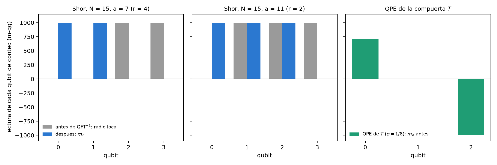

# Demarcación: criptografía cuántica frente a criptografía post-cuántica (PQC) {#sec-cap16}

La Parte VI trata la seguridad. Antes de leer en qg la distribución de claves (capítulo 17) y los números aleatorios
certificados (capítulo 18), conviene trazar la frontera. Hay dos respuestas a la computadora cuántica que comparten la
palabra "cuántica" y casi nada más. La **criptografía cuántica** (QKD, QRNG) usa qubits: su seguridad descansa en una
medición física, y por eso entra en la ecuación de probabilidad del capítulo 1. La **criptografía post-cuántica**
(PQC) es software clásico que corre en computadoras comunes: su seguridad descansa en la dificultad de un problema
matemático, y no hay qubit que leer. Este capítulo dice dónde pasa la línea, con números, y qué lee qang a cada lado.

## Desde la base: qué probabilidades hay a cada lado {#sec-pqc-base}

Cualquier probabilidad $p_0$ entra en la ecuación del capítulo 1: tiene ángulo qang $\theta=2\arccos\sqrt{p_0}$ y lectura
$m=1000(1-2p_1)$ m-qg. La pregunta no es si se puede escribir, sino si la lectura dice algo.

- **En QKD**, la probabilidad que decide la seguridad es la tasa de error de bit (QBER) de una medición en una base. Es la
  probabilidad de un qubit, y su lectura es la del capítulo 17: $Q=(1-|qg|)/2$, es decir, $m=1000\,|qg|=1000(1-2Q)$.
- **En PQC**, la única probabilidad del esquema es la de que el descifrado falle, $\delta$. Para ML-KEM, el estándar FIPS
  203 la acota en $2^{-138{,}8}$, $2^{-164{,}8}$ y $2^{-174{,}8}$ para los tres niveles. Escrita en m-qg es
  $m=1000-3{,}3\times10^{-39}$ en el mejor caso: está pegada al polo, y no hay operador hermítico, base de medición ni esfera
  de Bloch detrás de ese número.

La seguridad de la PQC, además, no es esa probabilidad: es la dificultad del problema de retículos (aprender con errores
en módulos, MLWE), que no es una frecuencia de nada. Esa es la demarcación en una línea: **qang lee probabilidades de
mediciones; la PQC no tiene mediciones**.

## La naturaleza de la PQC {#sec-pqc-naturaleza}

Los estándares del NIST de agosto de 2024 son tres: ML-KEM (FIPS 203, antes Kyber), un mecanismo de encapsulamiento de
claves sobre retículos; ML-DSA (FIPS 204, antes Dilithium), firmas sobre retículos; y SLH-DSA (FIPS 205, antes
SPHINCS+), firmas basadas sólo en funciones hash. En 2025 se eligió además HQC, basado en códigos correctores, como
segundo mecanismo de claves. Todos son aritmética entera: polinomios módulo $q=3329$ en ML-KEM, árboles de hash en
SLH-DSA. Ninguno prepara un estado, aplica una compuerta ni mide.

En ML-KEM, descifrar es restar y redondear: el mensaje sobrevive si un ruido acumulado (la suma de muchos productos de
coeficientes pequeños) queda dentro de $\pm q/4$. Si no, el descifrado falla. Esa es la $\delta$ de arriba.

## La falla de descifrado se cuenta, no se mide en un qubit {#sec-pqc-falla}

Para ver qué haría qang con $\delta$, el script de figuras construye un esquema de juguete con el mismo mecanismo: ruido
$e=\sum_{i<2n}a_ib_i+c$ con $a_i,b_i,c$ de la distribución binomial centrada de ML-KEM, $n=256$, $q=3329$, sin la compresión
del estándar (que en ML-KEM es la mayor parte de la falla), y con el ancho $\eta$ como perilla. La probabilidad de falla
se calcula exacta (convolución módulo $q$) y se cuenta con 200 000 cifrados simulados.

| $\eta$ | $\sigma/q$ | falla exacta | contada | lectura (m-qg, IC 95 %) |
|---|---|---|---|---|
| 16 | 0,054 | $5{,}1\times10^{-6}$ | 1 de 200 000 | 1000,0 [999,9; 1000,0] |
| 20 | 0,068 | $2{,}5\times10^{-4}$ | 60 | 999,4 [999,2; 999,5] |
| 24 | 0,082 | $2{,}2\times10^{-3}$ | 437 | 995,6 [995,2; 996,0] |
| 32 | 0,109 | $2{,}2\times10^{-2}$ | 4360 | 956,4 [955,1; 957,7] |
| 40 | 0,136 | $6{,}6\times10^{-2}$ | 13 072 | 869,3 [867,1; 871,4] |

: Falla de descifrado del esquema de juguete, exacta y contada. {#tbl-pqc-falla}

El conteo coincide con la cuenta exacta, y `qang.probability.analyze` lo lee en m-qg con su intervalo. Pero esa lectura
es la proporción de Wilson con otra unidad: no hay ángulo de un estado detrás. Y donde vive la PQC real no llega ningún
conteo (@fig-frontera16, derecha). Para ver una sola falla de ML-KEM-512 hacen falta del orden de $1/\delta\approx6\times10^{41}$
descifrados; con $10^{12}$ ensayos, lo más que se puede contar, el piso queda 30 órdenes de magnitud por encima. La regla de
disparos del capítulo 1 dice lo mismo en m-qg: junto al polo, $\sigma_m\approx2000\sqrt{\delta/N}$, y para que baje del
corrimiento $2000\,\delta$ hace falta $N>1/\delta$. **La $\delta$ de la PQC se demuestra, no se mide.**

{#fig-frontera16 width=100%}

Del otro lado de la línea (@fig-frontera16, izquierda), la cantidad que decide la seguridad de BB84 está en el centro de la
escala. La tasa asintótica de Shor–Preskill, $1-2h(Q)$, se anula en $Q=11{,}0\,\%$, que es $m=780$ m-qg; interceptar y
reenviar da $Q=25\,\%$, $m=500$. Con 2000 disparos, $\sigma_m$ es 11,8, 9,7 y 7,0 m-qg en 850, 900 y 950 m-qg: el margen
hasta el umbral se resuelve con holgura. Es una probabilidad de un qubit, legible y con barra de error; el capítulo 17
la usa para separar al espía del ruido.

## El vector de ataque cuántico: Grover {#sec-pqc-grover}

La computadora cuántica sí es cuántica, y sus ataques sí entran en la base. El de Grover contra una clave de $n$ bits
tiene probabilidad de fallar, después de $k$ iteraciones,

$$
p_{\text{falla}}=\cos^2\!\big((2k+1)\,\beta\big),\qquad \beta=\arcsin 2^{-n/2},
$$

que es la ecuación de probabilidad con ángulo qang $2(2k+1)\beta$: **cada iteración avanza el ángulo qang en $4\beta$, en línea
recta**. Se comprobó con los circuitos de `qang.algorithms` para $n=4$, 6, 8 y 10: el ángulo de la probabilidad exacta
coincide con la ley a $10^{-10}$ rad (@fig-grover16). En m-qg, la falla baja de +1000 a −1000 siguiendo un coseno, y
cruza el ecuador (éxito 1/2) a mitad de camino.

{#fig-grover16 width=100%}

Para AES-128 el paso es $4\arcsin2^{-64}=2{,}2\times10^{-19}$ rad por iteración, y llegar al polo exige $1{,}4\times10^{19}$
iteraciones en serie, cada una un circuito AES completo; para AES-256, $2{,}7\times10^{38}$. La respuesta de la PQC al ataque
es duplicar el largo de la clave simétrica, y la geometría lo explica: el ángulo avanza como $2^{-n/2}$, de modo que Grover
reduce a la mitad los bits de seguridad y nada más.

## El vector de ataque cuántico: Shor y la estimación de fase {#sec-pqc-shor}

El ataque que rompe RSA y las curvas elípticas, y que la PQC esquiva, es el algoritmo de Shor: estimación de fase (QPE)
sobre la multiplicación modular. Las notas (§13) muestran que la QPE recupera fases exactas, y el índice del libro decía
que "el registro de autoestados proyecta a $qg_Z=-1$ sin resolver la fase". Eso es cierto para la QPE de un autoestado, y
el cálculo exacto de este capítulo dice hasta dónde llega una lectura qg en el caso de Shor (@fig-shor16).

**QPE de un autoestado.** Con la compuerta $T$ sobre $|1\rangle$ ($\varphi=1/8$), el registro objetivo queda en $m_Z=-1000$ y
no lleva información: la fase vive en el registro de conteo. Ahí, antes de la QFT inversa, el qubit $k$ tiene
$m_X=1000\cos(2\pi2^k\varphi)$: 707, 0 y −1000 m-qg. Cada qubit lleva un bit de la fase en su ángulo qang, que es la
estimación de fase iterativa de Kitaev.

**Shor para $N=15$.** El registro de trabajo no está en un autoestado sino en una superposición de los $r$ autoestados,
y los qubits de conteo quedan entrelazados con él. Con cuatro qubits de conteo, antes de la QFT inversa:

| caso | radio local de cada qubit de conteo, antes (m-qg) | $m_Z$ de cada qubit, después | resultados |
|---|---|---|---|
| $a=7$ ($r=4$) | 0, 0, 1000, 1000 | 1000, 1000, 0, 0 | 0, 4, 8, 12 |
| $a=11$ ($r=2$) | 0, 1000, 1000, 1000 | 1000, 1000, 1000, 0 | 0, 8 |
| $N=21$, $a=2$ ($r=6$), seis qubits | 0, 0, 0, 0, 0, 0 | 0, 250, 312, 328, 332, 0 | picos en 0, 11, 21, 32, 43, 53 |

: Lecturas de un qubit del registro de conteo en el algoritmo de Shor (estado exacto). {#tbl-shor16}

Para $N=15$ el orden se lee qubit por qubit: el número de qubits con radio cero antes de la QFT, o con $m_Z=0$ después, es
$\log_2 r$. Pero es un accidente de $N=15$, donde $r$ es potencia de 2. Con $N=21$ y $r=6$, todos los radios locales son
cero y los $m_Z$ de después no dicen 6: el orden está en la distribución conjunta, y se extrae con fracciones continuas.
El registro de trabajo tampoco ayuda: para $a=7$ sus qubits leen $m_Z=\pm500$, la mezcla de 1, 7, 4 y 13.

{#fig-shor16 width=100%}

La conclusión vale para todo el capítulo: las lecturas de un qubit ven la fase cuando hay un autoestado, y la pierden
cuando la información está en las correlaciones. Es la limitación 3 de las notas (§14) en otra forma.

## La demarcación {#sec-pqc-demarcacion}

| | criptografía cuántica (QKD, QRNG) | criptografía post-cuántica (PQC) | ataque cuántico (Grover, Shor) |
|---|---|---|---|
| soporte | qubits, fotones | enteros, polinomios, hash | qubits |
| la seguridad descansa en | una medición física | la dificultad de MLWE, de códigos o del hash | — |
| la probabilidad clave | QBER, en el centro de la escala (780 m-qg) | $\delta\le2^{-138{,}8}$, pegada al polo | falla de Grover, éxito de Shor |
| ¿la lee qang? | **sí**: capítulos 17 y 18 | **no**: no hay qubit; $\delta$ sólo se cuenta, y no se puede | **en parte**: Grover sí; Shor sólo por qubit cuando hay autoestado |

: Dónde pasa la línea. {#tbl-demarcacion16}

qang es una herramienta de capa física: lee lo que sale de una medición sobre un qubit. No dice nada sobre la dificultad
de un retículo, y un módulo que pretendiera "medir en qg" la seguridad de ML-KEM sería un error de categoría.

## Lo que queda pendiente {#sec-pendiente16}

No existe un módulo `qang.crypto`, y este capítulo no propone uno. La criptografía del proyecto vive en `examples/`
(`bb84_qg_eve_vs_noise.py`, `bb84_finite_key_qg.py`, `bb84_attacks_beyond_ir_qg.py`, `qrng_qg_certified.py`,
`ionq_sim_bb84.py`, `ionq_sim_qrng.py`) y en `manuscript/crypto`. Quedan abiertas dos preguntas: si la lectura por qubit de
la QPE iterativa (un qubit de conteo reciclado) ahorra disparos frente a la QPE con QFT cuando hay ruido, y una corrida de
Shor para $N=15$ en un dispositivo, leída por qubit; ninguna tiene todavía circuito ni predicción escrita.

## Sin qang y con qang {#sec-comparacion16}

| acción | sin qang | con qang | diferencia |
|---|---|---|---|
| leer la seguridad de BB84 | QBER y $1-2h(Q)$ | umbral en 780 m-qg, $\sigma_m$ 7–12 m-qg con 2000 disparos | **unidad**; el detalle está en el capítulo 17 |
| estimar la falla de descifrado de la PQC | conteo con intervalo de Wilson | la misma proporción en m-qg | **ninguna**: es la misma estadística, y no hay estado detrás |
| la falla de ML-KEM | prueba matemática ($\le2^{-138{,}8}$) | $1000-3\times10^{-39}$ m-qg, sin resolución posible | **ninguna**; qang no se aplica |
| describir el ataque de Grover | $\sin^2((2k+1)\beta)$ | el ángulo qang avanza $4\beta$ por iteración, en línea recta | **equivalente**: es la geometría estándar de Grover con otro nombre, aunque se lee de un vistazo |
| leer la fase en la QPE de un autoestado | histograma del registro tras la QFT | $m_X$ de cada qubit de conteo: un bit por qubit | **a favor**, modesto: la QPE iterativa leída en la escala del capítulo 1 |
| leer el orden en Shor | fracciones continuas sobre el histograma | radios locales y $m_Z$ por qubit | **en contra** salvo para $r$ potencia de 2: con $N=21$ todo lee cero |

: Las acciones del capítulo sin la escala qang y con ella. {#tbl-comparacion16}

**Balance.** Este es el capítulo donde qang aporta menos, y su valor está en decirlo. Del lado de la PQC no hay nada que
leer; del lado del ataque, Grover es una ecuación de probabilidad y se lee limpio, y Shor muestra el límite conocido de
las lecturas de un qubit. Del lado cuántico, la QBER sí es una lectura qang, y los dos capítulos siguientes la usan.

## En código {#sec-codigo16}

```python
import math
from qang import algorithms as al
from qang import probability as pb

pb.milliqang_from_p0(1 - 0.11)                   # 780: el umbral de BB84 en m-qg
pb.analyze(200_000 - 437, 200_000).milliqang     # (995.6, 995.2, 996.0): una falla contada, en m-qg
p = 1 - al.grover_success_probability(8, 1, 5)
math.acos(2 * p - 1)                             # 2(2*5+1) asin(2**-4) = 1.376: el ángulo de Grover
```

## Resumen {#sec-resumen16}

- La criptografía cuántica tiene mediciones y entra en la ecuación de probabilidad; la PQC es aritmética clásica y no.
- La seguridad de BB84 es una línea en m-qg: la tasa de clave se anula en 780 m-qg, en el centro de la escala.
- La única probabilidad de ML-KEM, la falla de descifrado, está a $3\times10^{-39}$ m-qg del polo: se demuestra, no se mide;
  contarla es imposible, y leerla en m-qg es la misma proporción con otra unidad.
- El ataque de Grover avanza el ángulo qang $4\arcsin2^{-n/2}$ por iteración, en línea recta; de ahí que duplicar la clave
  baste.
- En la QPE de un autoestado cada qubit de conteo lleva un bit de la fase en $m_X$; en Shor la información está en las
  correlaciones, y las lecturas de un qubit sólo ven el orden cuando es potencia de 2.
