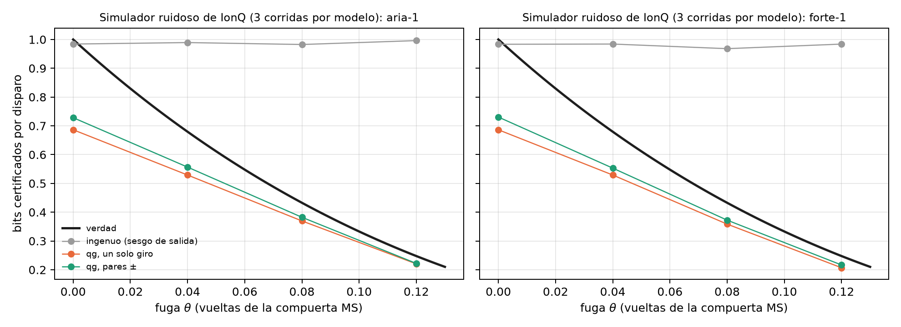

# Números aleatorios certificados (QRNG) y auditoría de canales {#sec-cap18}

Un generador cuántico de números aleatorios (QRNG) de un qubit es el experimento más simple del libro: preparar
$|+\rangle$, medir en Z, anotar el bit. El resultado es una moneda justa, y eso es lo que mide el análisis habitual. Pero
una moneda justa no es lo mismo que una moneda privada. Si el qubit perdió coherencia, la salida sigue saliendo 50/50,
y sin embargo alguien que tenga el entorno puede conocer cada bit de antemano. Este capítulo lee esa diferencia en la
escala del capítulo 1. La salida vive en una lectura y la privacidad en las otras dos, y lo que sabe el adversario es
una lectura más, la que le falta al estado para llegar a la esfera. El capítulo agrega la calibración de lectura que
hace falta para no sobrestimar, y el mismo certificador frente a una fuga diseñada en el simulador de IonQ.

## Desde la base: la salida y la privacidad son lecturas distintas {#sec-qrng-base}

El qubit de la fuente tiene tres lecturas, $m_X$, $m_Y$ y $m_Z$. La salida del QRNG es la medición en Z, y el análisis
habitual sólo mira su sesgo: con $p_0=(1000+m_Z)/2000$ certifica

$$
H_{\text{ingenuo}}=-\log_2\max(p_0,p_1)=-\log_2\frac{1000+|m_Z|}{2000}
$$

bits por disparo, 1 bit cuando $m_Z=0$. Pero $m_Z=0$ lo da tanto $|+\rangle$ como el estado completamente mezclado, y en
el segundo caso no hay nada privado: el entorno guarda la otra mitad de la purificación y sabe qué salió.

Con la medición de confianza y un adversario (Eve) que tiene la purificación, los dos estados condicionales de Eve son
puros y su solapamiento depende sólo del radio transversal $r_\perp=\sqrt{qg_X^2+qg_Y^2}$. Por Helstrom, su probabilidad de
adivinar es (notas, §41)

$$
P_{\text{adivinar}}=\frac{1+\sqrt{1-r_\perp^2}}{2},\qquad H_{\min}(Z|E)=-\log_2 P_{\text{adivinar}}.
$$

En la escala del capítulo 1, esa probabilidad es una lectura más. Su valor en m-qg es

$$
m_E=1000\sqrt{1-r_\perp^2}=\sqrt{1000^2-m_X^2-m_Y^2},
$$

**lo que le falta al radio transversal para llegar a la esfera**, y su ángulo qang es $\arcsin r_\perp$. La fórmula no
depende de $m_Z$. Un estado puro en el ecuador tiene $m_\perp=1000$ y deja a Eve en $m_E=0$: adivina con probabilidad
1/2, y el bit es privado. Un estado que perdió coherencia tiene $m_\perp<1000$, y la longitud que perdió es lo que sabe
Eve (@fig-privada18, izquierda).

| $m_\perp$ (m-qg) | 1000 | 990 | 950 | 900 | 800 | 500 | 200 |
|---|---|---|---|---|---|---|---|
| lo que sabe Eve, $m_E$ (m-qg) | 0 | 141 | 312 | 436 | 600 | 866 | 980 |
| bits privados por disparo | 1,000 | 0,810 | 0,608 | 0,478 | 0,322 | 0,100 | 0,015 |

: La aleatoriedad privada de un qubit medido en Z, en función de su radio transversal. {#tbl-privada18}

La forma de la fórmula tiene una consecuencia práctica. Diez m-qg menos de radio transversal, de 1000 a 990, le dan a
Eve 141 m-qg y le quitan a la fuente 0,19 bits por disparo. Es el polo del capítulo 1 visto desde el otro lado: cerca de
$m_\perp=1000$, la raíz tiene pendiente infinita.

## El análisis por sesgo de salida falla; la lectura qg no {#sec-qrng-fallo}

El certificador qg estima $m_X$ y $m_Y$ con rondas de prueba (giros que llevan X e Y a la base de medición) y usa una
cota inferior de $r_\perp$ a 3σ. Las notas (§41) comparan cuatro estimadores con $10^4$ rondas de prueba por ajuste, 300
corridas por escenario y la lectura asimétrica del §31 ($e_{01}=0{,}015$, $e_{10}=0{,}04$):

- **ingenuo**: el sesgo de la salida;
- **qg, un solo giro**: $m_X$ y $m_Y$ medidos con una rotación cada uno;
- **qg, pares ±**: cada eje con las dos rotaciones, de modo que el corrimiento de la lectura se cancela;
- **qg calibrado**: los pares ±, divididos por el factor de escala $b$ de la lectura medido con el protocolo del §31.

| escenario | $m_\perp$ | verdad | ingenuo | qg, un giro | qg, pares ± | **qg calibrado** |
|---|---|---|---|---|---|---|
| $\lvert+\rangle$ ideal | 1000 | 1,000 | 0,965 (0) | 0,578 (0) | 0,512 (0) | 0,681 (0) |
| T2: $V=0{,}8$ | 800 | 0,322 | 0,964 (**1,00**) | 0,269 (0) | 0,245 (0) | **0,286 (0)** |
| T2: $V=0{,}5$ | 500 | 0,100 | 0,965 (**1,00**) | 0,087 (0) | 0,077 (0) | **0,087 (0)** |
| T2: $V=0{,}2$ | 200 | 0,015 | 0,965 (**1,00**) | 0,013 (**0,07**) | 0,009 (0) | **0,010 (0)** |
| térmico $p=0{,}05$, $V=0{,}9$ | 810 | 0,334 | 0,965 (**1,00**) | 0,279 (0) | 0,254 (0) | **0,297 (0)** |
| lectura muy asimétrica, $e_{10}=0{,}10$, $V=0{,}95$ | 950 | 0,608 | 0,876 (**1,00**) | 0,498 (0) | 0,341 (0) | **0,513 (0)** |

: Bits certificados por disparo: estimación media y, entre paréntesis, la fracción de corridas por encima de la verdad
(inseguras). {#tbl-qrng18}

- **El estimador habitual es inseguro siempre que el estado no sea puro.** Con $V=0{,}2$ certifica 0,97 bits por disparo
  donde sólo 0,015 son privados, en el 100 % de las corridas. El desfase y la mezcla térmica dejan la salida sin sesgo.
- **El estimador qg con pares ± es seguro en todas las corridas**, porque el corrimiento $a$ de la lectura se cancela.
  Con un solo giro, el corrimiento infla $r_\perp$ y sobrestima en el 7 % de las corridas con $V=0{,}2$. Es decir, el
  "100 % frente a 0 %" de seguridad vale para el estimador con pares, no para cualquier lectura qg.
- **Calibrar $b$ con el §31 recupera de 10 a 50 % más bits certificados** (0,286 frente a 0,245 con $V=0{,}8$; 0,513
  frente a 0,341 con la lectura muy asimétrica), sin perder seguridad.

{#fig-privada18 width=100%}

## Junto al polo la certificación pide disparos {#sec-qrng-polo}

Una cota a 3σ con $n$ rondas por ajuste baja el radio en $3000/\sqrt n$ m-qg, y junto al polo eso cuesta caro. Para una
fuente perfecta, sin error de lectura:

| rondas de prueba | $10^3$ | $10^4$ | $10^5$ | $10^6$ | $10^7$ |
|---|---|---|---|---|---|
| cota de $m_\perp$ (m-qg) | 905 | 970 | 991 | 997 | 999 |
| lo que se le concede a Eve, $m_E$ (m-qg) | 425 | 243 | 137 | 77 | 44 |
| bits certificados (verdad: 1) | 0,489 | 0,686 | 0,814 | 0,892 | 0,939 |
| con $m_\perp=950$ (verdad: 0,608) | 0,397 | 0,523 | 0,578 | 0,598 | 0,605 |

: Bits certificados con una cota a 3σ, fórmula cerrada. {#tbl-polo18}

Con la lectura del §31 y el certificador calibrado, la simulación da 0,68, 0,81 y 0,89 bits con $10^4$, $10^5$ y $10^6$
rondas, lo mismo. Lejos del polo la cota converge rápido: con $m_\perp=950$, $10^5$ rondas ya dan el 95 % de la verdad
(@fig-lectura18, izquierda). Una fuente casi perfecta es la más cara de certificar.

## La calibración de lectura: temperatura o error del detector {#sec-qrng-lectura}

El certificador calibrado divide por el factor de escala $b$ de la lectura, y la pregunta es de dónde sale $b$. En la
escala del capítulo 1 la lectura es afín (notas, §31):

$$
m_{\text{medida}}=1000\,a+b\,m,\qquad a=e_{10}-e_{01},\quad b=1-e_{01}-e_{10}.
$$

Un qubit real arranca con población térmica $p$, es decir con $m_{\text{eq}}=1000(1-2p)=1000\tanh(hf/2k_BT_{\text{ef}})$.
La calibración estándar mide "$|0\rangle$" y "$|1\rangle$", que en verdad son el estado térmico y X sobre él: **dos
lecturas para tres incógnitas** ($a$, $b$, $m_{\text{eq}}$). Supone $m_{\text{eq}}=1000$ y carga la población térmica a la
lectura: informa $e_{01}+p\,b$ y $e_{10}+p\,b$, exactamente.

| $p$ | $T_{\text{ef}}$ (5 GHz) | $m_{\text{eq}}$ (m-qg) | $e_{01}$ estándar | $e_{01}$ protocolo qg (§31) |
|---|---|---|---|---|
| 0 | 0 mK | 1000 | 0,0150 | 0,0149 |
| 0,01 | 52 mK | 980 | 0,0245 | **0,0151** |
| 0,03 | 69 mK | 940 | 0,0434 | **0,0148** |
| 0,08 | 98 mK | 840 | 0,0906 | **0,0152** |

: La calibración estándar frente al protocolo qg del §31 ($e_{01}=0{,}015$, $e_{10}=0{,}04$). La columna estándar es
exacta; la columna qg es la mediana de 100 repeticiones del §31. {#tbl-lectura18}

El protocolo qg agrega la tercera ecuación. Mide, lee de nuevo y usa la covarianza de las dos lecturas,
$V=b^2(1-qg_{\text{eq}}^2)$, que separa $b$ de $m_{\text{eq}}$ en forma cerrada. Según las notas, recupera la temperatura
con ±1 mK desde 52 mK. El capítulo 27 lo desarrolla. Aquí importa su consecuencia para el QRNG: **calibrar con la suite
estándar vuelve inseguro al certificador**. Con una fuente térmica ($V=0{,}9$), dividir por la $b$ estándar, que es
$b(1-2p)$, devuelve $r_\perp$ sin la contracción térmica y certifica de más.

| $p$ | verdad | calibrado con $b$ estándar | calibrado con $b$ verdadera |
|---|---|---|---|
| 0,01 | 0,443 | 0,418 (0,01 inseguras) | 0,390 (0) |
| 0,03 | 0,383 | 0,414 (**1,00** inseguras) | 0,339 (0) |
| 0,05 | 0,334 | 0,413 (**1,00** inseguras) | 0,297 (0) |

: Fuente térmica con $V=0{,}9$, $10^4$ rondas de prueba, 300 corridas: el certificador con cada calibración. {#tbl-termica18}

{#fig-lectura18 width=100%}

## En el simulador ruidoso de IonQ, con una fuga {#sec-qrng-ionq}

En las notas (§42) la fuga es real: un ion $q$ es la fuente y un segundo ion $e$ hace de entorno. Una interacción
MS$(0,0,\theta)$ le deja a $e$ aprender el valor X de $q$, y la salida se lee en X. Sigue siendo una moneda justa, pero
la aleatoriedad privada cae a la fórmula de arriba con $r=|\cos2\pi\theta|$ (X y Z intercambiados). Las rondas de prueba
miden ±Z y ±Y, y dos circuitos calibran la lectura. Todo está en compuertas nativas (GPI, GPI2, MS), con 5 pares por
circuito, $10^4$ muestras por ajuste y tres repeticiones por modelo de ruido, en el simulador gratuito. No se envió nada
a una QPU.

| $\theta$ (vueltas) | verdad | ingenuo | qg, un giro | **qg, pares ±** | $m_\perp$ medido / ideal |
|---|---|---|---|---|---|
| 0 (sin fuga) | 1,000 | 0,98 | 0,69 | 0,73 | 1000 / 1000 |
| 0,04 | 0,680 | 0,99 / 0,98 | 0,53 | **0,56 / 0,55** | 954 / 969 |
| 0,08 | 0,433 | 0,98 / 0,97 | 0,37 / 0,36 | **0,38 / 0,37** | 866 / 876 |
| 0,12 | 0,248 | 1,00 / 0,98 | 0,22 / 0,21 | **0,22** | 721 / 729 |

: Bits certificados por disparo, media de 3 corridas (aria-1 / forte-1 donde difieren; $m_\perp$ de aria-1). {#tbl-ionq18}

- **El estimador ingenuo no ve la fuga:** 0,97–1,00 bits por disparo en todas las corridas, por encima de la verdad en
  el 100 % de las corridas con $\theta>0$. Con $\theta=0{,}12$ certifica cuatro veces la aleatoriedad privada.
- **El estimador qg es seguro en las 24 celdas** (corrida × $\theta$) y captura el 81–90 % de la verdad cuando hay fuga,
  y el 73 % sin ella, por el polo de la sección anterior.
- **La calibración no agrega nada aquí.** La lectura del simulador es casi perfecta ($b=0{,}9998$–$1{,}0000$,
  $|a|\le2\cdot10^{-4}$). La ganancia de 10–50 % necesita errores de lectura como los del hardware, y este es un límite
  del modelo de ruido que sólo una QPU puede revisar.
- **El ruido de la compuerta se cuenta como privacidad perdida:** el $m_\perp$ medido queda 1–2 % por debajo del ideal,
  que es el error de la MS. Es correcto que sea así, porque el certificador no puede saber quién se llevó esa longitud.

{#fig-ionq18 width=100%}

## Lo que queda pendiente {#sec-pendiente18}

No hay corrida en hardware. La prueba que falta es un QRNG en un dispositivo con errores de lectura reales, donde la
calibración del §31 debería mostrar su ganancia de 10–50 %. Es un QRNG que depende del dispositivo (medición de
confianza, rondas independientes e idénticas), no aleatoriedad independiente del dispositivo. Y la fuga del §42 es una
interacción diseñada, no la mejor estrategia de un adversario.

## Sin qang y con qang {#sec-comparacion18}

| acción | sin qang | con qang | diferencia |
|---|---|---|---|
| certificar bits por el sesgo de salida | $-\log_2\max(p_0,p_1)$ | lo mismo en $m_Z$ | **ninguna**: los dos fallan igual, 100 % inseguro con desfase |
| certificar bits privados | $H_{\min}(Z\mid E)$ de Helstrom con la purificación | $m_E=\sqrt{1000^2-m_\perp^2}$: lo que sabe Eve es la longitud que falta | **equivalente** en la cuenta (la fórmula es estándar); **a favor** en la lectura: la privacidad está en el plano transversal y se mide con dos giros |
| cuántas rondas de prueba hacen falta | propagación de errores sobre $H_{\min}$ | el polo del capítulo 1: 10 m-qg de radio le dan 141 m-qg a Eve | **a favor**, modesto: explica de un vistazo por qué la fuente perfecta es la más cara |
| calibrar la lectura | dos circuitos; la temperatura se lee como error | lectura afín y una tercera ecuación (§31) | **a favor**: evita un certificador inseguro (100 % de corridas con $p\ge0{,}03$) y recupera 10–50 % de bits |
| detectar una fuga (IonQ simulado) | el sesgo no la ve | seguro en 24 de 24 celdas, 81–90 % de la verdad | **a favor** del estimador transversal, que es estándar en QRNG dependientes del dispositivo |

: Las acciones del capítulo sin la escala qang y con ella. {#tbl-comparacion18}

**Balance.** La cota de entropía es la de siempre, y un experto en QRNG ya mide la coherencia transversal. Lo que aporta
la base del capítulo 1 es leerla: lo que sabe el adversario es una lectura en m-qg, $m_E$, la longitud que le falta al
estado para llegar a la esfera. De ahí salen dos cosas que se ven a simple vista, la caída de la certificación cerca del
polo y el peligro de calibrar la lectura con dos circuitos. La segunda es la ganancia más concreta del capítulo, y se
debe al protocolo del §31, no a la unidad.

## En código {#sec-codigo18}

```python
import math
import sys
sys.path.insert(0, "examples")
import qrng_qg_certified as Q

m_x, m_y = 800.0, 0.0                       # lecturas transversales (m-qg)
m_perp = math.hypot(m_x, m_y)
m_e = math.sqrt(1000**2 - m_perp**2)        # 600: lo que sabe Eve
-math.log2((1000 + m_e) / 2000)             # 0.322 bits privados por disparo
Q.h_min_certified(m_perp / 1000)            # 0.322, la misma cuenta
```

## Resumen {#sec-resumen18}

- La salida de un QRNG de un qubit es la lectura $m_Z$; su privacidad es el radio transversal $m_\perp$. Lo que sabe un
  adversario con la purificación es una lectura más, $m_E=\sqrt{1000^2-m_\perp^2}$.
- El análisis por sesgo de salida certifica casi 1 bit por disparo aunque el estado esté casi mezclado: inseguro en el
  100 % de las corridas con desfase o mezcla térmica. El estimador qg con pares ± es seguro en todas.
- Cerca del polo la certificación es cara: 10 m-qg de radio valen 0,19 bits, y una fuente perfecta da 0,69 bits
  certificados con $10^4$ rondas y 0,89 con $10^6$.
- La calibración estándar lee la temperatura como error de lectura, y usarla vuelve inseguro al certificador. El
  protocolo del §31 la separa y recupera 10–50 % de bits.
- En el simulador de IonQ, con una fuga diseñada, el estimador ingenuo no la ve y el qg es seguro en todas las celdas.

## Notas bibliográficas {.unnumbered}

La discriminación óptima de estados es @helstrom1976, y el significado operativo de la min-entropía, @konig2009. Para
generadores cuánticos de números aleatorios, véanse las revisiones @herrero2017 y @ma2016. Las notas de investigación
numeradas (§) que cita el capítulo y los scripts que lo verifican están en el repositorio [@qangrepo]; la definición de
la unidad qang, en @monteverde2026.
