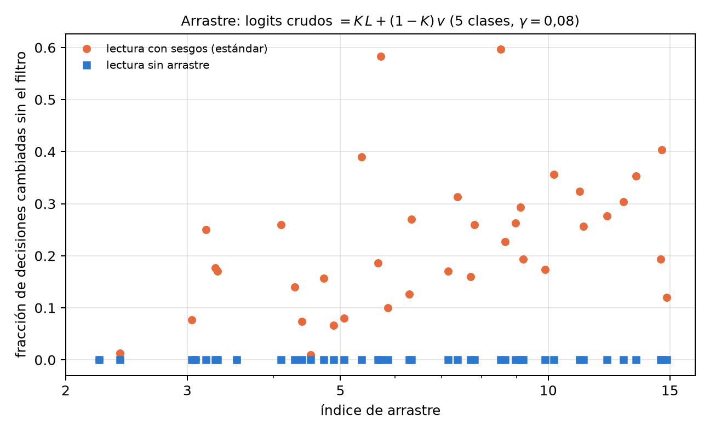

# Calibración por eco y el sesgo de ruido (pull effect) {#sec-cap22}

El filtro qg del capítulo 21 deja exacta la lectura bajo T1 igual, pero no corrige todo. Quedan dos cosas que este
capítulo trata. La primera son los errores que conservan el peso y mueven la excitación de un qubit a otro: pasan el
filtro, y hay que medirlos aparte, con circuitos de eco. La segunda es lo que hacen los disparos que decayeron en un
clasificador sin filtro: no agregan ruido al azar, sino que **arrastran** todas las decisiones hacia una misma clase. Las
dos se leen en la escala del capítulo 1, y para las dos el capítulo verifica con código el mecanismo y cita los
resultados en modelos de ruido de dispositivos de las notas, con predicciones registradas antes de correr.

## Desde la base: dos errores que el filtro trata distinto {#sec-eco-base}

En el sector de peso 1, cada qubit lee $m_Z(q)=1000(1-2p_q)$, con $p_q$ la probabilidad de que la excitación esté en él.
Hay dos maneras de equivocarse:

- **Un salto T1** saca el disparo del sector: la excitación desaparece y todos los qubits leen $+1000$, el polo norte. El
  filtro descarta esos disparos. Sin filtro, la lectura cruda es una mezcla: con probabilidad $K$ la lectura sin ruido, y
  con probabilidad $1-K$ el polo norte en todos los qubits.
- **Un error dentro del sector** mueve la excitación de un qubit a otro: el disparo sigue teniendo peso 1, pasa el filtro
  y cambia las lecturas de dos qubits a la vez. Sobre las probabilidades $p_q$ actúa como una matriz estocástica $M$.

La primera se corrige descartando; la segunda, invirtiendo $M$, como se invierte una matriz de confusión de lectura.

## Errores dentro del sector y el eco {#sec-eco-matriz}

Un circuito de eco prepara un estado de la base del sector, $|e_j\rangle$, aplica las compuertas de la red y después sus
inversas. Sin errores vuelve a $|e_j\rangle$; con errores, su distribución filtrada sobre los estados del sector es la
columna $j$ de una matriz de transferencia $M$ (notas, §105). Como el circuito real tiene la mitad de las compuertas del
eco, se corrige con $M^{1/2}$: la distribución filtrada $f$ se desmezcla resolviendo $M^{1/2}x=f$ con $x\ge0$
(`qang.sectors.unmix_sector`).

El script del capítulo lo prueba con un error dentro del sector controlado: después de cada subcapa, cada par de qubits de
una RBS se intercambia con probabilidad $p$ (conserva el peso y mueve la excitación). Cinco qubits, peso 1, 9 subcapas, 60
entradas al azar:

| $p$ | diagonal del eco | error con el filtro | + eco con $M^{1/2}$ | + eco con $M$ |
|---|---|---|---|---|
| 0,005 | 0,93–0,94 | 15,0 | 5,7 (−62 %) | 13,4 (−11 %) |
| 0,01 | 0,87–0,89 | 29,4 | 11,3 (−61 %) | 25,5 (−13 %) |
| 0,02 | 0,76–0,80 | 56,4 | 22,4 (−60 %) | 47,4 (−16 %) |
| 0,04 | 0,58–0,65 | 104,2 | 43,7 (−58 %) | 87,4 (−16 %) |
| 0,08 | 0,38–0,45 | 178,8 | 84,5 (−53 %) | 164,3 (−8 %) |

: Error medio de las lecturas $m_Z$ (m-qg) con probabilidades exactas. {#tbl-eco22}

$M^{1/2}$ quita algo más de la mitad del error que deja el filtro; $M$ completa corrige de más y quita poco. En los modelos de
ruido de dispositivos de las notas, el eco quita el 38–47 % del error filtrado en peso 1 con 5 qubits (§105, cinco
dispositivos simulados), el 37–43 % en peso 2 con una matriz de 10×10 (§107) y el 27–38 % en peso 2 con 8 qubits, una
matriz de 28×28 (§115). Cuanto más grande el sector, más sucio y más difícil de recuperar: la diagonal del eco baja de
0,77–0,92 a 0,50–0,80. El filtro más el eco queda 3,4 a 7 veces por debajo de la lectura cruda.

## ¿Llega al clasificador? {#sec-eco-clasificador}

Con la red de peso 1 sobre 189 entradas de prueba y 1000 disparos (§106), en tres dispositivos IBM simulados y el simulador
de IonQ:

| dispositivo | precisión (cruda / qang / qang + eco) | decisiones distintas de la sin ruido | error del valor de decisión |
|---|---|---|---|
| fake brisbane | 0,968 / 0,974 / 0,979 | 2 / 1 / 0 | 1,53 / 0,76 / 0,33 |
| fake sherbrooke | 0,963 / 0,974 / 0,979 | 3 / 1 / 0 | 1,26 / 0,61 / 0,29 |
| fake torino | 0,963 / 0,979 / 0,979 | 3 / 0 / 0 | 1,08 / 0,47 / 0,27 |
| IonQ aria-1 | 0,958 / 0,963 / 0,968 | 4 / 3 / 2 | 1,67 / 0,87 / 0,44 |
| IonQ forte-1 | 0,963 / 0,968 / 0,974 | 3 / 2 / 1 | 1,60 / 0,80 / 0,43 |

: La calibración por eco en el clasificador (notas §106; precisión sin ruido 0,979). {#tbl-clasificador22}

El eco reduce entre 43 y 56 % el error del valor de decisión que deja el filtro, y el filtro más el eco queda 3,7 a 4,6
veces por debajo de la lectura cruda. Las decisiones sólo se mueven hacia la red sin ruido: 15 distintas sin qang, 7 con el
filtro y 3 con el filtro más el eco, sobre 945 lecturas.

**Cuándo no sirve** (§108). Con entradas de margen estrecho, el eco no agregó nada (19 decisiones cambiadas contra 17 con el
filtro solo). El error del valor de decisión filtrado era de 0,26 a 0,35, apenas por encima de su ruido de disparo (0,22):
quedaba poco sesgo, e invertir la matriz suma varianza. La regla de las notas es usar el eco cuando el error filtrado está
bien por encima de su nivel de ruido de disparo. En el modelo de este capítulo, con 1000 disparos y 4000 por eco, el eco
siguió ayudando incluso con $p=0{,}005$ (22 → 17 m-qg); con $p=0$ no cambia nada (15 m-qg, el ruido de disparo puro).

{#fig-eco22 width=100%}

## El arrastre: por qué la pérdida sin qang varía entre semillas {#sec-eco-arrastre}

En la red multiclase del capítulo 20, la pérdida sin filtro variaba mucho de una semilla a otra (de −0,7 a 41,7 puntos).
Las notas lo explicaron con una propiedad exacta (§121 F7). En peso 1 bajo T1 igual, todo disparo que decae cae en
$|0\dots0\rangle$, donde cada qubit lee $+1000$. Como los logits son lineales en las lecturas, los logits crudos son

$$
\text{logits}_{\text{crudos}}=K\,L+(1-K)\,v,
$$

con $L$ los logits sin ruido y $v$ los logits del polo norte, un vector constante que fija el entrenamiento (para el
cabezal lineal, $v=W^\top\mathbf 1+b$). Sin filtro, cada entrada es arrastrada hacia la clase con el mayor $v_c$, y cuánto
pesa eso lo mide un índice de arrastre: $(1-K)/K$ por el rango de $v$, sobre el margen mediano de entrenamiento.

El script lo comprueba en 40 modelos de 5 clases con parámetros al azar ($K=0{,}472$, 300 entradas cada uno):

- la fórmula de los logits crudos se cumple a $7\cdot10^{-15}$;
- sin filtro cambian de 0 a 60 % de las decisiones según el modelo, y el cambio crece con el índice de arrastre
  (Spearman 0,60; en las notas, 0,65 con el cabezal y 0,98 con la lectura por qubit);
- con el filtro no cambia ninguna.

La dispersión entre semillas no es mala suerte: es el $v$ que dejó el entrenamiento, y se puede leer antes de correr nada.

{#fig-arrastre22 width=80%}

## La lectura sin arrastre {#sec-eco-sinarrastre}

Si el arrastre viene de $v$, se puede eliminar en el diseño: logits lineales en las probabilidades de excitación y sin
término constante (para el cabezal, $W^\top(qg_Z-1)$; para la lectura por qubit, $a\,p_c$). Entonces el polo norte aporta
cero, los disparos que decayeron sólo reescalan los logits por $K$, y la decisión cruda es la sin ruido. El script lo
comprueba en los 40 modelos: ninguna decisión cambia, y los logits crudos son $K$ veces los sin ruido a $6\cdot10^{-15}$. Las
notas (§123, 10 semillas, dígitos de 5 clases) lo confirman en precisión:

| lectura | modelo | sin ruido | T1 (qang / cruda) | T1 desigual (qang / cruda) | 1000 disparos (qang / cruda) |
|---|---|---|---|---|---|
| por qubit | estándar | 0,860 | 0,860 / 0,725 | 0,849 / 0,688 | 0,861 / 0,724 |
| por qubit | sin arrastre | 0,862 | 0,862 / 0,862 | 0,851 / 0,851 | 0,863 / 0,863 |
| cabezal | estándar | 0,932 | 0,932 / 0,653 | 0,932 / 0,624 | 0,927 / 0,651 |
| cabezal | sin arrastre | 0,938 | 0,938 / 0,938 | 0,928 / 0,928 | 0,932 / 0,932 |

: La lectura sin arrastre (notas §123). {#tbl-sinarrastre22}

Quitar los sesgos no cuesta precisión, y la lectura sin arrastre es inmune al decaimiento sin filtrar: lleva el filtro
adentro. Sin filtro, el cabezal sin arrastre queda 28,5 puntos por encima del estándar. Es la imagen del capítulo 1
llevada al diseño: si el polo norte vale cero, caer en él no arrastra.

## Calibrar con el propio dispositivo {#sec-eco-dispositivo}

Las notas probaron dos maneras más de usar la calibración en los modelos de ruido de IBM (§119, §120): entrenar con qang bajo
los T1 y T2 publicados, y medir el dispositivo mismo (con la matriz del eco dentro del modelo, o reajustando la lectura con
40 entradas corridas en el dispositivo). Ninguna le ganó a la receta simple: entrenar sin ruido y correr con el filtro
(0,972 de precisión media contra 0,979 sin ruido), más el eco para los valores de decisión. La razón es que en esos modelos
dominan los errores de compuerta, y la calibración de T1 y T2 no los describe (los $\gamma$ por subcapa son de sólo
0,002–0,017).

## Lo que queda pendiente {#sec-pendiente22}

El mecanismo del eco y la propiedad F7 están verificados con código, y los resultados en dispositivos simulados son los de las
notas. Hay un paquete listo para correr la red multiclase con eco en una QPU de IonQ (§116: 55 circuitos, 60 000 disparos,
con predicciones registradas antes de enviar nada); su ensayo en el simulador dio 4 decisiones cambiadas con el filtro y 1
con el eco, contra 8 en crudo. La corrida en hardware está pendiente de créditos y de una aprobación explícita del costo.

## Sin qang y con qang {#sec-comparacion22}

| acción | sin qang | con qang | diferencia |
|---|---|---|---|
| errores dentro del sector | invisibles: pasan cualquier filtro de peso | matriz del eco y desmezcla con $M^{1/2}$: −27 a −62 % del error filtrado | **a favor**, con costo: $\binom nk$ circuitos de eco más |
| error del valor de decisión | — | −43 a −56 % con el eco sobre el filtro (§106) | **a favor** cuando el error filtrado supera su ruido de disparo; **ninguna** con margen estrecho (§108) |
| entender la dispersión entre semillas | mala suerte | logits crudos $=KL+(1-K)v$, exacto; el índice de arrastre la predice | **a favor**: el arrastre se lee antes de correr |
| corregir el arrastre | entrenar con ruido | el filtro lo quita exactamente | **a favor** |
| diseñar una lectura inmune | — | sin sesgos: el polo norte vale cero, decisiones idénticas con o sin filtro | **a favor**, sin costo en precisión |
| calibrar con el dispositivo | entrenar con la calibración | igual o peor que entrenar sin ruido + filtro | **ninguna** en esos modelos: dominan los errores de compuerta |

: Las acciones del capítulo sin la escala qang y con ella. {#tbl-comparacion22}

**Balance.** La calibración por eco es mitigación conocida, del tipo de la inversión de matrices de confusión de lectura,
aplicada dentro de un sector. Lo que agregan las notas es su alcance medido (cuánto quita según el tamaño del sector) y la
regla de cuándo no sirve. El aporte más limpio del capítulo es el arrastre: una propiedad exacta que explica la dispersión
entre semillas, y una lectura sin sesgos que la evita sin filtro. Las dos salen de leer el decaimiento como lo lee el
capítulo 1: todos los qubits en el polo norte.

## En código {#sec-codigo22}

```python
import numpy as np
from qang import qml as QML

m = QML.MultiClassQNN(n_qubits=5, n_classes=5, readout="head")
rng = np.random.default_rng(0)
psi = m.encode(rng.uniform(-1, 1, size=(4, 4)))
th = rng.uniform(-np.pi, np.pi, size=m.n_theta)
head = rng.normal(size=m.n_head)
K = QML.kept_fraction(0.08, 1, m.depth)
L = m._logits(m.qg_z(m.probs(th, psi), qang=False), head)
raw = m._logits(m.qg_z(m.probs(th, psi, gamma=0.08), qang=False), head)
v = m._logits(np.ones((1, 5)), head)       # el polo norte: +1000 m-qg en cada qubit
np.abs(raw - (K * L + (1 - K) * v)).max()  # ~1e-15: F7
```

## Resumen {#sec-resumen22}

- Un salto T1 lleva todos los qubits al polo norte y saca el disparo del sector; un error dentro del sector mueve la
  excitación y pasa el filtro. El primero se descarta; el segundo se mide con ecos y se invierte.
- El eco con $M^{1/2}$ quita más de la mitad del error filtrado en el modelo del capítulo y 27–47 % en los dispositivos
  simulados de las notas; $M$ completa corrige de más. Sirve cuando el error filtrado supera su ruido de disparo.
- Sin filtro, los logits crudos son exactamente $K\,L+(1-K)\,v$: el decaimiento arrastra todas las decisiones hacia una clase,
  y el índice de arrastre predice cuánto.
- Una lectura sin sesgos hace que el polo norte valga cero: las decisiones crudas son las sin ruido, sin filtrar y sin perder
  precisión.
- En los modelos de ruido de IBM, entrenar sin ruido y correr con el filtro (y el eco) fue la mejor receta; calibrar con el
  dispositivo no la mejoró.

## Notas bibliográficas {.unnumbered}

El eco es el de @hahn1950; la mitigación de errores de lectura, @bravyi2021. El filtro de sector es la verificación de
simetría de @bonetmonroig2018. Las notas de investigación numeradas (§) que cita el capítulo y los scripts que lo
verifican están en el repositorio [@qangrepo]; la definición de la unidad qang, en @monteverde2026.
