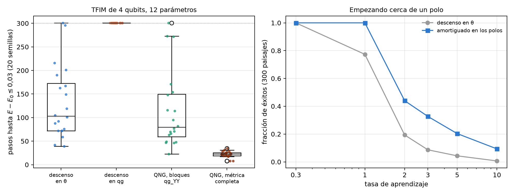
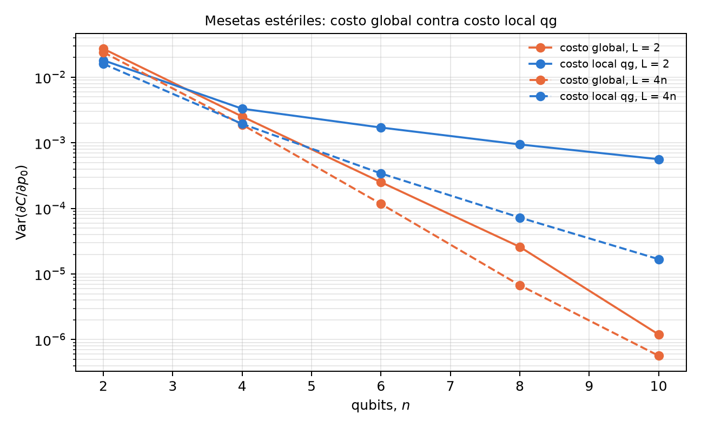

# Geometría de la información, gradiente natural (QNG) y núcleos {#sec-cap23}

Los capítulos 20 a 22 leyeron en qg lo que sale de un circuito. Este capítulo pregunta por lo que entra: los parámetros que
un optimizador mueve. Circula una idea atractiva: si la lectura natural es qg, escribir el circuito en coordenadas qg
debería acelerar el gradiente y aplanar el paisaje. El capítulo muestra con código que es al revés, y por qué. La
coordenada en la que conviene optimizar es el ángulo qang $\theta$, y qg es la coordenada en la que conviene leer. De esa
distinción salen cuatro usos honestos de qang: regularizar la singularidad de los polos, leer la métrica del gradiente
natural con correlaciones qg, amortiguar el paso cerca de los polos y escribir un costo local que no se aplana tan rápido.
Lo estructural se verifica con código; los resultados con núcleos en modelos de ruido de dispositivos son los de las notas,
con predicciones registradas antes de correr.

## Desde la base: el ángulo y la lectura {#sec-geo-base}

En el capítulo 1, un qubit preparado con $R_y(\theta)|0\rangle$ lee $m_Z=1000\cos\theta$ m-qg, y $\theta$ es el ángulo
qang. Las dos coordenadas describen el mismo estado, pero no son equivalentes para optimizar, porque el cambio entre ellas
no es lineal:

$$
\frac{d\,qg_Z}{d\theta}=-\sin\theta ,\qquad \frac{dE}{d\,qg_Z}=-\frac{1}{\sin\theta}\,\frac{dE}{d\theta}.
$$

En los polos ($m_Z=\pm1000$) la lectura casi no se mueve cuando $\theta$ cambia, y por eso el gradiente en qg diverge. Todo
el capítulo es una consecuencia de esa línea.

## La singularidad y sus regularizaciones {#sec-geo-singularidad}

El factor $-1/\sin\theta$ vale $-10$ en $\theta=0{,}1$, $-100$ en $0{,}01$ y $-1000$ en $0{,}001$. Las notas (§1) proponen
dos versiones acotadas, en `qang.gradients`:

- **recorte:** $-1/(\operatorname{sign}(\sin\theta)\max(|\sin\theta|,\varepsilon))$, que nunca supera $1/\varepsilon$;
- **Tikhonov:** $-\sin\theta/(\sin^2\theta+\varepsilon^2)$, suave en todas partes y nula en el polo mismo.

Con $\varepsilon=0{,}05$, en $\theta=0{,}001$ el factor crudo vale 1000, el recortado 20 y el de Tikhonov 0,40. El script del
capítulo repite el experimento de las notas: minimizar $E=-\sin\theta$ (mínimo en $\pi/2$, lejos de los bordes) empezando en
el polo, $\theta_0=0{,}01$, durante 150 iteraciones.

| espacio | tasa | $\theta$ final | $E$ final | paso máximo | comportamiento |
|---|---|---|---|---|---|
| en $\theta$ | 0,05 | 1,5698 | −1,0000 | 0,05 | converge a $\pi/2$ |
| en qg, crudo | 0,05 | 3,1416 | 0,0000 | 3,14 | salta de un polo al otro y no se detiene |
| en qg, recortado | 0,01 | 1,4184 | −0,9884 | 0,63 | converge, más lento |
| en qg, Tikhonov | 0,01 | 1,4043 | −0,9862 | 0,27 | converge, más lento, pasos más chicos |

: Descenso desde un polo (notas §1; las cifras del script coinciden con las de las notas). {#tbl-singularidad23}

Con la misma tasa que en $\theta$, el descenso crudo en qg nunca se recupera: cada paso enorme cruza al polo opuesto, donde
el gradiente vuelve a ser enorme. Las dos regularizaciones lo arreglan, pero piden una tasa unas cinco veces menor (la regla
práctica de las notas es tasa $\le\varepsilon$) y aun así llegan peor que el descenso en $\theta$. Regularizar quita la
divergencia; no convierte a qg en una buena coordenada para optimizar.

## El ángulo es la coordenada plana de Fisher {#sec-geo-fisher}

La razón de fondo es estadística. Midiendo en Z, la información de Fisher por disparo es (notas §15.1, §159)

$$
F_\theta=1, \qquad F_{qg}=\frac{1}{1-qg_Z^2}=\frac{1}{\sin^2\theta}.
$$

En el ángulo vale 1 en todas partes; en qg depende de dónde se esté y diverge en los polos. Es la misma $1/\sin\theta$ de la
sección anterior, ahora como métrica de Fubini-Study escrita en coordenadas qg. En unidades del capítulo 1, el desvío de la
lectura con $N$ disparos es $\sigma_m=1000\sin\theta/\sqrt N$ m-qg (la media muestral alcanza la cota de Cramér-Rao), y el
del ángulo estimado es $1/\sqrt N$ radianes, igual en todo el círculo.

El script lo comprueba con 4000 repeticiones de 1000 disparos en 12 ángulos: $\sigma_{qg}\sqrt N$ reproduce $\sin\theta$
a la tercera cifra (0,149 contra 0,149 en $\theta=0{,}15$; 0,995 contra 0,992 en $1{,}70$), y $\sigma_\theta\sqrt N$ queda
entre 0,98 y 1,05 en todos los puntos (@fig-fisher23, izquierda). El ángulo es la coordenada plana: en ella cada paso del
optimizador vale lo mismo en cualquier punto.

**Una coordenada no ahorra evaluaciones.** Para una compuerta $e^{-i\theta G}$ con $G^2=I/4$, la energía es
$E(\theta)=a+b\cos\theta+c\sin\theta$. Una sola evaluación desplazada no alcanza para la derivada: el script construye dos
funciones de esa forma que coinciden en $\theta+\pi/2$ ($-0{,}644218$ las dos) y tienen derivadas distintas en $\theta$
($-0{,}644$ y $+0{,}765$). Dos evaluaciones bastan, así que dos por parámetro es el mínimo en cualquier coordenada. En qg se
usan los mismos dos números y se agrega el polo.

{#fig-fisher23 width=100%}

## El gradiente natural y la métrica qg_YY {#sec-geo-qng}

El gradiente natural (QNG) [@stokes2020] corrige el paso con la métrica: $\Delta\theta=-\eta\,g^{-1}\nabla E$. Para
un qubit, el paso natural en qg es exactamente el descenso común en $\theta$ (notas §15.1): la invariancia ante el cambio de
coordenadas hace que escribirlo en qg no agregue nada.

Con varios qubits hay algo que qang sí aporta (§159). En un ansatz real de $R_y$ y CZ, todos los estados del circuito son
reales, así que $\langle Y_k\rangle=0$ antes de cada $R_y$ y **cada entrada diagonal de la métrica vale exactamente 1/4**.
Los ángulos son planos uno por uno, y toda la curvatura está fuera de la diagonal. Dentro de una capa, esos términos son
$g_{ij}=\langle Y_iY_j\rangle/4$: correlaciones qg_YY que se leen con un circuito en la base Y por capa. Es la métrica por
bloques de Stokes y otros, escrita como lecturas qg. El script lo comprueba en el TFIM de 4 qubits con 3 capas: la diagonal
vale 1/4 a $1{,}7\cdot10^{-16}$, los bloques qg_YY coinciden con la métrica completa dentro de cada capa a
$1{,}7\cdot10^{-16}$, y fuera de la diagonal hay entradas de hasta 0,248, que es donde actúa la métrica.

El experimento de las notas, con predicciones registradas antes de correr: TFIM de 4 qubits ($h=1$), 12 parámetros,
éxito si $E-E_0\le0{,}03$ en 300 pasos (el piso del ansatz es 0,0245), tasa elegida en 6 semillas y 20 semillas de prueba.
El script vuelve a correr las 20 semillas de prueba con las tasas guardadas y obtiene las mismas cifras:

| método | pasos (mediana) | éxitos | tasa |
|---|---|---|---|
| descenso en $\theta$ | 103 | 19/20 | 0,2 |
| descenso en qg (jacobiano recortado) | nunca | 0/20 | 0,005 |
| QNG, bloques qg_YY | 79,5 | 19/20 | 0,05 |
| QNG, métrica completa | 22,5 | 20/20 | 0,1 |

: Gradiente natural en el TFIM de 4 qubits (notas §159, reproducido por el script). {#tbl-qng23}

- **El descenso en qg falla** en todas las tasas de la grilla. Se optimiza en el ángulo y se lee en qg.
- **La métrica qg_YY ayuda poco**: 1,3 veces menos pasos que el descenso en $\theta$. La predicción registrada pedía 1,5 y
  falló. La métrica completa es 4,6 veces más rápida.
- Contando circuitos (24 por gradiente, 3 más para la métrica por bloques y unos 78 más para la completa en hardware), los
  tres métodos terminan a menos de 15 % uno del otro. Esta cuenta es posterior a la corrida.
- Con 1000 disparos, cada entrada de la métrica qg_YY sale con un error de 0,013 a 0,022.

## El descenso amortiguado en los polos {#sec-geo-amortiguado}

Si el problema está en los polos, se puede frenar ahí sin salir del ángulo (notas §9):

$$
\theta\leftarrow\theta-\eta\,\max(|\sin\theta|,\varepsilon)\,\frac{dE}{d\theta}.
$$

El factor es $|d\,qg_Z/d\theta|$, la misma geometría de la primera sección, y no hay que ajustarlo. Es el paso natural
multiplicado por $|\sin\theta|$, que para estos estados reales es también la coherencia $2|\rho_{01}|$: el optimizador va
más despacio cuanto menos coherencia le queda al qubit. **No es una clase nueva de optimizador**: es un paso que depende de
la posición, del tipo de las regiones de confianza.

El script repite la prueba de robustez: 300 paisajes al azar $E=h_z\cos\theta+h_x\sin\theta$ por tasa, empezando cerca de un
polo.

| tasa | descenso en $\theta$ | amortiguado | amortiguado, atrapado |
|---|---|---|---|
| 0,3 | 1,000 | 1,000 | 0,000 |
| 1 | 0,773 | 1,000 | 0,000 |
| 2 | 0,193 | 0,440 | 0,013 |
| 3 | 0,087 | 0,327 | 0,017 |
| 5 | 0,043 | 0,203 | 0,030 |
| 10 | 0,007 | 0,093 | 0,077 |

: Fracción de éxitos empezando cerca de un polo (300 paisajes por tasa, semilla 0). {#tbl-amortiguado23}

Con tasas seguras no cambia nada; con tasa 1 acierta siempre contra 77 %; desde tasa 2 gana de 2,3 a 13 veces, aunque con
tasas grandes los dos fallan casi siempre. La fracción que queda atrapada oscilando en su polo crece con la tasa, hasta 7,7 %
en tasa 10. Las cifras difieren algo de las de las notas (§9.2): allí, con tasa 0,3, el amortiguado perdía unos puntos
(0,963 contra 0,997), y las ganancias desde tasa 2 eran de 2,5 a 5 veces. El patrón es el mismo; las cifras exactas dependen
de los paisajes sorteados.

{#fig-qng23 width=100%}

## Núcleos cuánticos y el filtro qg {#sec-geo-nucleos}

Un núcleo de fidelidad $K_{ij}=|\langle\psi(x_i)|\psi(x_j)\rangle|^2$ estimado en un dispositivo ruidoso sale encogido
($K_{ii}<1$) y arrastrado hacia el valor del ruido. La reparación habitual, $K_{ij}/\sqrt{K_{ii}K_{jj}}$, cuesta los
circuitos de la diagonal. Si el circuito del núcleo conserva el peso de Hamming, el filtro qg del capítulo 21 es otra
reparación (notas §161). Con la codificación de peso 1 (un qubit por componente del vector normalizado), el núcleo es
$K=(x\cdot y)^2$, y en qg es un ángulo qang: $\arccos(2K-1)=2\varphi$, con $\varphi$ el ángulo entre los dos vectores. El
script lo comprueba a $1{,}3\cdot10^{-15}$.

El experimento de las notas: datos de cáncer de mama reducidos a 4 componentes más una constante (5 qubits), 40 + 40 puntos,
SVM con núcleo precalculado, 2000 disparos y tres modelos de ruido de dispositivos IBM.

| dispositivo | error de la matriz de Gram (cruda / normalizada / filtrada / ambas) | aciertos (exacto 35/40) | diagonal (cruda / filtrada) |
|---|---|---|---|
| FakeBrisbane | 0,097 / 0,016 / 0,016 / 0,015 | 32 / 34 / 34 / 35 | 0,674 / 0,944 |
| FakeTorino | 0,101 / 0,021 / 0,017 / 0,014 | 34 / 35 / 34 / 34 | 0,717 / 0,971 |
| FakeFez | 0,039 / 0,027 / 0,011 / 0,011 | 34 / 34 / 35 / 35 | 0,953 / 1,000 |

: El núcleo de peso 1 con el filtro qg (notas §161). {#tbl-nucleos23}

- **El filtro repara mejor la matriz de Gram**: entre 2,4 y 6 veces por debajo de la cruda, y entre 1,0 y 2,5 veces por
  debajo de la normalización, sin los 80 circuitos de la diagonal. Normalizar después del filtro casi no agrega nada.
- **La precisión casi no lo nota**: una SVM compara valores del núcleo, y un encogimiento común se cancela. La predicción
  registrada sobre la precisión falló en un núcleo crudo, por tres puntos.
- La alineación núcleo-objetivo no ve el encogimiento, porque divide por $\|K\|$.
- Este núcleo es un polinomio de grado 2, fácil de calcular clásicamente: es una prueba de reparación, no de ventaja.

## Mesetas estériles: costo global contra costo local qg {#sec-geo-mesetas}

Con muchos qubits, el gradiente de un circuito al azar se vuelve exponencialmente chico [@mcclean2018]. Las notas
lo miraron en qg dos veces. En §12, pasar el gradiente a qg no cambia nada: la meseta sigue siendo exponencial, la
regularización sólo la reescala, y en los polos se le suma la singularidad. **Las dos cosas son independientes y se
acumulan.**

En §23, la coordenada sí importa por otro camino: el costo. Se entrena un ansatz para llegar a un estado producto y se
comparan dos costos que valen cero sólo en el objetivo: el global, $C_G=1-P(0\dots0)$, y el local de
@cerezo2021, que en la escala del capítulo 1 es la lectura media del registro, $C_L=(1-\overline{qg_Z})/2$. El script recalcula
la varianza de la derivada respecto del primer parámetro con 200 inicializaciones al azar:

| | $n=2$ | $n=4$ | $n=6$ | $n=8$ | $n=10$ |
|---|---|---|---|---|---|
| global, $L=2$ | $2{,}7\cdot10^{-2}$ | $2{,}5\cdot10^{-3}$ | $2{,}5\cdot10^{-4}$ | $2{,}6\cdot10^{-5}$ | $1{,}2\cdot10^{-6}$ |
| local qg, $L=2$ | $1{,}8\cdot10^{-2}$ | $3{,}3\cdot10^{-3}$ | $1{,}7\cdot10^{-3}$ | $9{,}4\cdot10^{-4}$ | $5{,}6\cdot10^{-4}$ |
| global, $L=4n$ | $2{,}4\cdot10^{-2}$ | $1{,}9\cdot10^{-3}$ | $1{,}2\cdot10^{-4}$ | $6{,}7\cdot10^{-6}$ | $5{,}7\cdot10^{-7}$ |
| local qg, $L=4n$ | $1{,}6\cdot10^{-2}$ | $1{,}9\cdot10^{-3}$ | $3{,}4\cdot10^{-4}$ | $7{,}3\cdot10^{-5}$ | $1{,}7\cdot10^{-5}$ |

: Varianza de $\partial C/\partial p_0$ (200 inicializaciones). {#tbl-mesetas23}

- Con circuitos cortos ($L=2$), el costo local qg decae como un polinomio y el global como una exponencial: en $n=10$ el local
  tiene 470 veces más varianza (en las notas, 5600 veces en $n=12$), es decir, hacen falta unas 470 veces menos disparos para
  la misma relación señal-ruido.
- Con circuitos profundos ($L=4n$) **el costo local no cura la meseta**: los dos decaen exponencialmente.
- Con disparos finitos (notas §23, 100 disparos por circuito), el gradiente global sale exactamente cero en 22 % de las
  inicializaciones con $n=10$ y en 35 % con $n=12$; el local, nunca. Entrenando con $n=10$, el local llega a fidelidad 0,5 en
  una mediana de 11 pasos contra 20 del global.
- **El control clásico.** Con profundidad $L$, cada $\langle Z_i\rangle$ depende sólo de los $2L+1$ qubits de su cono de luz,
  así que el costo local y su gradiente se calculan clásicamente en tiempo $O(n\,2^{2L+1})$. Las notas entrenan así 50 y 100
  qubits sin disparos. Donde el costo local qg escapa a la meseta, también es simulable: la ventaja es de entrenamiento, no
  cuántica.

{#fig-mesetas23 width=80%}

## Lo que queda pendiente {#sec-pendiente23}

Todo lo de este capítulo es sin ruido o en modelos de ruido. El gradiente natural de §159 se probó con gradientes exactos en
un solo modelo chico; falta medir la métrica qg_YY con disparos en hardware y ver si la ventaja de 1,3 veces sobrevive al
ruido de disparo de la métrica. El núcleo filtrado se probó con un núcleo pequeño y fácil, sin la concentración exponencial
que aparece con más qubits.

## Sin qang y con qang {#sec-comparacion23}

| acción | sin qang | con qang | diferencia |
|---|---|---|---|
| optimizar los parámetros | descenso en el ángulo | descenso en qg: diverge en los polos y falla (0/20) | **en contra**: se optimiza en $\theta$, se lee en qg |
| regularizar cerca de los polos | — | recorte o Tikhonov sobre $1/\sin\theta$ | **ninguna** frente a no usar qg: sólo repara el problema que qg crea |
| entender por qué | métrica de Fubini-Study | $F_{qg}=1/(1-qg_Z^2)$: la singularidad de qg es la métrica; $\sigma_m=1000\sin\theta/\sqrt N$ | **a favor** como lectura: explica el fallo y da el error de cada lectura |
| contar evaluaciones del gradiente | 2 por parámetro | 2 por parámetro | **ninguna**: ninguna coordenada baja de dos |
| métrica del gradiente natural | métrica por bloques (Stokes y otros) | la misma, leída como correlaciones qg_YY; diagonal exactamente 1/4 | **ninguna** en el método; **a favor** en la lectura: un circuito por capa |
| paso cerca de los polos | tasa fija | amortiguado por $|\sin\theta|$, sin ajuste | **a favor** con tasas agresivas (2,3 a 13 veces más éxitos desde tasa 2); cuesta poco o nada con tasas seguras |
| reparar un núcleo ruidoso | normalizar por la diagonal | filtro qg en circuitos de peso fijo | **a favor**: Gram 1,0 a 2,5 veces mejor sin los circuitos de la diagonal; **ninguna** en precisión |
| costo de entrenamiento | fidelidad global | costo local $(1-\overline{qg_Z})/2$ | **a favor** con circuitos cortos (470 veces más varianza en $n=10$); **ninguna** con circuitos profundos |

: Las acciones del capítulo sin la escala qang y con ella. {#tbl-comparacion23}

**Balance.** El capítulo es, en buena parte, una corrección: qg no es una coordenada para optimizar, y la geometría de Fisher
dice exactamente por qué. Lo que queda a favor de qang no es una coordenada sino una lectura: la métrica del gradiente
natural como correlaciones qg_YY, el amortiguado como $|d\,qg_Z/d\theta|$, el núcleo como un ángulo qang reparado por el
filtro y el costo local como la lectura media del registro. Son resultados conocidos (Stokes y otros, Cerezo y otros) escritos
en la escala del capítulo 1, más dos ganancias medidas: la reparación del núcleo con el filtro y la robustez del amortiguado.

## En código {#sec-codigo23}

```python
import math
import numpy as np
from qang import fisher as F
from qang import gradients as GR

F.fisher_theta(1.0), F.fisher_qg(math.cos(1.0))       # 1 en el ángulo; 1/sin^2(1) = 1,41 en qg
GR.inverse_jacobian_raw(0.001)                        # -1000: la singularidad
GR.inverse_jacobian_tikhonov(0.001)                   # -0,40: regularizada
th = np.random.default_rng(0).uniform(0, 2 * np.pi, 12)
B = F.block_metric(th, 4, 3)                          # bloques qg_YY / 4
G = F.full_metric(th, 4, 3)                           # Fubini-Study completa
np.diag(G)                                            # todas 0,25
np.abs(B[:4, :4] - G[:4, :4]).max()                   # ~1e-16 dentro de la capa
```

## Resumen {#sec-resumen23}

- En la escala del capítulo 1, $dE/d\,qg_Z=-(1/\sin\theta)\,dE/d\theta$ diverge en los polos. El descenso crudo en qg salta
  de polo a polo; el recorte y Tikhonov lo arreglan, pero convergen más lento que el descenso en $\theta$.
- La información de Fisher es 1 en el ángulo y $1/(1-qg_Z^2)$ en qg: el ángulo qang es la coordenada plana. Se optimiza en
  $\theta$ y se lee en qg, con $\sigma_m=1000\sin\theta/\sqrt N$ m-qg.
- Ningún cambio de coordenada baja de dos evaluaciones por parámetro.
- En un ansatz real, la diagonal de la métrica vale exactamente 1/4 y los bloques son correlaciones qg_YY. La métrica por
  bloques ayuda poco (1,3 veces); la completa, 4,6 veces; contando circuitos, los tres métodos quedan a menos de 15 %.
- El amortiguado por $|\sin\theta|$ no es un optimizador nuevo, pero resiste tasas agresivas empezando cerca de un polo.
- El filtro qg repara la matriz de Gram de un núcleo de peso fijo mejor que la normalización y sin sus circuitos; la
  precisión casi no cambia.
- El costo local qg escapa a la meseta sólo con circuitos cortos, y ahí también es simulable clásicamente.

## Notas bibliográficas {.unnumbered}

La geometría de Fisher es @braunstein1994, y el gradiente natural, @amari1998 y, en circuitos cuánticos, @stokes2020. El
descenso amortiguado es el de @levenberg1944 y @marquardt1963. Los núcleos cuánticos son @havlicek2019 y @schuld2019;
las mesetas estériles, @mcclean2018 y @cerezo2021. Las notas de investigación numeradas (§) que cita el capítulo y los
scripts que lo verifican están en el repositorio [@qangrepo]; la definición de la unidad qang, en @monteverde2026.
