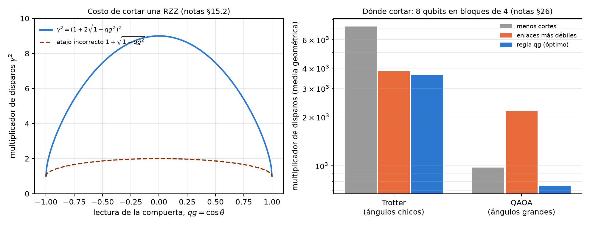

# Corrección de errores y síndromes continuos {#sec-cap26}

La corrección de errores protege un qubit lógico repartiéndolo en varios físicos y midiendo síndromes: paridades que
dicen qué error ocurrió sin tocar la información. En la escala del capítulo 1, cada síndrome es la lectura qg de una
paridad, un número entre $-1000$ y $1000$ m-qg que se puede promediar y seguir en el tiempo. Este capítulo usa esa lectura
para cuatro cosas: elegir el código según cuánto T1 y cuánto desfase tiene el dispositivo, seguir la deriva del ruido con
los síndromes mismos, decodificar el código de superficie sabiendo que el T1 deja ceros, y decidir dónde cortar un circuito.
Lo de capacidad de código (síndromes perfectos, una ronda) se verifica con código; los resultados a nivel de circuito, con
qutrits, con qubits de borrado y en modelos de dispositivos son los de las corridas registradas de las notas.

## Desde la base: el síndrome es una lectura qg {#sec-qec-base}

Un estabilizador como $Z_0Z_1$ vale $+1$ o $-1$ en cada disparo; su promedio es $qg$ de la paridad, y la tasa de síndromes
no triviales es $(1-qg)/2$, la misma ecuación de probabilidad del capítulo 1. Los dos ruidos de un qubit en reposo se leen
con dos experimentos (notas §27): preparar $|1\rangle$ y medir Z da $qg_Z=-1+2\gamma$ (el amortiguamiento, T1), y preparar
$|+\rangle$ y medir X da $qg_X=\sqrt{1-\gamma}\,(1-2p)$ (el desfase, $T_\varphi$). Invertirlos da $\gamma$ y $p$, y con ellos se
decide qué código conviene.

## Qué código conviene bajo T1 y desfase {#sec-qec-codigos}

En capacidad de código, con una ronda de amortiguamiento $\gamma$ y desfase $p$ en cada qubit, el script recalcula la
infidelidad lógica exacta de cuatro opciones: sin código, el código de repetición contra inversión de bit, el de inversión de
fase, y el código de 4 qubits de @leung1997, hecho para el T1.

| ruido | sin código | inversión de bit | inversión de fase |
|---|---|---|---|
| sólo T1, $\gamma=0{,}02$ | **0,0067** | 0,0101 | 0,0197 |
| sólo desfase, $p=0{,}02$ | 0,0133 | 0,0384 | **0,0008** |
| $\gamma=p=0{,}02$ | **0,0199** | 0,0474 | 0,0204 |

: Códigos de repetición bajo T1 y desfase (notas §27, recalculado). {#tbl-repeticion26}

- **Ningún código de repetición corrige el T1**, y el de inversión de bit es peor que no codificar en todos los casos. La
  frontera entre "código de fase" y "sin código" está en $p=\gamma$ (cociente 1,00, 1,02 y 1,10 con $\gamma=0{,}002$, 0,01 y
  0,04).
- **El código de Leung sí corrige el T1**: su infidelidad es $\approx0{,}92\,\gamma^2$, 36 veces menor que sin código con
  $\gamma=0{,}01$ y 364 veces con $\gamma=0{,}001$. Pero es frágil al desfase: gana sólo si $p<\gamma/4$ (frontera 0,249, 0,247 y
  0,237).

**La regla en tiempos del dispositivo.** Con una ronda de espera, $\gamma=t/T_1$ y $p=t/2T_\varphi$, así que $p=\gamma/4$ es
$T_2=T_1$ y $p=\gamma$ es $T_2=0{,}4\,T_1$. La mejor opción es **Leung si $T_2>T_1$, ningún código si $0{,}4\,T_1<T_2<T_1$, y el
código de fase si $T_2<0{,}4\,T_1$**; el script lo confirma en nueve cocientes $T_2/T_1$. Con los dos testigos qg medidos con
1000 disparos cada uno, la política elige bien en 79 % de 300 casos al azar, con un costo de 6,4 % sobre el oráculo, contra
14,7 % de la política de §27 (sin Leung) y 64–220 % de quedarse siempre con una opción. **La lectura $qg_Z$ sola no sirve**: ve
el T1 pero no el desfase, y recomienda siempre no codificar.

{#fig-codigos26 width=100%}

## El síndrome como testigo continuo {#sec-qec-sindrome}

Una vez elegido el código, sus ancillas siguen leyendo el ruido. En el código de Leung las expectativas de los estabilizadores
son, en forma cerrada (notas §33),

$$
\langle Z_0Z_1\rangle=1-2\gamma(1-\gamma),\qquad \langle XXXX\rangle=qg_X^4,
$$

y el script lo confirma contra el cálculo con operadores de Kraus (por ejemplo, tasas 0,0099 y 0,02161 con $\gamma=0{,}01$ y
$p=0{,}003$). Así, la lectura qg de cada ancilla se invierte en una línea a $\gamma$ y $p$. En las notas, con $T_2/T_1$ que salta al
azar entre 1,6, 0,6 y 0,3, seguir el ruido sólo con los síndromes cuesta 13,1 % sobre el oráculo **sin ningún disparo de
prueba**, mejor que recalibrar cada 10 ventanas (20,4 %); un híbrido llega a 7,2 % con 4 veces menos disparos de prueba que
medir en cada ventana (6,6 %). Calibrar una sola vez al principio es peor que no codificar nunca (57,7 % contra 25,9 %).

**En circuitos de dispositivos.** Leyendo los síndromes de Leung en tres modelos de ruido de IBM (§88), el amortiguamiento salía
a 1–10 % de la calibración en dos de ellos y fallaba en el tercero; las causas eran el enrutamiento y un piso de errores de
9 % (§92). Leyéndolos de forma destructiva, sin ancillas ni SWAP, sobre el mejor camino de 4 qubits (§93), las cuatro
predicciones registradas se cumplieron: el amortiguamiento sale a 1–4 % de la calibración y el piso baja a 2–3 %. El desfase
salía 1,17–1,51 veces alto, y §99 encontró por qué: $\langle XXXX\rangle$ lee la **media producto** de los cuatro qubits, que es lo
que limita la coherencia lógica, y contra ella el ajuste coincide a 0,99–1,04.

## El código de superficie y el decodificador consciente del T1 {#sec-qec-superficie}

En el código de superficie rotado de distancia 3 (9 qubits de datos), cada estabilizador promediado es una lectura qg de una
paridad. El script recalcula en capacidad de código, enumerando los 512 patrones: $p_L=1{,}79\cdot10^{-5}$,
$1{,}73\cdot10^{-3}$ y $1{,}44\cdot10^{-2}$ con $p=0{,}001$, 0,01 y 0,03, y un pseudo-umbral de 0,0753 (notas §59).

**Los síndromes casi no ven el T1.** Bajo amortiguamiento, un síndrome de peso $w$ lee exactamente $(1-\gamma)^w+\gamma^w$,
contra $(1-\gamma)^w$ del modelo de Pauli equivalente: con $\gamma=0{,}01$ y $w=2$, 0,98020 contra 0,98010, una diferencia que
pediría unos $10^8$ disparos. **La lectura media del registro sí lo ve**: vale $\gamma$ bajo T1 y 0 con inversiones simétricas,
y sale de los mismos bits.

**Decodificar sabiendo que el T1 deja ceros.** Un decaimiento sólo convierte 1 en 0, así que un decodificador que pone los
errores sólo en bits leídos 0 baja el error lógico:

| $\gamma$ | modelo de Pauli | peso mínimo | consciente del T1 | máxima verosimilitud | cociente |
|---|---|---|---|---|---|
| 0,01 | $4{,}41\cdot10^{-4}$ | $4{,}90\cdot10^{-4}$ | $1{,}99\cdot10^{-4}$ | $1{,}99\cdot10^{-4}$ | 2,46 |
| 0,03 | $3{,}82\cdot10^{-3}$ | $4{,}22\cdot10^{-3}$ | $1{,}77\cdot10^{-3}$ | $1{,}77\cdot10^{-3}$ | 2,39 |
| 0,1 | $3{,}69\cdot10^{-2}$ | $4{,}03\cdot10^{-2}$ | $1{,}89\cdot10^{-2}$ | $1{,}89\cdot10^{-2}$ | 2,14 |
| 0,3 | 0,217 | 0,231 | 0,144 | 0,144 | 1,60 |

: Código de superficie d = 3 bajo T1, capacidad de código (notas §59, recalculado). {#tbl-superficie26}

El decodificador consciente del T1 coincide con el de máxima verosimilitud, y el modelo de Pauli subestima el error del
estándar en 6–11 %. **¿Sobrevive a nivel de circuito?** En las notas (§64), con extracción de síndromes completa y $d$ rondas,
la ganancia es 2,2 veces con $d=3$ y 3,3 con $d=5$ bajo T1 puro, 1,6 y 2,0 cuando el T1 domina, y crece con la distancia.
**No es gratis**: cuando domina el ruido despolarizante, reponderar cuesta 15 % con $d=3$. Un testigo qg (lectura media final
sobre tasa de detectores) elige el decodificador sin etiquetas: 1,3–2,6 donde gana el consciente del T1 y 0,34–0,54 donde
pierde, aunque el umbral de 1 se eligió después de ver los casos.

## Qutrits y qubits de borrado {#sec-qec-qutrits}

Antes de extender qang más allá del qubit, las notas preguntaron si una lectura de tres niveles le da una ventaja (§70–§74),
con criterios registrados antes de cada corrida:

- **Si el qubit fugado conserva su valor, la bandera $|2\rangle$ no sirve** (§70): toda la ganancia era la reponderación por T1,
  y agregarle la bandera la empeoraba. Veredicto registrado: sin ventaja del qutrit.
- **Si la fuga desordena el qubit, sí sirve** (§70b): reponderación más bandera dan 1,78 veces sobre el estándar, más que el
  producto de las dos partes (1,55).
- **Una regla para la bandera** (§71): pesarla por de dónde vino la fuga (posterior $1/(1+a)$) nunca es peor que el estándar, y
  la ganancia de qutrit más qg crece con la distancia (1,48 veces con $d=3$, 1,77 con $d=5$). Una de las cuatro predicciones
  falló, así que queda como regla parcialmente confirmada.
- **Un transmón real** (§72, CZ coherente de tres niveles): la fuga sale sólo desde $|11\rangle$, la asimetría es cero y la
  bandera casi no sirve; la reponderación qg sí (1,8–2,0 veces).
- **Qubits de borrado** (§73, §74): si el dispositivo avisa los decaimientos con probabilidad $h$, combinar ingenuamente el aviso
  con la reponderación empeora (0,46 veces con $h=0{,}99$). La regla $(1-h)$, registrada antes de correr, lo arregla: qg sigue
  dando 1,4–1,9 veces con $h=0{,}25$–$0{,}5$ y se apaga hacia 1 cuando el aviso es casi perfecto.

## Cortar circuitos: dónde y a qué costo {#sec-qec-corte}

Cortar una compuerta de dos qubits para correr un circuito grande en partes multiplica los disparos necesarios por
$\gamma^2$. Para una rotación de Pauli como RZZ$(\theta)$, en qg (notas §15.2):

$$
\gamma=1+2|\sin\theta|=1+2\sqrt{1-qg^2},\qquad qg=\cos\theta .
$$

Cortar es gratis en los polos ($qg=\pm1$) y cuesta 9 veces en el ecuador. Un atajo que circula, $\gamma^2=1+\sqrt{1-qg^2}$,
subestima el costo hasta 4,5 veces (2 en lugar de 9 en $qg=0$).

¿Dónde cortar? Un circuito de 8 qubits con 12 acoplamientos RZZ debe correr en bloques de a lo sumo 4 qubits (§26). El script
compara tres reglas en 200 instancias por régimen, eligiendo entre las 3795 particiones:

| régimen | menos cortes | enlaces más débiles | regla qg (óptimo) |
|---|---|---|---|
| Trotter (ángulos chicos) | 7254 | 3838 | 3642 |
| QAOA (ángulos grandes) | 976 | 2174 | 753 |

: Multiplicador de disparos, media geométrica (notas §26, recalculado). {#tbl-corte26}

Con ángulos chicos, "cortar los enlaces más débiles" casi coincide con la regla qg. Con ángulos grandes es la peor regla:
RZZ$(\theta\approx\pi)$ es casi un $Z\otimes Z$ local y cortarla casi no cuesta. **La herramienta de referencia ya lo hace**:
`find_cuts` de qiskit-addon-cutting llega al óptimo en las 400 instancias de las notas (no está instalada en este entorno, así
que el script no la recorre). Lo que agrega qg es la forma cerrada: puntuar las 3795 particiones lleva 1–2 ms por instancia. En
la corrida completa de las notas, la elección qg baja el error 2,9 veces con disparos proporcionales a los pesos, y lo sube
con disparos iguales por subexperimento: la ley $\gamma^2$ supone muestreo por importancia.

{#fig-corte26 width=100%}

## Benchmarking aleatorizado, ZNE y $qg_S$ como señal {#sec-qec-benchmarking}

- **Benchmarking aleatorizado** (§11.1): con ruido despolarizante por compuerta, la supervivencia es exactamente
  $qg_Z(m)=(1-p)^{m+1}$, la misma para cualquier secuencia de Clifford. El script lo confirma en cuatro semillas (0,95, 0,7351 y
  0,5688 con $m=0$, 5 y 10).
- **ZNE: en qué espacio extrapolar** (§11.2): si el ruido encoge la lectura, extrapolar en qg es exacto ($10^{-16}$) y en el
  ángulo no ($10^{-4}$); si el ruido gira el ángulo, al revés. Regla: extrapolar donde el ruido es lineal, y el cambio
  $\theta\leftrightarrow qg$ hace barato probar los dos.
- **$qg_S$ como señal** (§10): la entropía de la salida sigue a la probabilidad de salidas pesadas sin simulación ideal
  (correlación −0,926 con ruido despolarizante), pero bajo T1 deja de ser monótona: en un modelo de fake brisbane con 200 µs
  de espera queda por debajo del valor sin ruido, y ordenaría como menos ruidoso al punto más dañado. Con la lectura media del
  registro al lado, que sube en cada paso, el par ya no se confunde.

## Lo que queda pendiente {#sec-pendiente26}

Lo de capacidad de código está verificado; lo de circuito, qutrits y borrado es de simulaciones de las notas con predicciones
registradas. La lectura destructiva de los síndromes de Leung (§93, 24 circuitos de 4 qubits) está lista para correr en un
dispositivo IBM real y no se corrió.

## Sin qang y con qang {#sec-comparacion26}

| acción | sin qang | con qang | diferencia |
|---|---|---|---|
| elegir un código | elegir uno fijo: 64–220 % sobre el oráculo | testigos $qg_Z$ y $qg_X$ y la regla $T_2/T_1$: 6,4 % | **a favor**; la regla en $T_2/T_1$ es equivalente, qg la hace medible con dos lecturas |
| ver el T1 con un solo testigo | — | $qg_Z$ solo: recomienda siempre no codificar | **en contra** si se usa solo: hacen falta las dos componentes |
| seguir la deriva | recalibrar cada 10 ventanas: 20,4 % | síndromes como lecturas qg: 13,1 % sin disparos de prueba | **a favor** |
| leer el desfase de los síndromes | media aritmética: 1,17–1,51 veces alto | media producto: 0,99–1,04 | **a favor**: el número correcto es el que limita al código |
| ver el T1 en el código de superficie | síndromes: diferencia de $\gamma^w$, invisible | lectura media del registro: vale $\gamma$ | **a favor** |
| decodificar bajo T1 | peso mínimo | errores sólo en bits leídos 0: 2,1–2,5 veces (capacidad), 2,2–3,3 (circuito) | **a favor** cuando domina el T1; **en contra** (15 %) cuando domina el despolarizante |
| qutrits y borrado | bandera borrada a ciegas | bandera pesada por su origen; regla $(1-h)$ | **a favor** con fugas que desordenan o avisos parciales; **ninguna** con avisos casi perfectos |
| elegir cortes | contar cortes o cortar lo débil | $\gamma=1+2\sqrt{1-qg^2}$ por compuerta | **a favor** frente a reglas ciegas al ángulo (hasta 2,9 veces); **ninguna** frente a qiskit-addon-cutting, que ya lo hace |
| extrapolar a ruido cero | un espacio fijo | elegir qg o $\theta$ según el ruido | **a favor**, en modelos idealizados |
| certificar con la entropía | $qg_S$ solo: se engaña bajo T1 | $qg_S$ más la lectura media | **a favor** del par |

: Las acciones del capítulo sin la escala qang y con ella. {#tbl-comparacion26}

**Balance.** Ninguno de los códigos ni de los decodificadores es nuevo, y la herramienta de corte de referencia ya elige como qg.
Lo que la escala qang aporta acá es medible y concreto: el síndrome como lectura que se invierte en una línea a $\gamma$ y $p$,
una regla de elección de código con su costo, una lectura del T1 que los síndromes no tienen, un decodificador que usa que el T1
deja ceros, y la forma cerrada del costo de cortar. Las ganancias dependen del régimen, y la tabla dice dónde se pierden.

## En código {#sec-codigo26}

```python
from qang import knitting as KN

KN.cut_sampling_overhead(0.0)    # 9: cortar una RZZ en el ecuador (qg = 0)
KN.cut_sampling_overhead(0.95)   # 2,64: barato cerca del polo
KN.total_sampling_overhead([0.95, 0.2, -0.99])   # 38,0: producto de los gamma^2
```

## Resumen {#sec-resumen26}

- Cada síndrome es la lectura qg de una paridad; con $qg_Z$ de $|1\rangle$ y $qg_X$ de $|+\rangle$ se leen el T1 y el desfase.
- Ningún código de repetición corrige el T1; el de Leung sí. Regla: Leung si $T_2>T_1$, ningún código si
  $0{,}4\,T_1<T_2<T_1$, código de fase si $T_2<0{,}4\,T_1$.
- Los síndromes de Leung siguen la deriva sin disparos de prueba, y leen la media producto del desfase.
- En el código de superficie los síndromes no ven el T1 y la lectura media sí; poner los errores sólo en bits leídos 0 baja el
  error lógico 2–3 veces cuando domina el T1.
- Con qutrits y qubits de borrado, qg suma si la bandera se pesa por su origen y el aviso por $(1-h)$.
- Cortar una RZZ cuesta $(1+2\sqrt{1-qg^2})^2$: gratis en los polos, 9 veces en el ecuador.

## Notas bibliográficas {.unnumbered}

El primer código cuántico es @shor1995, y el de 4 qubits para T1, @leung1997. El código de superficie es @kitaev2003,
@dennis2002 y @fowler2012; la conversión a borrados, @wu2022. El corte de circuitos es @peng2020; el benchmarking
aleatorizado, @magesan2011, y la extrapolación a ruido cero, @temme2017. Las notas de investigación numeradas (§) que
cita el capítulo y los scripts que lo verifican están en el repositorio [@qangrepo]; la definición de la unidad qang, en
@monteverde2026.
