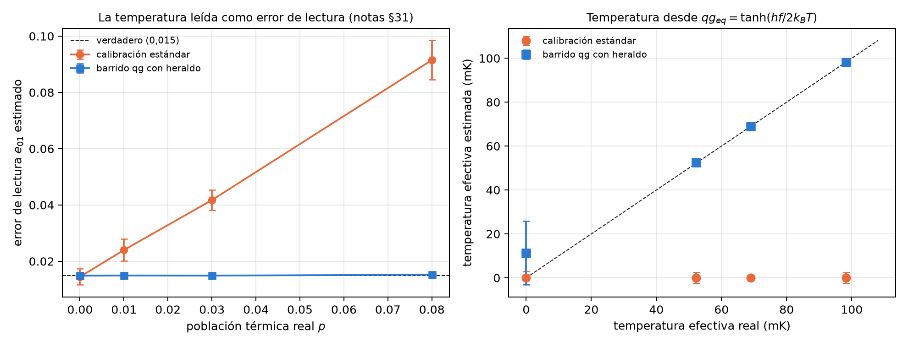

# Caracterización de hardware en qg {#sec-cap27}

Antes de correr cualquier algoritmo hay que saber cómo es el dispositivo: cuánto tarda en decaer (T1), cuánto en perder la
fase (T2), qué tan caliente está y cuánto se equivoca al leer. Este capítulo lee esas cantidades en la escala del capítulo
1. Cada una aparece como una lectura qg, y la escala ayuda en tres casos concretos: separar la temperatura del error de
lectura, distinguir T1 de ruido unital con la lectura media, y elegir la grilla con la que la electrónica fija los ángulos.
Los tres se recalculan con código. Los resultados en modelos de dispositivos IBM son los de las corridas registradas de las
notas.

## Desde la base: un qubit en reposo es una lectura {#sec-hw-base}

Un qubit real nunca está del todo frío: en reposo tiene una población excitada residual $p$, y su lectura de equilibrio
es $qg_{eq}=1-2p$, en m-qg $m_{eq}=1000(1-2p)$. Para un qubit de frecuencia $f$ en equilibrio térmico,

$$
qg_{eq}=\tanh\!\left(\frac{hf}{2k_BT_{\text{ef}}}\right),
$$

así que la lectura de equilibrio **es** un termómetro. La lectura del aparato también es afín en qg: si confunde 0→1 con
probabilidad $e_{01}$ y 1→0 con $e_{10}$, la lectura medida es $a+b\,qg$, con $a=e_{10}-e_{01}$ y $b=1-e_{01}-e_{10}$ (notas
§31). El problema es que en la base Z sólo se ve $a+b\,qg_{eq}$: la temperatura y el error de lectura quedan mezclados.

## T1, T2, temperatura y lectura en un solo barrido {#sec-hw-barrido}

La calibración estándar mide "$|0\rangle$" y "$|1\rangle$", que en realidad son el estado térmico y X aplicado a él, y cuenta
la población térmica como error de lectura. El protocolo qg agrega un heraldo: medir, aplicar I, X o $R_y(\pi/2)$, esperar y
medir de nuevo. Los pares a tiempo cero dan, en forma cerrada, la media $m$, la covarianza de lectura $V=b^2(1-qg_{eq}^2)$ y
$C_X=a^2-b^2$, de donde salen $a$, $b$ y $qg_{eq}$. Los retardos agregan T1 (después de X) y T2 (el decaimiento de $qg_X$). El
script repite el experimento de las notas con 40 repeticiones de 16 circuitos de 2000 disparos (T1 = 100 µs, T2 = 70 µs,
$e_{01}=0{,}015$, $e_{10}=0{,}04$, 5 GHz):

| población térmica real (temperatura) | $e_{01}$ estándar | $e_{01}$ qg | temperatura estándar | temperatura qg |
|---|---|---|---|---|
| 0 (0 mK) | 0,0145 | 0,0149 | 0 | $11\pm15$ mK (cota) |
| 0,01 (52 mK) | 0,0240 | **0,0149** | 0 | **$52{,}5\pm1{,}0$** |
| 0,03 (69 mK) | 0,0418 | **0,0149** | 0 | **$68{,}9\pm0{,}9$** |
| 0,08 (98 mK) | 0,0915 | **0,0153** | 0 | **$98{,}3\pm0{,}8$** |

: Calibración estándar contra barrido qg con heraldo (notas §31, recalculado). {#tbl-barrido27}

- **La calibración estándar lee la temperatura como error de lectura**: sobreestima $e_{01}$ exactamente en $p\cdot b$ y ve
  el qubit perfectamente frío a cualquier temperatura.
- **El barrido qg no tiene sesgo** en $e_{01}$, $e_{10}$, $p$ ni la temperatura, y la resuelve a 1 mK desde 52 mK (con $p=0$
  sólo da una cota).
- T1 y T2 salen sin sesgo en los dos, pero el ajuste conjunto qg es más preciso (desvío de T1 de 1,5–2,1 µs contra 2,8–3,1;
  de T2, 2,2–2,5 contra 3,1–4,8), en parte por el ajuste de máxima verosimilitud mismo.

**Como circuitos de IBM** (§86). Con 32 circuitos de un qubit con medición a mitad del circuito, en tres modelos de ruido de
dispositivos IBM, las tres predicciones registradas se cumplieron: T1 y T2 dentro de 25 % y errores de lectura dentro de
0,01. El T2 qg queda más cerca del reportado que el estándar, que sale 10 % alto en dos de ellos. Lo que un modelo simulado no
puede probar es justamente la población térmica (Aer no la tiene). La corrida real está pendiente y es la primera que
convendría hacer en hardware.

{#fig-caracterizacion27 width=100%}

## ¿Qué ruido es? La lectura media contra XEB y HOP {#sec-hw-ruido}

Con $N$ disparos de un circuito de volumen cuántico de 4 qubits, ¿se puede decidir si el ruido es disipativo (T1) o unital
(desfase o despolarizante)? Las notas (§18) lo plantearon con 24 circuitos, tres canales y 10 intensidades, y cada medida se
convierte en un clasificador con un único umbral ajustado en 16 circuitos y evaluado en 8 que no vio. XEB y HOP necesitan la
distribución ideal (una simulación clásica); la lectura media y $qg_S$ sólo conteos. El script lo recalcula:

| ruido por compuerta | disparos | lectura media | $qg_S$ | XEB | HOP |
|---|---|---|---|---|---|
| fuerte, 2–50 % | 100 | **0,88** | 0,72 | 0,70 | 0,71 |
| fuerte, 2–50 % | 1000 | **0,91** | 0,72 | 0,74 | 0,73 |
| fuerte, 2–50 % | 10 000 | **0,91** | 0,73 | 0,76 | 0,75 |
| débil, 0,5–5 % | 100 000 | 0,67 | 0,67 | 0,67 | 0,67 |

: Acierto en circuitos de prueba (0,67 = responder siempre «unital»). {#tbl-ruido27}

- **Con ruido fuerte, la lectura media identifica el T1** mucho mejor que las medidas estándar, con sólo 100 disparos y sin la
  distribución ideal: 0,88 con 100 disparos y 0,91 con 1000 o más. Su acierto crece con la intensidad (0,75 debajo de 10 %
  por compuerta, 0,98 arriba de 25 %). XEB y HOP miden cuánto ruido hay, no de qué tipo.
- **Con intensidades realistas, todo queda en el azar**, aun con 100 000 disparos. El límite no es el ruido de disparo: la
  lectura media ideal ya varía de circuito en circuito (desvío 0,139, de −0,325 a +0,334), más que el corrimiento del T1.

La consecuencia práctica: la lectura media es un detector de T1 en circuitos cuyo valor ideal se conoce, como una espera
antes de medir, no un detector pasivo sobre cualquier circuito.

## Errores coherentes y el ZZ siempre encendido {#sec-hw-zz}

Un error de fase condicional (un ZZ de más) conserva el peso, así que se podría esperar que pase el filtro de peso sin que lo
note. Las notas lo probaron dos veces con predicciones registradas, y las dos veces la predicción falló de una forma
informativa:

- **Un RZZ coherente después de cada compuerta nativa** (§145): la fracción conservada cayó 0,009–0,020 con $\varepsilon=0{,}10$
  rad, y el error filtrado creció sólo 4 % en los dispositivos con ECR pero 62 % en FakeTorino (CZ). El error actúa dentro de la
  descomposición de la compuerta lógica, donde los qubits no están en la base computacional, y parte sale del sector.
- **El ZZ siempre encendido entre vecinos** (§150, 5 y 15 kHz): el filtro quitó 32–60 % del error agregado; el error filtrado
  creció 14–38 % a 15 kHz y quedó 4–5 veces por debajo del crudo. Los circuitos cortos sufren menos.

En estos dispositivos los errores coherentes se filtran en proporción al tiempo que los qubits pasan fuera de la base
computacional.

## Cuantización del control: grilla pareja en el ángulo o en qg {#sec-hw-control}

La electrónica fija cada ángulo con una grilla de $2^b$ valores. Lo habitual es una grilla pareja en $\theta$; una grilla
pareja en $qg=\cos\theta$ es pareja en la probabilidad de Born y, sobre la esfera de Bloch, son bandas de igual área (notas
§17). El script lo recalcula:

- **Un qubit, objetivos al azar**: el peor error de probabilidad de la grilla qg es exactamente $\pi/2$ veces menor (1,568,
  1,570 y 1,570 con 4, 8 y 10 bits; ahorra $\log_2(\pi/2)\approx0{,}65$ bits). Pero su peor infidelidad es peor, por un factor
  que crece como $2^b$ (de 2,7·10⁻³ a 1,7·10⁻² con 4 bits), porque es gruesa cerca de los polos.
- **Cargar una distribución** con un árbol de rotaciones $R_y$ (el paso de preparación de Monte Carlo cuántico): en qg cada
  rotación se fija directamente con una probabilidad condicional, $qg=2p-1$. En los 45 casos (4, 6 y 8 qubits; 4, 6 y 8 bits;
  cinco distribuciones), la grilla qg baja la distancia de variación total en **43 de 45** (mediana 1,56 veces, hasta 2,9).
- Para distribuciones suaves la infidelidad también es menor con la grilla qg (25 de 27, mediana 1,98 veces); para las
  ralas o muy picudas gana la grilla en $\theta$ (15 de 18, mediana 3,3 veces, hasta 56).

**Regla de diseño**: grilla pareja en qg cuando la tarea es reproducir probabilidades (muestreo, Monte Carlo, distribuciones
suaves); grilla pareja en $\theta$ cuando importa la fidelidad del estado y los objetivos están cerca de los polos.

{#fig-ruido27 width=100%}

## Lo que queda pendiente {#sec-pendiente27}

El barrido con heraldo (§86, 32 circuitos de un qubit) está listo para un dispositivo IBM real y es lo que más conviene correr
primero: la población térmica, su punto central, no existe en los simuladores. La detección de T1 con intensidades realistas
necesita circuitos de valor ideal conocido.

## Sin qang y con qang {#sec-comparacion27}

| acción | sin qang | con qang | diferencia |
|---|---|---|---|
| calibrar la lectura | dos circuitos, "$|0\rangle$" y "$|1\rangle$": $e_{01}$ inflado en $p\,b$ | barrido con heraldo: sin sesgo | **a favor**; separar con mediciones repetidas es práctica conocida, qg agrega la forma cerrada |
| medir la temperatura | la calibración estándar ve 0 siempre | $T_{\text{ef}}$ desde $qg_{eq}$, a 1 mK | **a favor** |
| medir T1 y T2 | ajustes separados | ajuste conjunto qg: 1,5 veces más preciso | **a favor**, en parte por el ajuste conjunto |
| distinguir T1 de ruido unital | XEB o HOP, con simulación ideal: 0,70–0,76 | lectura media, sólo conteos: 0,88–0,91 | **a favor** con ruido fuerte; **ninguna** con ruido realista |
| prever errores coherentes ZZ | "el filtro no los ve" | el filtro quita 32–60 % del ZZ siempre encendido | **a favor**, aunque la predicción registrada falló |
| cuantizar el control | grilla pareja en $\theta$ | grilla pareja en qg: probabilidad $\pi/2$ veces mejor, 43 de 45 cargas mejores | **a favor** para probabilidades; **en contra** para fidelidad cerca de los polos |

: Las acciones del capítulo sin la escala qang y con ella. {#tbl-comparacion27}

**Balance.** Este es el capítulo donde la escala qang aporta más por sí misma, sin depender del filtro de peso: la lectura de
equilibrio es un termómetro, la lectura del aparato es afín en qg y se separa de la temperatura en forma cerrada, la lectura
media distingue disipación de ruido unital, y una grilla pareja en qg es la grilla correcta para probabilidades. Los límites
quedan escritos: con ruido realista la lectura media no clasifica circuitos arbitrarios, y la grilla qg pierde en fidelidad
cerca de los polos.

## En código {#sec-codigo27}

```python
import numpy as np

f = 5e9                                  # frecuencia del qubit (Hz)
h, kB = 6.62607015e-34, 1.380649e-23
p = 0.03                                 # población térmica residual
qg_eq = 1 - 2 * p                        # lectura de equilibrio: 940 m-qg
T_eff = h * f / (2 * kB * np.arctanh(qg_eq))
T_eff * 1e3                              # ~69 mK
```

## Resumen {#sec-resumen27}

- La lectura de equilibrio $qg_{eq}=\tanh(hf/2k_BT_{\text{ef}})$ es un termómetro, y la lectura del aparato es afín en qg.
- La calibración estándar cuenta la temperatura como error de lectura; el barrido con heraldo separa las dos cosas sin sesgo y
  mide la temperatura a 1 mK.
- La lectura media distingue T1 de ruido unital con 100 disparos cuando el ruido es fuerte (0,88 contra 0,70–0,72); con ruido
  realista nada lo logra sobre circuitos arbitrarios.
- Los errores ZZ coherentes no son invisibles al filtro: se filtran según el tiempo fuera de la base computacional.
- Una grilla pareja en qg mejora 43 de 45 cargas de distribuciones; una pareja en $\theta$ conviene para fidelidad cerca de
  los polos.
