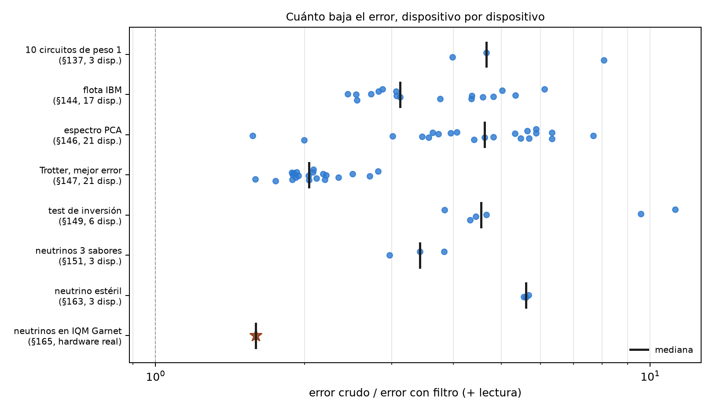
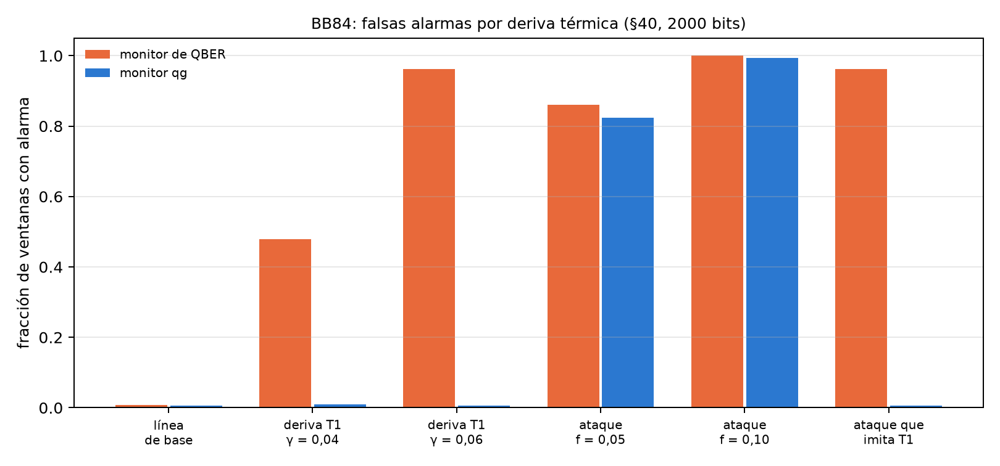

# Las ventajas empíricas confirmadas {#sec-cap29}

Después de veintiocho capítulos de comparaciones "sin qang y con qang", este junta las que dieron un beneficio medible,
con su tamaño, sus límites y de dónde viene cada cifra. El criterio para entrar es estricto: una ganancia medida en código o
en una corrida pre-registrada, contra la misma acción sin la escala o sin el filtro, y con el caso en que deja de valer
escrito al lado. Todos los factores se recalculan acá, dispositivo por dispositivo, desde los archivos guardados de las
corridas. No se vuelve a simular nada. Lo que no pasó el criterio va al capítulo 30.

## Desde la base: de dónde vienen las ventajas {#sec-ventajas-base}

Las ventajas del libro tienen dos orígenes, y conviene no mezclarlos:

- **El filtro de peso** (capítulos 20–25): si el circuito conserva el número de excitaciones, cada disparo con el peso
  equivocado tuvo un error y se descarta. Es verificación de simetría, una técnica conocida. La escala qang aporta el testigo
  (la lectura media del registro, cuyo valor ideal se sabe antes de correr) y la regla de cuándo conviene (capítulo 21).
- **La escala misma** (capítulos 18, 23, 26, 27): lecturas que separan cosas que la lectura cruda mezcla. La temperatura del
  error de lectura, el T1 del ruido unital, la deriva térmica de un ataque.

## Restauración exacta bajo T1 {#sec-ventajas-t1}

Con el mismo T1 en todos los qubits, el filtro devuelve exactamente la lectura sin ruido en cada sector (capítulo 21, verificado a
$10^{-12}$ m-qg). En clasificación, las notas (§80) lo midieron en 60 corridas pareadas (5 semillas, 3 particiones, 4 conjuntos de
datos), con predicciones registradas antes de correr:

- con el modelo de peso 1, entrenado sin ruido y leído bajo T1, qang recupera **+2,5 puntos** de precisión (intervalo de 95 %:
  +0,8 a +4,1), hasta la precisión exacta de 0,952;
- con el modelo de peso 2 recupera **+16,5 puntos** (+11,8 a +21,2), de 0,757 a 0,922;
- con desfase, +12,6 y +22,6 puntos;
- si se entrena con el ruido, la diferencia desaparece (+0,1 y −0,1 puntos): **la ventaja es no tener que entrenar con el
  ruido**, no una precisión mayor que la alcanzable.

Las cinco predicciones se cumplieron. Las cifras del índice ("+2,5 y +16,5 en 60 corridas") están en §80, tal cual.

## Menos error en las lecturas de dispositivos simulados {#sec-ventajas-filtro}

El script recalcula el factor de reducción del error (crudo sobre filtro más corrección de lectura) en cada dispositivo de cada
corrida guardada:

| estudio | dispositivos | mínimo | mediana | máximo |
|---|---|---|---|---|
| 10 circuitos de peso 1 (§137) | 3 | 3,99 | 4,66 | 8,07 |
| flota IBM (§144) | 17 | 2,45 | 3,12 | 6,11 |
| espectro PCA (§146) | 21 | 1,57 | 4,63 | 7,67 |
| Trotter XY, mejor error (§147) | 21 | 1,59 | 2,04 | 2,82 |
| test de inversión (§149) | 6 | 3,84 | 4,55 | 11,24 |
| neutrinos de 3 sabores (§151) | 3 | 2,97 | 3,43 | 3,83 |
| neutrino estéril (§163) | 3 | 5,55 | 5,61 | 5,68 |
| **neutrinos en IQM Garnet (§165, hardware real)** | 1 | — | **1,59** | — |

: Error crudo sobre error con filtro más lectura, recalculado de las corridas guardadas. {#tbl-factores29}

- **El filtro nunca empeoró el error** en ninguno de los 74 casos (un mismo dispositivo simulado aparece en varios estudios). Bajó entre 1,6 y 11 veces.
- **En hardware real ganó menos** (1,59 veces): el chip era mejor que su modelo simulado (error crudo 0,062 contra 0,126), así que
  menos disparos salían del sector. El error que queda está dentro del sector, donde el filtro no ve.
- La flota de IBM, tomando el mejor entre filtro solo y filtro más lectura, da 2,4 a 9,0 veces (las notas: 2,4–8,9). El rango
  "2,7–3,6×" que anunciaba el índice no está en las notas: las cifras son las de esta tabla. Para el clasificador de §85 las notas
  dan 2,9–3,6 veces en el error de la lectura, con la precisión igual (0,933) con y sin qang.

{#fig-factores29 width=100%}

## Errores dentro del sector: el eco {#sec-ventajas-eco}

Lo que el filtro no ve, el eco lo mide (capítulo 22). Con la red de peso 1 sobre 189 entradas y 1000 disparos, en cinco
dispositivos simulados, las decisiones distintas de la red sin ruido son **15 sin qang, 7 con el filtro y 3 con el filtro más el
eco**, sobre 945 lecturas (§106). El eco quita entre 43 y 56 % del error del valor de decisión que deja el filtro. No sirve con
entradas de margen estrecho, cuando el error filtrado ya está cerca de su ruido de disparo (§108).

## Caracterización y control {#sec-ventajas-hardware}

Estas ventajas son de la escala misma, sin filtro (capítulo 27):

- **Temperatura y lectura**: el barrido con heraldo mide el error de lectura sin sesgo y la temperatura efectiva a 1 mK, donde la
  calibración estándar infla el error en $p\cdot b$ y ve el qubit a 0 mK.
- **Diagnóstico del T1 sin simulación clásica**: la lectura media distingue T1 de ruido unital con 88 % de acierto con 100
  disparos y ruido fuerte, contra 70–76 % de XEB y HOP, que además necesitan la distribución ideal. Con ruido realista nada
  distingue los dos sobre circuitos arbitrarios.
- **Cuantización del control**: una grilla pareja en qg baja la distancia de variación total al cargar una distribución en 43 de
  45 casos (mediana 1,56 veces), y el peor error de probabilidad en un factor exacto $\pi/2$. Pierde en fidelidad cerca de los
  polos.

## Neutrinos: mitigación sin circuitos extra {#sec-ventajas-neutrinos}

Las oscilaciones de neutrinos en un circuito conservan el peso, así que el filtro se aplica sin agregar ningún circuito. Con tres
sabores (§151), el error baja 3,4 veces en la mediana de tres dispositivos simulados (el índice decía 3 veces); con un neutrino
estéril (§163), 5,6 veces, y la caída de supervivencia aparece en la energía correcta en los tres. **En IQM Garnet** (§165), con
hardware real, el filtro baja el error 1,59 veces y devuelve el máximo de oscilación a 2,6 GeV (exacto 2,63), donde la lectura
cruda lo ponía en 0,8 GeV. Es la única de estas ventajas confirmada en hardware.

## BB84: menos falsas alarmas ante la deriva térmica {#sec-ventajas-bb84}

En BB84, la suma $qg(0)+qg(1)$ de los estados enviados en Z es un testigo de T1: la relajación sólo produce errores 1→0, y un
ataque de interceptar y reenviar produce errores simétricos (notas §40, capítulo 17). Con ventanas de 2000 bits y 1 % de falsas
alarmas en la línea de base:

| escenario | monitor de QBER | monitor qg |
|---|---|---|
| línea de base | 0,007 | 0,006 |
| deriva T1, $\gamma$ 0,02 → 0,04 | 0,478 | **0,009** |
| deriva T1, $\gamma$ 0,02 → 0,06 | 0,962 | **0,006** |
| interceptar y reenviar, $f=0{,}05$ | 0,861 | 0,823 |
| interceptar y reenviar, $f=0{,}10$ | 1,000 | 0,994 |
| ataque que imita al T1 | **0,962** | 0,006 |

: Fracción de ventanas con alarma (notas §40, de la caché del capítulo 17). {#tbl-bb84-29}

El monitor qg detecta el ataque igual que el de QBER y **no salta cuando sólo empeora el T1 de la memoria**, donde el de QBER salta
en 48–96 % de las ventanas. El precio está escrito: un atacante que imita al T1 pasa inadvertido para el monitor qg y no para el de
QBER. Los dos son complementarios, y no hay ganancia de seguridad: la tasa de clave cae igual en los dos casos.

{#fig-bb84-29 width=100%}

## Lo que queda pendiente {#sec-pendiente29}

De todas estas ventajas, sólo la de neutrinos está confirmada en hardware real, una vez, con 300 disparos por circuito. Las que más
conviene llevar a un dispositivo son la caracterización con heraldo (la población térmica no existe en los simuladores) y el
filtro en un circuito de varias excitaciones.

## Sin qang y con qang {#sec-comparacion29}

| ventaja | sin qang | con qang | tamaño | dónde deja de valer |
|---|---|---|---|---|
| precisión bajo T1 sin reentrenar | 0,928 / 0,757 (pesos 1 / 2) | 0,952 / 0,922 | +2,5 / +16,5 puntos | con T1 desigual pierde ≤ 1 punto; entrenando con ruido, ninguna |
| error de las lecturas (simulado) | crudo | filtro + lectura | 1,6 a 11 veces, nunca peor | error dentro del sector |
| error en hardware real | 0,062 | 0,039 | 1,59 veces | chips mejores que su modelo ganan menos |
| decisiones de un clasificador | 15 de 945 distintas | 3 con filtro y eco | 5 veces menos | margen estrecho (§108) |
| lectura y temperatura | $e_{01}$ inflado, 0 mK | sin sesgo, a 1 mK | — | necesita medición a mitad de circuito |
| diagnóstico del T1 | 0,70–0,76 con simulación ideal | 0,88 sólo con conteos | +12–18 puntos | ruido realista: azar |
| cargar distribuciones | grilla en $\theta$ | grilla en qg | 43 de 45, mediana 1,56 veces | fidelidad cerca de los polos |
| alarmas en BB84 | 48–96 % de falsas alarmas por deriva | 0,6–0,9 % | — | un ataque que imita al T1 |

: Las ventajas confirmadas y sus límites. {#tbl-comparacion29}

**Balance.** Las ventajas son reales y medidas, pero de dos clases. Las del filtro son las más grandes (hasta 11 veces en
simulación) y pertenecen a la verificación de simetría, conocida; qang aporta el testigo y la regla. Las de la escala misma son más
chicas y más propias: separar temperatura de lectura, T1 de ruido unital y deriva de ataque. Sólo una ventaja pasó por hardware
real, y ahí ganó menos que en simulación. Esa es la cifra que hay que mirar primero.

## En código {#sec-codigo29}

```python
import json

d = json.load(open("examples/data/iqm_neutrino_qg_run.json"))
d["raw_error"] / d["filtered_error"]      # 1,59: el filtro en IQM Garnet, hardware real
d["kept"]                                 # 0,88 de los disparos conservados
```

## Resumen {#sec-resumen29}

- Bajo T1 igual, qang recupera la precisión sin ruido sin reentrenar: +2,5 puntos con peso 1 y +16,5 con peso 2 en 60 corridas.
- El filtro baja el error de las lecturas entre 1,6 y 11 veces en 74 casos de dispositivos simulados, sin empeorarlo nunca; en hardware real,
  1,59 veces.
- El eco lleva las decisiones erróneas de 15 a 3 sobre 945 lecturas.
- La escala misma separa temperatura de error de lectura, T1 de ruido unital y deriva térmica de un ataque en BB84.
- Cada ventaja tiene escrito dónde deja de valer; el capítulo 30 junta los resultados negativos.
