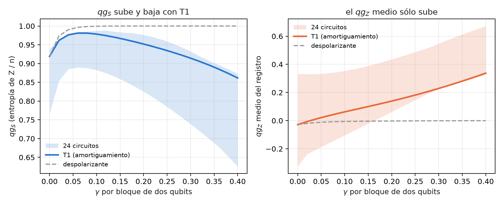
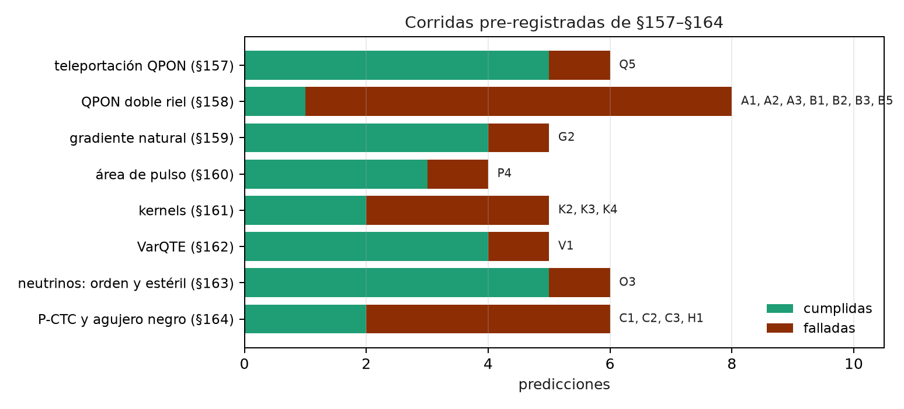

# Límites estructurales, equivalencias y resultados negativos {#sec-cap30}

El capítulo 29 juntó lo que dio un beneficio medible. Este junta lo que no: los puntos ciegos que vienen de la definición
misma de la escala, las equivalencias que se presentaron como ventajas y las predicciones que fallaron. Un límite entra si se
puede mostrar en código o si está en una corrida guardada, con la misma acción sin qang al lado. Las comprobaciones nuevas
están en `tools/make_cap30_figures.py`; el resto se cita de las notas y de los capítulos donde se midió.

## Desde la base: qué no puede ver la escala {#sec-limites-base}

La ecuación del capítulo 1 hace de qg una función de una sola probabilidad, $p_0$, medida en la base Z. De ahí salen dos
clases de límites:

- **Lo que vive fuera de las poblaciones en Z.** Las fases relativas y las coherencias no cambian $p_0$, así que ninguna
  lectura qg de la base Z las ve. Sólo se ven midiendo en otra base, y entonces ya no es la lectura qg de la base Z.
- **Lo que el filtro no alcanza.** El filtro descarta disparos fuera del sector de peso correcto. Un error que deja el disparo
  en el sector, o un circuito que no conserva el peso, quedan fuera de su alcance.

Ninguno es un defecto de implementación: son consecuencias de la definición.

## Estados de grafo: entrelazamiento invisible en Z {#sec-limites-grafo}

Un estado de grafo es $H^{\otimes n}$ seguido de una CZ por arista. La CZ es diagonal, así que sólo cambia fases: todas las
poblaciones en Z quedan en $2^{-n}$. El script lo comprueba con el anillo de 6 qubits:

- su distribución en Z coincide con la de $|+\rangle^{\otimes 6}$, que no tiene entrelazamiento, con diferencia **exactamente 0**;
- por eso $qg_Z = 0$ en cada qubit, $qg_S = 1$ y la correlación qg es 0 en los dos estados;
- los estabilizadores $X_i Z_{i-1} Z_{i+1}$ valen **1** en el estado de grafo y **0** en el producto. Distinguen los dos estados,
  pero se miden en la base X.

Sin qang pasa lo mismo: cualquier estadística de la base Z, cruda o tomográfica, es ciega a este entrelazamiento. qang hereda el
límite, no lo crea (notas §8.1). El desfase en la lectura es el mismo punto ciego visto desde el lado del ruido (§10.4).

## $qg_S$ no es monótona bajo T1 {#sec-limites-qgs}

Con ruido despolarizante, $qg_S$ (la entropía de la distribución en Z dividida por $n$) sube hacia 1 a medida que el ruido
crece, así que sirve para ordenar dispositivos. Con amortiguamiento (T1) no: primero sube, porque el ruido mezcla, y después
baja, porque el T1 empuja todo a $|0\ldots0\rangle$, que tiene entropía 0.

El script corre 24 circuitos de volumen cuántico de 4 qubits con amortiguamiento en cada qubit después de cada bloque de dos
qubits, con matrices densidad exactas:

- **$qg_S$ sube y baja en los 24.** En el circuito 0 empieza en 0,919, llega a 0,981 con $\gamma=0{,}06$ y vuelve a 0,923 con
  $\gamma=0{,}28$. Sola, no distingue un dispositivo casi sin ruido de uno con mucho T1.
- **El par ($qg_S$, $qg_Z$ medio) sí los distingue.** En esos dos puntos el $qg_Z$ medio vale −0,029 y +0,209. El T1 empuja
  el $qg_Z$ medio hacia +1 y el ruido despolarizante lo deja en 0 (va de −0,029 a 0,000).
- **El arreglo no es un teorema.** En este modelo el $qg_Z$ medio crece de forma monótona en 21 de los 24 circuitos. Las
  notas, con su modelo de T1 a mitad de circuito, lo encontraron en 23 de 24 (§10.4 D). En los demás tiene escalones
  pequeños hacia abajo.

{#fig-t1-30 width=100%}

## La equivalencia del gradiente natural {#sec-limites-qng}

El capítulo 23 lo midió y acá queda escrito como límite. Cambiar de coordenada no acelera un optimizador. El gradiente natural
escrito en qg es el descenso común en $\theta$, salvo términos de orden $\eta^2$ (notas §15.1). Las afirmaciones de que
"converge en qg donde $\theta$ no converge" venían de recortar $\theta$ a $[0,\pi]$. Eso esconde los mínimos con $\theta<0$, y
sin el recorte el descenso en $\theta$ converge.

En la corrida pre-registrada de §159, con 20 semillas del modelo de Ising de 4 qubits:

- el descenso en $\theta$ llegó en 103 pasos (mediana);
- el descenso en qg no llegó nunca;
- el gradiente natural con la métrica completa, en 22,5 pasos.

Esa ganancia es del gradiente natural y no de qang: la métrica completa no se lee en qg. La versión que sí se lee de
correladores qg (bloques $qg_{YY}$) tardó 79,5 pasos. Mejoró 1,3 veces sobre $\theta$, no las 1,5 que se habían predicho
(G2 falló).

## El filtro no alcanza los circuitos profundos {#sec-limites-profundos}

En el capítulo 25 el filtro de número de electrones bajó tres veces el error de H₂ y no le hizo nada a LiH. Las notas (§50)
separaron las causas, y la principal resultó ser el **alcance**: el filtro actúa sobre los disparos medidos en Z, y en LiH el
error está en los grupos medidos en X e Y.

| caso | compuertas de 2 qubits | error en el grupo Z, crudo → filtrado | grupos X/Y | total crudo → con filtro (mHa) |
|---|---|---|---|---|
| H₂, todos con todos | 3 | 13,0 → 4,9 | 0,9 | 13,9 → 5,9 |
| LiH, todos con todos, 1 capa | 20 | −2,2 → −1,9 | 26,2 | 24,0 → 24,3 |
| LiH, todos con todos, 3 capas | 60 | −20,8 → −12,4 | 97,4 | 76,6 → 85,0 |
| LiH, heavy-hex, 3 capas | 60 | −30,5 → −18,0 | 165,8 | 135,3 → 147,9 |

: Error de energía con lectura corregida y 200 000 disparos (notas §50). {#tbl-lih30}

- **No es el enrutamiento.** El ansatz de LiH es de primeros vecinos y necesita las mismas 60 compuertas sin enrutar.
- **El remedio qg para los grupos X/Y falla.** Reescalarlos con la fuerza despolarizante que se lee de la fracción conservada
  corrige de más, entre 2 y 3 veces (de +97 a −124 mHa). El ruido local de compuerta no es despolarizante global.
- **Hubbard llega a la misma pared** (§29). En fake_brisbane, desde 4 pasos de Trotter (188 ECR o más, 18 % de los disparos
  conservados), todos los métodos quedan en el piso de ruido: la doble ocupación tiende a 1/4 y el desbalance de carga a 0.

Con moléculas más grandes, los grupos X/Y son cada vez más y cargan la mayor parte de la energía de correlación. Un filtro en Z
alcanza una parte cada vez menor del error.

## La red de peso 1 es clásica {#sec-limites-qnn}

El filtro protege exactamente del T1 a una red neuronal cuántica que conserva el peso (capítulo 20). El mismo motivo la hace
simulable. En el sector de peso 1 la red es una matriz ortogonal $O$ que actúa sobre los datos cargados $v$, y cada lectura
vale $qg_Z^{(i)} = 1 - 2\,(Ov)_i^2$. Es una **forma cuadrática** en $v$ que se calcula en $O(n^2)$ (notas §76, F2). El script lo
comprueba en circuitos de 5 qubits, con cargador unario y red RBS al azar: el error máximo es $7{,}8\cdot10^{-16}$.

- §75: el mejor modelo clásico iguala o supera a la mejor red cuántica en los cuatro conjuntos de datos (en dígitos, SVM con
  núcleo RBF 0,963 contra 0,933). No hay ventaja cuántica.
- §76: la predicción Q3 decía que la red no superaría a su gemelo cuadrático por más de 1 punto, y falló, pero por la línea de
  base. El gemelo usaba la regularización por defecto. Corrido después del resultado con $C=100$, queda a entre 0,3 y 1,6
  puntos de la red.
- Con peso 2 la salida es de cuarto grado y deja de ser trivial. Aun así, el techo de la codificación se acota con una forma
  cuadrática sobre los productos de amplitudes (§87).

El filtro aporta robustez a redes chicas en hardware ruidoso. No aporta supremacía.

## Dónde el filtro no se aplica: fases y cifrado clásico {#sec-limites-fase}

El filtro exige que cada compuerta conserve el peso de Hamming. El analizador de qang (`qang.ibm.WeightPreservationCheck`) lo
decide compuerta por compuerta antes de correr:

| circuito | ¿conserva el peso? | compuertas que lo rompen |
|---|---|---|
| QFT de 4 qubits | no | 4 |
| QPE de la compuerta T, 3 qubits de conteo | no | 6 |
| GHZ de 4 qubits | no | 4 |
| volumen cuántico de 4 qubits | no | 8 |
| neutrinos de 3 sabores (capítulo 9) | sí | 0 |
| cargador unario + red RBS | sí | 0 |

: Lo que decide el analizador de qang. {#tbl-alcance30}

La estimación de fase y todo lo que se apoya en ella (Shor, HHL) empieza con Hadamards, que mezclan todos los pesos. Ahí la
escala aporta una lectura cerrada de la fase, $qg_\Phi = e^{i2\pi\varphi}$, invertible en todo su dominio (notas §13). Esa lectura
es la que QPE calcula con un circuito, pero no reduce el error de QPE. La criptografía post-cuántica (capítulo 16) es aritmética
clásica: no hay qubits ni operadores, así que qang no tiene nada que leer.

## Las predicciones falladas de §157–§164 {#sec-limites-fallos}

En las ocho corridas pre-registradas de §157–§164 se cumplieron **26 de 45 predicciones**, según los veredictos que guardó el
código. Las 19 falladas:

- **Teleportación por red óptica pasiva** (§157, Q5): 5 de 24 casos lejos del óptimo, todos donde la fidelidad ideal es 1
  (medida entre 0,897 y 0,957). El circuito no conserva el peso, así que el único filtro es el anuncio de pérdida.
- **Doble riel** (§158, siete falladas): la fidelidad que se lee de tres correladores predice la de la teleportación con
  diferencias de 0,029 o menos, pero no la descompone (A1–A3). Los anuncios falsos ponen un piso (B1, B2, B5).
- **Gradiente natural** (§159, G2): 1,3 veces contra las 1,5 predichas.
- **Área de pulso** (§160, P4): la vuelta de período $\pi$ de RZZ ahorra 1,14 veces en error contra las 1,5 predichas.
- **Kernels** (§161, K2–K4): la precisión casi no cambia con la reparación y la alineación con el objetivo no ve el
  encogimiento; K4 falló por sus umbrales, no por su dirección.
- **VarQTE** (§162, V1): el ansatz no es lo bastante expresivo a tiempos largos (fidelidad sin ruido 0,934 en $t=2$).
- **Neutrinos** (§163, O3): los valores filtrados quedan entre 0,010 y 0,033 por encima, por el error dentro del sector.
- **Bucles temporales y agujeros negros** (§164, cuatro falladas). En FakeTorino la paradoja no se suprime del todo: el éxito
  en $\varphi=\pi$ es 0,056 donde la predicción pedía cerca de 0 (C2), y la rotación controlada da 0,600 donde el valor exacto es
  1 (C3). El decodificador funcionó en los tres dispositivos (H2, H3); H1 falló por 0,001.

{#fig-fallos30 width=100%}

## Lista consolidada de limitaciones {#sec-limites-lista}

La lista de las notas (§14), con lo que agregó el libro:

1. **Singularidad del jacobiano** en $\theta\in\{0,\pi\}$: regularizarla cuesta exactitud cerca de los polos (capítulo 23).
2. **Trampa del rango de arccos**: las actualizaciones en qg no llegan a $\theta<0$; en H₂ pierden toda la energía de
   correlación (§8.2).
3. **Ceguera a la base Z**: el entrelazamiento de los estados de grafo y el desfase en la lectura son invisibles para $qg_Z$,
   $qg_S$ y la correlación qg.
4. **La correlación qg no mide entrelazamiento**: es positiva en mezclas clásicas y vale 0 en estados de grafo (§7.2).
5. **$qg_S$ no es monótona bajo T1**: hay que leerla junto con el $qg_Z$ medio, y ese par es monótono en 21 a 23 de 24
   circuitos, no en todos.
6. **Sesgo de $qg_S$ con disparos finitos**: se corrige con Miller–Madow (§10.2).
7. **El amortiguado en los polos** cuesta entre 3 y 20 veces más iteraciones cuando el óptimo está en un polo (§9).
8. **Ninguna ventaja de velocidad ni de energía**: qg no cambia cuántos disparos pide una precisión dada (§14, punto 9; §15.3).
9. **Alcance del filtro**: sólo actúa en circuitos que conservan el peso y sobre lo medido en Z; no ve el error dentro del sector.
10. **Las redes que admiten el filtro son simulables** en peso 1.
11. **En hardware real el filtro ganó menos que en simulación** (1,59 veces contra 2,2 en el modelo de IQM, capítulo 31).

## Sin qang y con qang {#sec-comparacion30}

| límite | sin qang | con qang | diferencia |
|---|---|---|---|
| estados de grafo | lectura en Z ciega | $qg_Z=0$, $qg_S=1$, igual que el producto | ninguna: el límite es de la base Z |
| T1 contra ruido unital | entropía en Z, no monótona | par ($qg_S$, $qg_Z$ medio) | separa los dos casos en 21–23 de 24 circuitos |
| optimización | descenso en $\theta$, 103 pasos | gradiente natural en qg = descenso en $\theta$ | ninguna aceleración propia |
| LiH, 60 compuertas | 76,6 mHa | 85,0 mHa con filtro | el filtro empeora: el error está en X/Y |
| red de peso 1 | modelos clásicos | forma cuadrática exacta | no hay ventaja cuántica |
| QPE, Shor, HHL | estimación de fase | $qg_\Phi$ cerrada, filtro inaplicable | lectura nueva, sin mitigación |
| §157–§164 | — | 26 de 45 predicciones | 19 falladas, publicadas |

: Los límites, con y sin la escala. {#tbl-comparacion30}

**Balance.** Casi todos los límites tienen la misma raíz: qg lee una probabilidad de la base Z, y lo que no está en esa
probabilidad no lo ve. Los resultados negativos no se esconden: 19 de las 45 predicciones de §157–§164 fallaron y quedan
escritas. Varias "ventajas" que se ofrecían como propias de qang (el gradiente natural, la supremacía de la red de peso 1)
resultaron ser equivalencias.

## En código {#sec-codigo30}

```python
import math
from qiskit.transpiler import PassManager
from qang import ibm, neutrino as nu

pm = PassManager([ibm.WeightPreservationCheck()])
pm.run(nu.three_flavour_circuit("mu", 1300.0, 2.6, -math.pi / 2))
pm.property_set["qg_weight_preserving"]      # True: el filtro se aplica
```

## Resumen {#sec-resumen30}

- El entrelazamiento de un estado de grafo es invisible en Z: su distribución coincide exactamente con la de $|+\rangle^{\otimes n}$.
- $qg_S$ sube y baja bajo T1 en los 24 circuitos probados; el par con el $qg_Z$ medio los separa, sin ser un teorema.
- El gradiente natural en qg es descenso en $\theta$: cambiar de coordenada no acelera.
- En LiH el error está en los grupos X/Y, fuera del alcance del filtro; Hubbard choca con la misma pared desde 4 pasos.
- La red de peso 1 que el filtro protege es una forma cuadrática clásica.
- En las corridas de §157–§164 fallaron 19 de 45 predicciones.

## Notas bibliográficas {.unnumbered}

Los estados de grafo son @hein2004; el volumen cuántico, @cross2019. La equivalencia del gradiente natural es con
@stokes2020, y la simulabilidad clásica de los modelos sin mesetas, @cerezo2023. QFT y QPE siguen @nielsen2010. Las
notas de investigación numeradas (§) que cita el capítulo y los scripts que lo verifican están en el repositorio
[@qangrepo]; la definición de la unidad qang, en @monteverde2026.
