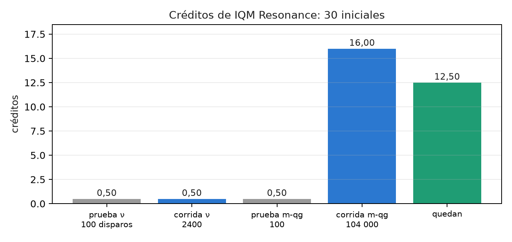
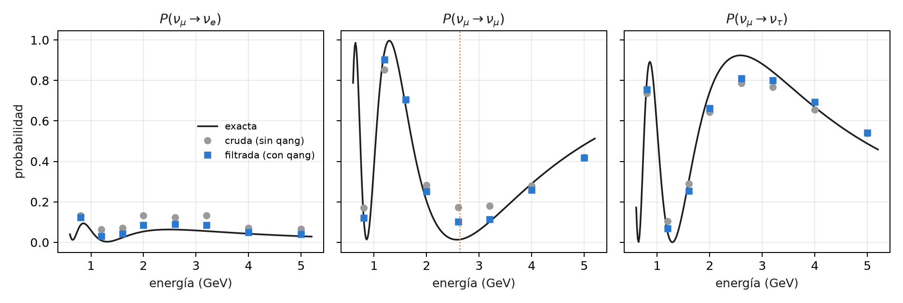

# Primer experimento en hardware real: IQM Resonance {#sec-cap31}

Hasta acá, casi todo el libro se midió en simuladores con modelos de ruido de dispositivos. Este capítulo cuenta cómo se llevó
qang a un chip superconductor real, Garnet de IQM (20 qubits), con créditos de prueba: por qué ese equipo, cómo se ensayó
gratis, cuánto costó y qué salió. Las cifras se recalculan de los archivos guardados de las corridas con
`tools/make_cap31_figures.py`. No se envía nada a IQM y no hace falta `iqm-client` para verificarlas.

## Desde la base: qué se lleva al chip {#sec-iqm-base}

La lectura de un qubit real es la misma del capítulo 1: se cuentan ceros y unos, y $qg_Z = 2p_0 - 1$. Lo que cambia es todo
lo que rodea esa cuenta: el circuito se compila a las compuertas nativas del chip, la lectura tiene errores propios y cada
disparo cuesta créditos. qang aporta tres cosas, todas en el posprocesamiento:

- el **filtro de peso**, si el circuito lo conserva;
- el **testigo** que dice cuánto quitó el filtro (la fracción conservada);
- la **lectura en m-qg**, donde una diferencia de probabilidad de 0,0005 es 1 m-qg.

## Por qué IQM, y qué cuesta compilar {#sec-iqm-por-que}

Garnet tiene compuertas nativas PRX (una rotación de un qubit, `r` en Qiskit) y CZ, sobre una red cuadrada. El experimento
elegido (neutrinos de tres sabores) usa compuertas XX+YY, que conservan el peso. El script compila en una línea de tres qubits
a los tres juegos nativos:

| juego nativo | RBS | XX+YY | circuito de neutrinos, nivel 1 | nivel 3 |
|---|---|---|---|---|
| IQM (r, cz) | 2 | 2 | 18 | 12 |
| IBM Heron (cz, rz, sx, x) | 2 | 2 | 18 | 12 |
| IBM Eagle (ecr, rz, sx, x) | 2 | 2 | 18 | 12 |

: Compuertas de dos qubits después de compilar (`seed_transpiler` 137). {#tbl-compilar31}

Las notas (§165) contaban 12 CZ en IQM contra 18 compuertas de dos qubits en IBM. **La diferencia no es del chip**: el ensayo de
IQM se compiló con el nivel de optimización 3 y las corridas de IBM de §151 con el nivel 1. Con el mismo nivel, los tres juegos
dan lo mismo: las seis XX+YY del circuito cuestan dos compuertas de dos qubits cada una. IQM se eligió por los créditos
disponibles, no por una compilación más barata.

## El módulo que todavía no existe {#sec-iqm-modulo}

El índice anunciaba un módulo `qang/iqm.py`, análogo a `qang/ibm.py`. **No existe.** Todo lo que se usó en IQM está en los
scripts `examples/iqm_neutrino_qg.py` y `examples/iqm_milliqang_qg.py`, que leen los conteos con `qang.interop`:

- `canonical_counts` pone los bits en el orden de qang;
- `qg_z_profile` da el $qg_Z$ de cada qubit, y `filtered_qg_z_profile`, el mismo valor sobre los disparos del sector;
- `weight_filter` da la fracción conservada.

Lo que tiene `qang.ibm` y falta para IQM:

- **corrección de lectura con la calibración.** En §165 no hubo corrección: los modelos simulados de IQM no dan los errores de
  lectura en la forma que usa `qang.ibm`. En §168 se midieron directamente con los dos polos: $e_0 = 0{,}0055$ y $e_1 = 0{,}029$;
- **elección de la cadena de qubits** (`best_chain` en IBM). En IQM se usó la disposición por defecto.

Queda como propuesta para la versión siguiente de la biblioteca.

## Ensayo gratis antes de gastar {#sec-iqm-ensayo}

IQM publica modelos simulados de sus chips. El circuito de neutrinos se corrió primero ahí, con 4000 disparos y 8 energías
(docstring de `examples/iqm_neutrino_qg.py`):

| modelo | parecido a | error crudo | error filtrado | factor | conservado |
|---|---|---|---|---|---|
| IQMFakeApollo | Garnet | 0,1263 | 0,0584 | 2,16 | 0,688 |
| IQMFakeAphrodite | Emerald | 0,1161 | 0,0515 | 2,25 | 0,708 |

: Ensayo en los modelos simulados de IQM (2026-10-20). {#tbl-ensayo31}

El ensayo del milli-qang (§168) también pasó sus cuatro predicciones en los dos modelos antes de correr en el chip.

## El presupuesto: lo planeado y lo gastado {#sec-iqm-presupuesto}

La cuenta empezó con 30 créditos. El plan era gastar un 10 % en pruebas, un 60 % en el experimento principal y guardar un 30 %
de reserva. El token se lee sólo de la variable de entorno `IQM_TOKEN`, y ningún script gasta créditos sin la bandera
`--yes-i-accept-qpu-cost`.

| paso | disparos | créditos | saldo |
|---|---|---|---|
| prueba de neutrinos | 100 | 0,50 | 29,50 |
| corrida de neutrinos | 2400 | 0,50 | 29,00 |
| prueba del milli-qang | 100 | 0,50 | 28,50 |
| corrida del milli-qang | 104 000 | 16,00 | 12,50 |

: Créditos de IQM Resonance. El costo de la corrida de neutrinos no está escrito: es la diferencia entre dos saldos. {#tbl-creditos31}

- **Gastado:** pruebas, 3,3 %; corridas, 55,0 %; quedan 12,50 créditos (41,7 %). El plan se cumplió con margen.
- **El modelo de costo se corrigió con datos.** La primera estimación, 0,50 créditos por trabajo, venía de trabajos chicos y
  estaba mal. El costo crece con los disparos (unos 0,15 créditos cada 1000) y tiene un piso de unos 0,50 por trabajo.

{#fig-creditos31 width=85%}

## El experimento principal: neutrinos de tres sabores {#sec-iqm-neutrinos}

Es el circuito del capítulo 9 (§151): un $\nu_\mu$ inicial, 1300 km de base, $\delta_{CP}=-\pi/2$, ocho energías entre 0,8 y
5 GeV, y los tres sabores leídos a la vez. Tiene 3 qubits, 12 CZ y todas sus compuertas conservan el peso. El script quedó
congelado (sha256 b320f51f en `examples/data/iqm_neutrino_qg.prereg`, commit a74c07c) antes de enviar ningún trabajo, con
cuatro predicciones:

| predicción | resultado |
|---|---|
| I1: el error filtrado queda por debajo del crudo | 0,0386 < 0,0615 |
| I2: el cociente crudo / filtrado es al menos 1,5 | 1,59 (por poco) |
| I3: la supervivencia filtrada tiene su mínimo en 2,6 GeV | sí; **la cruda, en 0,8 GeV** |
| I4: se conserva al menos la mitad de los disparos | 0,880 |

: Trabajo 01a15b04, Garnet, 8 circuitos × 300 disparos, 2026-10-20. Las cuatro se cumplieron. {#tbl-neutrinos31}

El script recalcula todo desde el archivo guardado:

- **Por sabor**, el filtro baja el error de $\nu_e$ de 0,054 a 0,023 y el de $\nu_\mu$ de 0,069 a 0,041. El de $\nu_\tau$ casi no
  cambia (0,062 → 0,052).
- **El máximo de oscilación vuelve a su lugar.** Sin filtro, la supervivencia más baja se lee en 0,8 GeV. Con filtro se lee en
  2,6 GeV, y el máximo exacto está en 2,63.
- **Lo que queda está dentro del sector.** En 2,6 GeV la supervivencia exacta es 0,013, la cruda 0,173 y la filtrada 0,101. El
  filtro no ve ese error (capítulo 22).

{#fig-neutrinos31 width=100%}

## Lo que vino después, y lo que queda {#sec-iqm-siguientes}

- **El milli-qang en Garnet** (§168, capítulo 28) usó la mayor parte de los créditos. Se cumplieron 3 de 4 predicciones: una X
  cuesta 1,64 m-qg y el costo crece en línea recta con el número de compuertas. La dispersión de las copias en el ecuador fue la
  mitad de la esperada (M2 falló), y eso sigue abierto.
- **La réplica en cinco qubits y dos días** está preparada en `examples/iqm_milliqang_replication_qg.py`, todavía sin
  pre-registrar ni correr. A tamaño completo (130 circuitos × 4000 disparos por día) costaría unos 80 créditos por día, mucho
  más de lo que queda: hay que achicarla antes de usarla.
- **Los candidatos del índice** siguen pendientes: la P-CTC con un qubit (§164), el decodificador de Yoshida–Kitaev (8 qubits
  y 90 compuertas de dos qubits en los modelos de IBM, probablemente demasiado profundo) y H₂ (§20, §128). La corrida de H₂ en
  IonQ fue rechazada antes de aceptar ningún trabajo y no se cobró nada.

Con 12,50 créditos y unos 0,15 cada 1000 disparos quedan unos 80 000 disparos, menos los pisos por trabajo.

## Resultado: aciertos, fallos y comparación con la simulación {#sec-iqm-resultado}

| | modelos de IBM (§151) | modelo de IQM (ensayo) | Garnet (real) |
|---|---|---|---|
| error crudo | — | 0,126 | **0,062** |
| factor del filtro | 2,97–3,83 | 2,16 | **1,59** |
| disparos conservados | — | 0,688 | 0,880 |

: El mismo circuito en simulación y en el chip. {#tbl-resultado31}

**El chip fue mejor que su modelo**: tuvo la mitad de error crudo, y por eso salieron menos disparos del sector y el filtro tuvo
menos para quitar. Es la regla del capítulo 21 vista en hardware: el filtro rinde en proporción al ruido que saca del sector.
Una sola corrida, un día, 300 disparos por circuito: no hay afirmación sobre la estabilidad.

## Sin qang y con qang {#sec-comparacion31}

| acción | sin qang | con qang | diferencia |
|---|---|---|---|
| error medio de las probabilidades | 0,0615 | 0,0386 | 1,59 veces menos |
| energía del máximo de oscilación | 0,8 GeV | 2,6 GeV (exacta 2,63) | el filtro corrige la física que se lee |
| error de $\nu_\tau$ | 0,062 | 0,052 | casi nada: es error dentro del sector |
| costo | 2400 disparos, 0,50 créditos | los mismos disparos | ninguno: el filtro es posprocesamiento |
| disparos útiles | 2400 | 2113 (88 %) | se descarta un 12 % |
| compilación | 12 compuertas de dos qubits | 12 | ninguna: depende del nivel de optimización |

: La corrida en Garnet, con y sin la escala. {#tbl-comparacion31}

**Balance.** El primer dato en hardware real confirma lo que la simulación decía, con un efecto más chico: 1,59 veces contra
2,2 en el modelo de IQM y entre 3 y 3,8 en los de IBM. El filtro no cuesta disparos extra y pone la oscilación en la energía
correcta. Dos cosas del plan original no se sostuvieron: el módulo `qang/iqm.py` no se escribió, y la ventaja de compilación de
IQM era un artefacto del nivel de optimización.

## En código {#sec-codigo31}

```python
import json
import numpy as np

d = json.load(open("examples/data/iqm_neutrino_qg_run.json"))
raw, fil, ex = (np.array(d[k]) for k in ("raw", "filtered", "exact"))
np.abs(raw - ex).mean(), np.abs(fil - ex).mean()   # 0,0615 y 0,0386
d["energies"][int(np.argmin(fil[:, 1]))]           # 2,6 GeV: el máximo de oscilación
```

## Resumen {#sec-resumen31}

- En Garnet, con hardware real, el filtro bajó el error 1,59 veces y llevó el máximo de oscilación de 0,8 a 2,6 GeV
  (exacto 2,63). Las cuatro predicciones pre-registradas se cumplieron.
- El chip fue mejor que su modelo simulado, y el filtro ganó menos (1,59 veces contra 2,16).
- La ventaja de compilación de IQM (12 contra 18) era del nivel de optimización: con el mismo nivel, IBM también da 12.
- Se gastaron 17,50 de 30 créditos, a unos 0,15 cada 1000 disparos con un piso de 0,50 por trabajo.
- El módulo `qang/iqm.py` no existe todavía: la corrección de lectura y la elección de qubits para IQM quedan pendientes.
