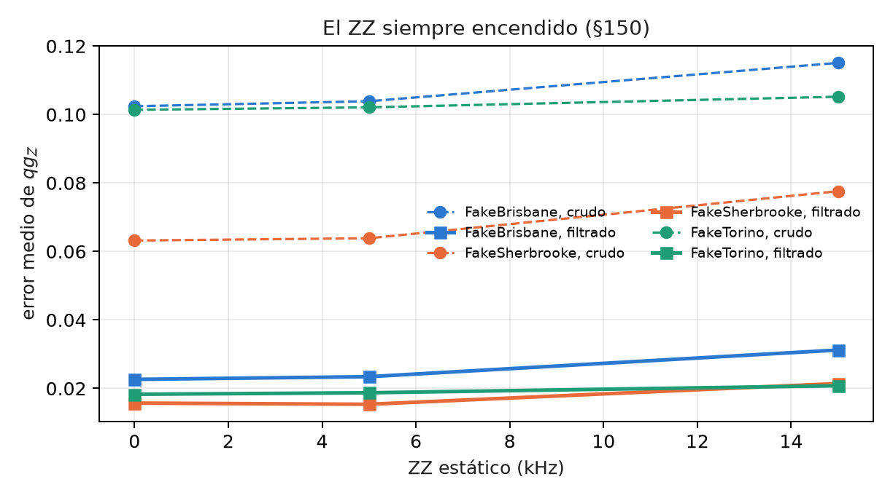
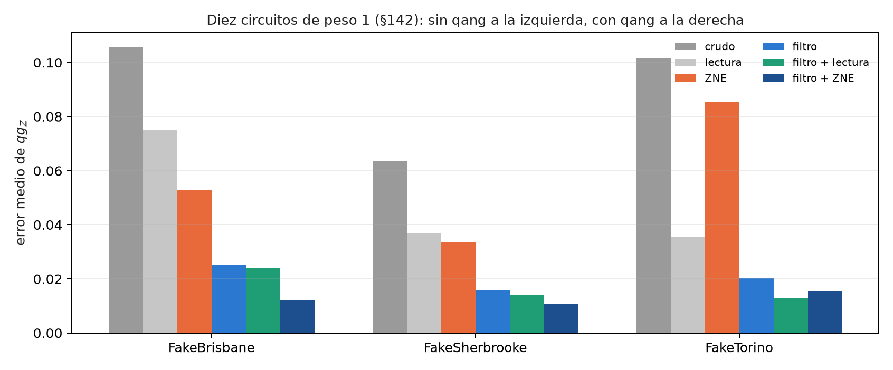

# Arquitectura de software, ecosistema multi-SDK y ejecución física {#sec-cap32}

Una lectura qg sólo sirve si llega bien desde el dispositivo hasta el número que se reporta. En el medio hay un SDK que ordena
los bits a su manera, primitivas que devuelven valores esperados en vez de conteos, un compilador que elige qubits y un chip
con errores que ningún filtro ve. Este capítulo recorre esa cadena tal como la resolvió la biblioteca. Las comprobaciones
nuevas y el recálculo de las corridas de IBM guardadas están en `tools/make_cap32_figures.py`.

## Desde la base: una cuenta, muchos caminos {#sec-software-base}

La ecuación del capítulo 1 necesita una sola cosa: cuántos ceros salieron en cada qubit. Todo lo demás es plomería, y cada
caño puede romper la lectura sin que se note:

- un SDK que escribe el qubit 0 a la derecha y otro que lo escribe a la izquierda **intercambian los qubits** sin dar error;
- una primitiva que devuelve $\langle Z_i\rangle$ ya da $qg_Z$, pero **no da los disparos** que el filtro necesita descartar;
- un compilador que elige qubits malos **baja la fracción conservada** antes de medir nada.

## Un solo orden de qubits {#sec-software-orden}

Qiskit escribe el qubit 0 a la derecha de la cadena de bits; Cirq, PennyLane, Braket y pytket lo escriben primero.
`qang.interop.canonical_counts` lleva todo a $\{(b_0,\ldots,b_{n-1}):\text{cuenta}\}$, con el qubit 0 primero. El script lo
comprueba con los dos SDK instalados acá:

- el mismo resultado (sólo el qubit 0 excitado) escrito `001` por Qiskit y `100` por PennyLane da **(1, 0, 0)** en los dos;
- un estado W de 3 qubits muestreado 20 000 veces en cada SDK da $qg_Z$ entre 0,328 y 0,343 (ideal 1/3), todos los disparos
  en peso 1 y $qg_S$ del registro 0,528 (ideal $\log_2 3/3 = 0{,}528$), igual en Qiskit y en PennyLane.

Cirq, Braket y pytket no están instalados en esta máquina. Su orden está fijado en los tests de la biblioteca (notas §130) y
no se volvió a correr.

## Primitivas V2 y observables filtrados {#sec-software-primitivas}

Las primitivas V2 de Qiskit vienen en dos formas, y qang lee las dos (notas §131):

- **Sampler.** `interop.sampler_qg` toma el resultado de un SamplerV2 y da el $qg_Z$ de cada qubit, con su error, para todos
  los juegos de parámetros a la vez. Si se le pasa el peso, da también el perfil filtrado y la fracción conservada.
- **Estimator.** No devuelve disparos, así que no se puede descartar ninguno. Pero el $qg_Z$ filtrado es un cociente de dos
  valores esperados, $\langle P_w Z_i\rangle / \langle P_w\rangle$, donde $P_w$ proyecta sobre el peso $w$. Los dos operadores son
  diagonales, así que se escriben como sumas de cadenas Z. `interop.filtered_observables` arma esas sumas.

El script comprueba que es exacto: en 20 estados al azar de 4 qubits, los valores de `filtered_observables(4, 2)` dan la
fracción conservada y el $qg_Z$ filtrado con un error máximo de $3{,}3\cdot10^{-16}$. Tiene un costo: el observable más grande
tiene $2^{n-1}$ cadenas Z (8 con 4 qubits, 2048 con 12). Todas conmutan y se miden en la misma base, así que el costo es de
cuentas clásicas y no de circuitos. Aun así limita el método a registros de una docena de qubits.

## Compilar pensando en el sector {#sec-software-compilacion}

`qang.ibm` agrega al compilador de Qiskit un análisis que decide, compuerta por compuerta, si el circuito conserva el peso
(capítulo 30). También lee los errores de lectura publicados de los qubits físicos y transforma un resultado de IBM Runtime en
cuatro lecturas: cruda, con corrección de lectura, filtrada y filtrada con corrección. En los diez circuitos de peso 1 de §137,
recalculados del archivo guardado:

| dispositivo | crudo | lectura | filtro | filtro + lectura |
|---|---|---|---|---|
| FakeBrisbane | 0,104 | 0,074 | 0,023 | 0,022 |
| FakeSherbrooke | 0,065 | 0,038 | 0,019 | 0,016 |
| FakeTorino | 0,101 | 0,036 | 0,018 | 0,013 |

: Error medio de $qg_Z$, 8000 disparos (§137). Las tres predicciones se cumplieron. {#tbl-runtime32}

**Elegir los qubits con la calibración** (§138). `predict_kept_fraction` multiplica la supervivencia del peso bajo cada canal
calibrado, y `best_chain` elige la cadena con la mejor predicción:

- la predicción da números demasiado bajos: el error medio es de 0,08 a 0,13 (L1 falló);
- pero ordena bien las disposiciones (Spearman de 0,94 a 0,98, L2 se cumplió);
- y `best_chain` conserva entre 6 y 17 puntos más de disparos que la disposición por defecto de Qiskit (L3 se cumplió);
- después del resultado, sumar la parte de disparos que vuelve al sector como en un estado totalmente mezclado bajó el error a
  0,023–0,041 (`kept_mixed_floor`).

Para la red neuronal con acoplamiento en anillo (§141), `best_layout` nunca quedó peor que la disposición por defecto. Mejoró
0,022 en FakeBrisbane, y con filtro y corrección acertó 550 de 567 entradas. R3 pedía 551 y falló por una, que está dentro de
la variación entre corridas con la misma disposición.

## El ZZ estático: se simula, no se mitiga {#sec-software-zz}

Los transmones acoplados acumulan todo el tiempo una fase ZZ. `ibm.add_static_zz` **la agrega** al circuito compilado, después
de cada capa y en cada arista que se usa, con la duración calibrada de la capa. Sirve para medir cuánto ve el filtro de ese
error. **No lo corrige.** En §150, con 0, 5 y 15 kHz:

- **El filtro ve parte del ZZ, no todo.** Entre compuertas lógicas el ZZ es diagonal y pasa el filtro. Dentro de la
  descomposición nativa de las XX+YY saca excitaciones del sector: la fracción conservada cayó entre 0,019 y 0,022 en los dos
  dispositivos con ECR, y 0,001 en FakeTorino.
- **El filtro quitó entre 32 y 60 % del error agregado.** El error filtrado creció entre 0,0025 y 0,0086 (de 14 a 38 %) a
  15 kHz, y siguió entre 3,6 y 5,1 veces por debajo del crudo. Las notas decían "4 a 5 veces"; el recálculo da 3,6–5,1.
- **Los circuitos cortos sufren menos**: FakeTorino dura 2,1 µs contra 9 a 10 µs de los otros.

Las predicciones Z2 y Z3 fallaron, porque suponían que el filtro no vería nada del ZZ.

{#fig-zz32 width=80%}

## ZNE con el filtro y planificación de disparos {#sec-software-zne}

En modo local, las opciones de mitigación de IBM Runtime no hacen nada. Por eso `ibm.zne_qg` pliega cada compuerta de dos qubits
(escala 3), corre las dos escalas y extrapola en línea recta. El plegado conserva el peso, así que la extrapolación (ZNE) se
combina con el filtro (§142):

- **El filtro hace más que la extrapolación**, entre 2 y 7 veces más: filtro + ZNE da 0,012, 0,011 y 0,015 contra 0,053, 0,034
  y 0,085 de ZNE sola (Z2 se cumplió).
- **ZNE no ayuda siempre.** En FakeTorino, agregarla a filtro + lectura empeora el error de 0,013 a 0,014 (Z1 falló), y la
  mejor combinación ahí es filtro + lectura (Z3 falló).

`ibm.plan_shots` traduce una precisión pedida del $qg_Z$ filtrado en disparos y segundos de QPU, a partir de la fracción
conservada predicha (§143). Para un error de 0,02 planeó entre 3000 y 3400 disparos, y en 30 repeticiones el peor qubit quedó en
0,021–0,023 (P1 se cumplió). La predicción por qubit fue entre 1,4 y 1,6 veces demasiado chica (P2 falló). Los que fallan son
los qubits cerca de un polo, donde el ruido aleja al $qg_Z$ de ±1. Por eso el plan usa el peor caso.

{#fig-metodos32 width=100%}

## Directrices por tipo de hardware {#sec-software-directrices}

**Superconductores (IBM, IQM).**

- Compilar con compuertas que conservan el peso (XX+YY, RBS) y comprobarlo con el análisis antes de correr.
- Comparar el número de compuertas de dos qubits con el mismo nivel de optimización (capítulo 31).
- Elegir la cadena por la fracción conservada predicha, y corregir la lectura con la calibración, o con los dos polos donde la
  calibración no esté disponible (IQM).
- Preferir circuitos cortos: el ZZ y el desfase dentro de las compuertas se filtran en proporción al tiempo que los qubits
  pasan fuera del marco computacional.

**Iones (IonQ, por la nube o por AWS Braket).** La conectividad es de todos con todos y la compuerta nativa es Mølmer–Sørensen.
El ensayo de H₂ en el simulador de IonQ con el modelo de ruido de Forte-1 (§128) dio:

- testigo +0,0003;
- 97,9 % de los disparos conservados;
- el error baja de 29,9 a 15,0 mHa con el filtro.

La corrida en el equipo real fue rechazada antes de aceptar ningún trabajo, porque el proyecto no tenía habilitado Forte-1, y
no se cobró nada. Por Braket, `interop` resuelve el orden de los bits.

**En cualquier plataforma.**

- Ensayar gratis en el modelo simulado.
- Medir el costo con una prueba chica.
- Pre-registrar antes del trabajo principal.
- Leer el token de una variable de entorno y no gastar nada sin una bandera explícita.

## Sin qang y con qang {#sec-comparacion32}

| acción | sin qang | con qang | diferencia |
|---|---|---|---|
| leer conteos de otro SDK | cada SDK con su orden de bits | un orden único | se evita un intercambio silencioso de qubits |
| Estimator | $\langle Z_i\rangle$ sin filtrar | cociente de dos observables diagonales | el filtro sin disparos, exacto a $10^{-16}$ |
| diez circuitos de peso 1 | 0,065–0,104 crudo | 0,013–0,022 con filtro y lectura | entre 4 y 8 veces menos error |
| elegir qubits | disposición por defecto | `best_chain` | entre 6 y 17 puntos más de disparos conservados |
| ZZ estático a 15 kHz | +0,004 a +0,015 en el crudo | +0,0025 a +0,0086 filtrado | se quita entre 32 y 60 % del agregado; no se mitiga |
| ZNE | 0,034–0,085 | 0,011–0,015 con filtro | 2 a 7 veces; ZNE empeora un poco en FakeTorino |
| planificar disparos | — | 3000–3400 para un error de 0,02 | se cumple en el peor qubit; la predicción por qubit falla |

: La cadena de software, con y sin la escala. {#tbl-comparacion32}

**Balance.** La biblioteca resuelve la plomería que rompe las lecturas sin avisar: el orden de los bits, el filtro dentro de un
Estimator y la elección de qubits. Las cifras de IBM son de modelos simulados en modo local, no de hardware. De las predicciones
de este capítulo fallaron L1, Z1, Z3, P2, R3 y dos del ZZ, y todas quedan escritas. El ZZ estático es la advertencia más
importante: la biblioteca lo agrega para medirlo, y el filtro sólo quita una parte.

## En código {#sec-codigo32}

```python
from qiskit.quantum_info import SparsePauliOp, random_statevector
from qang import interop as IO

obs = [SparsePauliOp.from_list(list(o.items())) for o in IO.filtered_observables(4, 2)]
sv = random_statevector(16, seed=0)
kept, qg = IO.estimator_filtered_qg([sv.expectation_value(o).real for o in obs])
# kept: fracción en peso 2; qg: los cuatro qg_Z filtrados, exactos
```

## Resumen {#sec-resumen32}

- `qang.interop` lleva los conteos de cualquier SDK a un único orden de qubits; Qiskit y PennyLane dan el mismo estado W.
- El $qg_Z$ filtrado sale de un Estimator como cociente de dos observables diagonales, exacto, con $2^{n-1}$ cadenas Z.
- En los modelos de IBM, filtro y lectura bajan el error de 0,065–0,104 a 0,013–0,022, y `best_chain` conserva entre 6 y 17
  puntos más de disparos.
- `add_static_zz` simula el ZZ: el filtro quita entre 32 y 60 % de lo agregado y no lo mitiga del todo.
- El filtro rinde entre 2 y 7 veces más que ZNE sola; el plan de disparos se cumple usando el peor qubit.

## Notas bibliográficas {.unnumbered}

Los kits son Qiskit [@javadiabhari2024], PennyLane [@bergholm2018], Cirq [@cirq] y Amazon Braket [@braket]. Para el
acoplamiento ZZ estático, véase @krantz2019; la extrapolación a ruido cero es @temme2017. Las notas de investigación
numeradas (§) que cita el capítulo y los scripts que lo verifican están en el repositorio [@qangrepo]; la definición de
la unidad qang, en @monteverde2026.
