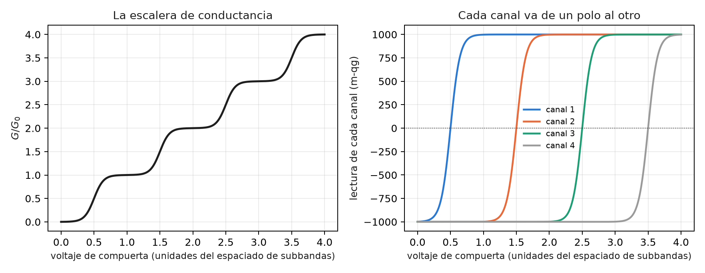
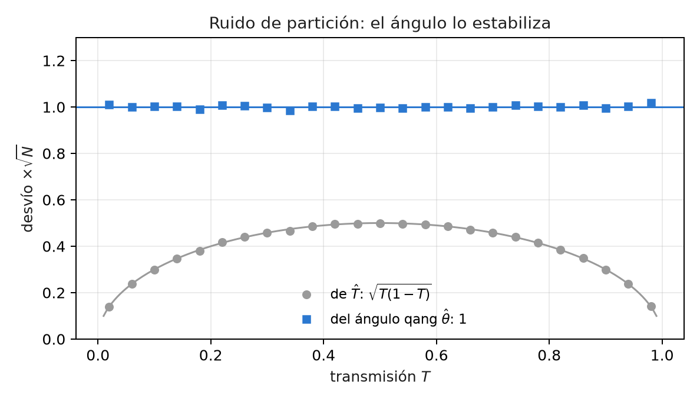
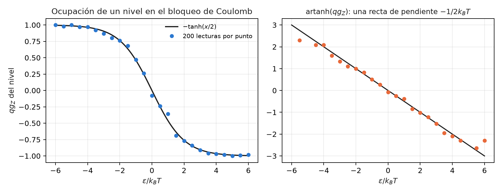

# Nanocuántica: transmisión, ruido de partición y qubits a escala nanométrica {#sec-cap33}

En la escala nanométrica, muchas cantidades medibles son una probabilidad: la de que un electrón atraviese una barrera, la de
que un nivel esté ocupado, la de que un espín esté arriba. Este capítulo las lee con la ecuación del capítulo 1. No hay
sección de las notas ni módulo de qang para estos temas, así que cada cifra sale de una fórmula cerrada o de un Monte Carlo
escrito en `tools/make_cap33_figures.py`. Al lado de cada lectura con qang va la forma usual, y se dice cuándo la escala
aporta algo y cuándo sólo cambia la notación.

## Desde la base: una probabilidad por experimento {#sec-nano-base}

La ecuación del capítulo 1 pide una probabilidad $p_0$ y da cuatro lecturas exactas:

$$
\theta = 2\arccos\sqrt{p_0},\qquad qg_Z = 2p_0-1,\qquad qg_S = H(p_0),\qquad m = 2000\,p_0 - 1000\ \text{m-qg}.
$$

En este capítulo $p_0$ es, según el caso, la transmisión $T$ de un canal, la ocupación de un nivel o la población de un estado
de espín. Dos propiedades del capítulo 1 hacen todo el trabajo:

- **la lectura en m-qg es lineal en la probabilidad**: 1 m-qg es siempre $\Delta p_0 = 0{,}0005$;
- **el ángulo estabiliza el ruido binomial**: con $N$ cuentas, $\sigma_\theta = 1/\sqrt N$ para cualquier $p_0$, mientras que
  $\sigma_{p_0} = \sqrt{p_0(1-p_0)/N}$ cambia con $p_0$.

## La transmisión por túnel como probabilidad qang {#sec-nano-tunel}

Un electrón llega a una barrera rectangular y la atraviesa con probabilidad $T$. Con $p_0 = T$:

$$
\theta_T = 2\arccos\sqrt T,\qquad \cos(\theta_T/2) = \sqrt T = |t|.
$$

**El medio ángulo qang es el módulo de la amplitud de transmisión $t$.** No es una analogía: es la misma definición, y el
script la comprueba a $10^{-16}$. Con una barrera de 1 eV, un electrón de 0,5 eV ($\kappa = 3{,}62$ nm⁻¹) y la fórmula exacta
de la barrera rectangular:

| ancho | $T$ | lectura | $\theta_T$ |
|---|---|---|---|
| 0,2 nm | 0,616 | +231,9 m-qg | 76,6° |
| 0,5 nm | 0,101 | −797,3 m-qg | 142,9° |
| 1,0 nm | 2,85·10⁻³ | −994,3 m-qg | 173,9° |
| 1,5 nm | 7,62·10⁻⁵ | −999,85 m-qg | 179,0° |

: Transmisión por una barrera rectangular de 1 eV para un electrón de 0,5 eV. {#tbl-tunel33}

- **Sin qang** se grafica $\ln T$, que cae con pendiente $-2\kappa$.
- **Con qang**, la distancia angular al polo, $\pi - \theta_T \approx 2|t|$, cae con pendiente $-\kappa$: el script mide −3,620
  nm⁻¹ contra −3,623. Es la amplitud en vez de la probabilidad, la misma información.
- **Las barreras gruesas viven pegadas al polo.** Un nanómetro deja la lectura a 5,7 m-qg del polo, y un nanómetro y medio, a
  0,15 m-qg. Para leer esa diferencia con el error de una cuenta de electrones hace falta el ángulo exacto cerca del polo
  (capítulo 1), no la aproximación lineal.

## La fórmula de Landauer: un canal, una lectura {#sec-nano-landauer}

La conductancia de un conductor balístico es $G = G_0\sum_n T_n$, con $G_0 = 2e^2/h$. Escrita en qg:

$$
\frac{G}{G_0} = \frac{N}{2} + \frac{1}{2}\sum_{n=1}^{N} qg_n .
$$

El script usa el modelo de punto de silla de un contacto puntual cuántico, $T_n = 1/(1+e^{-2\pi(V-n-1/2)/w})$, y comprueba la
identidad a $9\cdot10^{-16}$:

- **Cada meseta es un conjunto de canales en los polos**: abiertos en +1000 m-qg, cerrados en −1000. En $V = 1, 2, 3$ la
  conductancia vale exactamente 1, 2 y 3.
- **Cada escalón es un canal que cruza el ecuador.** El punto medio del escalón es la lectura 0 m-qg de ese canal.
- **La conductancia sola no separa canales que se abren a la vez**: da $\sum T_n$ y nada más. El ruido de disparo (sección
  siguiente) da $\sum T_n(1-T_n)$. Con las dos, dos canales parcialmente abiertos se recuperan exactamente: el script parte de
  $T = 0{,}4031$ y $0{,}9716$ y los recupera iguales. Es la técnica conocida para medir las transmisiones de un contacto
  atómico. En qg, la conductancia lee el $qg$ medio de los canales y el ruido lee el $qg^2$ medio.

{#fig-qpc33 width=100%}

## Ruido de partición: la varianza binomial, estabilizada {#sec-nano-ruido}

Cada electrón que llega al canal pasa o rebota: es un ensayo de Bernoulli con probabilidad $T$. De ahí sale el ruido de
partición, $S = 2eI(1-T)$, con factor de Fano $F = 1-T$. En qg, $T(1-T) = (1-qg^2)/4 = \sin^2\theta/4$: es la varianza
binomial del capítulo 1. El script cuenta 1000 electrones por ventana, en 20 000 ventanas:

- **El factor de Fano** medido como varianza sobre media de los electrones transmitidos coincide con $1-T$ a 0,02 o menos.
- **Sin qang**, el desvío de $\hat T$ por $\sqrt N$ va de 0,14 a 0,50: depende de lo que se mide, y cerca de los polos la barra
  de error se achica tanto que engaña.
- **Con qang**, el desvío del ángulo $\hat\theta$ por $\sqrt N$ queda entre 0,985 y 1,009 para $T$ entre 0,05 y 0,95, y sigue
  en 1,01–1,02 en 0,02 y 0,98. La barra de error es la misma en todo el rango.

Es la transformación arcoseno, conocida en estadística desde hace mucho. qang no la inventa. Lo que aporta es que el ángulo
estabilizado es la coordenada natural del estado.

{#fig-ruido33 width=85%}

## Bloqueo de Coulomb: la ocupación de un nivel {#sec-nano-coulomb}

En un punto cuántico con bloqueo de Coulomb, un nivel a energía $\varepsilon$ del potencial químico de los contactos está
ocupado con la probabilidad de Fermi $f = 1/(1+e^{x})$, con $x = \varepsilon/k_BT$. Con $p_0 = f$:

$$
qg_Z = 2f - 1 = -\tanh(x/2).
$$

Es el mismo estado térmico que $qg_Z = \tanh(\beta h)$ del capítulo 8, con el signo de la convención. El script lo comprueba a
$2\cdot10^{-16}$. La pendiente en el centro, $-1/(2k_BT)$, es un termómetro: un sensor de carga lee la ocupación y su ancho da
la temperatura del electrón. Con 25 puntos de $\varepsilon$, 200 lecturas por punto y 400 repeticiones ($k_BT = 1$):

| método | $k_BT$ estimado |
|---|---|
| ajuste de Fermi por máxima verosimilitud (sin qang) | 0,9986 ± 0,0294 |
| recta por $\operatorname{artanh}(qg_Z)$ (con qang) | 1,0294 ± 0,0305 |

: Termometría con la ocupación de un nivel. {#tbl-coulomb33}

**qang pierde acá.** La recta es cerrada y no necesita un ajuste no lineal, pero tiene un sesgo de +2,9 %. En las colas,
$\operatorname{artanh}$ amplifica el ruido de las lecturas cerca de ±1 (se ve en la figura), y los puntos con todas las lecturas
iguales hay que descartarlos. El ajuste de Fermi usa la misma información sin sesgo. La lectura qg sirve para ver el
termómetro, no para estimar con él.

{#fig-coulomb33 width=100%}

## Qubits de carga y de espín en puntos cuánticos {#sec-nano-puntos}

Un qubit de espín en un punto cuántico se lee con un sensor de carga: el espín se convierte en carga y el sensor decide 0 o 1,
con errores $e_0 = P(1\,|\,0)$ y $e_1 = P(0\,|\,1)$. Es la misma lectura que la de un transmón, y la regla del capítulo 28 la
describe en m-qg:

$$
m_{\text{leída}} = (1 - e_0 - e_1)\,m + 1000\,(e_1 - e_0).
$$

El script simula una oscilación de Rabi con $e_0 = 0{,}02$ y $e_1 = 0{,}08$ (valores ilustrativos) y 2000 lecturas por punto:

- la identidad afín vale a $2\cdot10^{-13}$;
- **sin corregir**, la oscilación tiene una amplitud de 898 m-qg en vez de 1000 y está corrida +60 m-qg. Su error cuadrático
  medio es de 95,5 m-qg;
- **corregida con los dos polos** (2000 lecturas en cada uno), el error baja a 19,4 m-qg. El precio es que el ruido crece
  $1/(1-e_0-e_1) = 1{,}11$ veces;
- la fidelidad de lectura usual, $1-(e_0+e_1)/2 = 0{,}95$, es en m-qg una visibilidad de 900 m-qg y un corrimiento de 60.

La corrección es la estándar. Escribirla en m-qg la vuelve una cuenta lineal: cada punto de error de lectura cuesta 10 m-qg de
visibilidad.

## Centros NV: el contraste como presupuesto de m-qg {#sec-nano-nv}

Un centro NV en diamante se lee por fluorescencia: el estado $m_s = 0$ brilla más que $m_s = \pm1$, con un contraste $C$. Si
$p_0$ es la población de $m_s = 0$ y $N_b$ los fotones que daría el estado brillante, la cuenta es poissoniana con media
$N_b\,[1 - C(1-p_0)]$, y la lectura de $p_0$ en m-qg tiene

$$
\sigma_m \approx \frac{2000}{C\sqrt{N_b}}\ \text{m-qg}.
$$

- Con $C = 0{,}3$ y 444 444 fotones, la fórmula da 10,00 m-qg. El Monte Carlo da 9,22, igual que la fórmula sin aproximar
  (el factor $\sqrt{1-C/2}$ en $p_0 = 1/2$).
- **Resolver 10 m-qg cuesta unos 444 000 fotones.** Un contraste de 0,3 hace que cada m-qg cueste once veces más fotones que si
  el contraste fuera 1. Es el mismo presupuesto del capítulo 1 con un factor $1/C^2$.
- **Magnetometría por ODMR.** Una línea de 1 MHz de ancho, contraste 0,2, 61 frecuencias y 1,16 millones de fotones en total.
  El ajuste de la línea da el centro con un desvío de 8,3 kHz, igual a la cota de Cramér–Rao (8,3 kHz). Son 296 nT con
  $\gamma = 28$ GHz/T.

El ajuste de la línea no cambia con qang. Lo que la escala agrega es la cuenta previa: cuántos fotones pide una resolución
dada, en una unidad lineal en la población del espín.

## Sin qang y con qang {#sec-comparacion33}

| tema | sin qang | con qang | diferencia |
|---|---|---|---|
| túnel | $\ln T$, pendiente $-2\kappa$ | $\cos(\theta_T/2) = \lvert t\rvert$; $\pi-\theta_T$ con pendiente $-\kappa$ | la amplitud a la vista; la misma información |
| Landauer | $G/G_0 = \sum T_n$ | $N/2 + \sum qg_n/2$; mesetas en los polos | conductancia = $qg$ medio, ruido = $qg^2$ medio |
| ruido de partición | barra de $\hat T$: 0,14 a 0,50 ($\times 1/\sqrt N$) | barra de $\hat\theta$: 0,985 a 1,009 | constante en todo el rango (transformación arcoseno) |
| termometría | ajuste de Fermi: 0,9986 ± 0,029 | recta en artanh: 1,029 ± 0,031 | **qang peor**: +2,9 % de sesgo |
| lectura de un espín | 95,5 m-qg de error sin corregir | 19,4 corregida con los polos | la corrección estándar, escrita lineal |
| NV | contraste y fotones | 444 000 fotones para 10 m-qg con $C=0{,}3$ | un presupuesto en unidades de población |
| ODMR | 8,3 kHz por ajuste | lo mismo | ninguna |

: La nanocuántica, con y sin la escala. {#tbl-comparacion33}

**Balance.** En la nanocuántica la escala acierta en el lenguaje: transmisiones, ocupaciones y poblaciones son probabilidades,
y qang las lee todas igual. Aporta poco más:

- la barra de error constante del ángulo, que es la transformación arcoseno;
- el medio ángulo como amplitud de transmisión;
- presupuestos lineales en m-qg.

En el único caso en que compite como estimador, la termometría, pierde contra el ajuste de máxima verosimilitud. Todo es
cálculo y simulación: ninguna cifra de este capítulo viene de un experimento. Tampoco hay todavía un módulo de qang para estos
temas.

## En código {#sec-codigo33}

```python
import numpy as np
from qang import probability as PB

T = 2.85e-3                                  # barrera de 1 nm (tabla de arriba)
PB.milliqang_from_p0(T)                      # -994,3 m-qg
np.cos(PB.theta_from_milliqang(PB.milliqang_from_p0(T)) / 2)   # 0,0534 = sqrt(T) = |t|
```

## Resumen {#sec-resumen33}

- La transmisión por túnel es una probabilidad qang, y su medio ángulo es el módulo de la amplitud: $\cos(\theta_T/2) = |t|$.
- En la fórmula de Landauer cada canal es una lectura qg: las mesetas son canales en los polos y los escalones, canales que
  cruzan el ecuador. Con la conductancia y el ruido se recuperan dos canales abiertos a la vez.
- El ruido de partición es la varianza binomial; el ángulo qang la estabiliza en $1/\sqrt N$ en todo el rango.
- La ocupación de un nivel es $qg_Z = -\tanh(x/2)$; como termómetro, la recta en artanh tiene un sesgo de +2,9 % que el ajuste
  de Fermi no tiene.
- La lectura de espines por sensor de carga y la de centros NV por fluorescencia se escriben como presupuestos lineales en
  m-qg; sus estimadores no cambian.

## Notas bibliográficas {.unnumbered}

La conductancia como transmisión es @landauer1957 y @buttiker1986; para transporte mesoscópico en general, véase
@datta1995. El ruido de disparo es @blanter2000, y el factor de Fano, @fano1947. El bloqueo de Coulomb es
@beenakker1991; los espines en puntos cuánticos, @hanson2007, y su lectura en un disparo, @elzerman2004. El centro NV es
@doherty2013, y la sensibilidad de ODMR, @dreau2011. Las notas de investigación numeradas (§) que cita el capítulo y los
scripts que lo verifican están en el repositorio [@qangrepo]; la definición de la unidad qang, en @monteverde2026.
