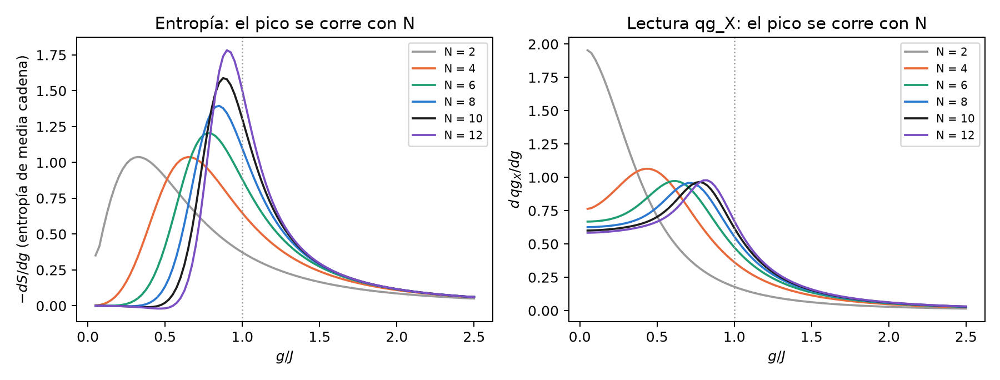
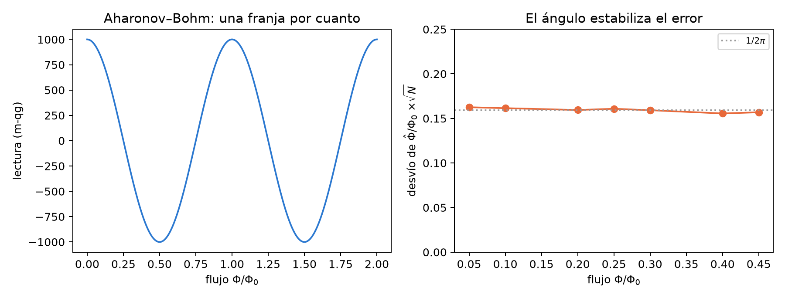
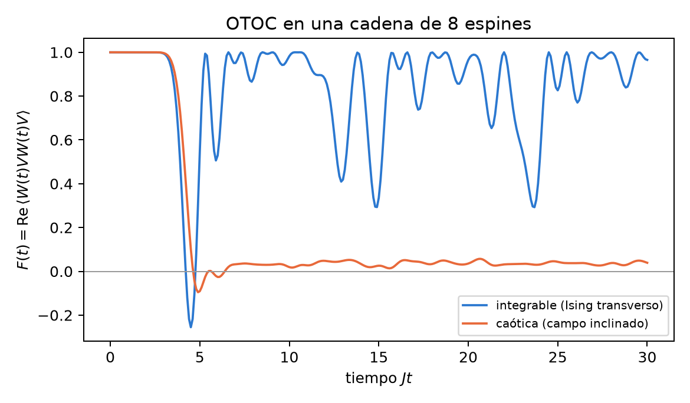

# Arquitectura angular: química, materia condensada, óptica relativista, termodinámica y geometría {#sec-cap34}

Este capítulo responde a una propuesta: trece fenómenos de cinco áreas, cada uno con una ecuación, un "mapeo con qg" y un
test analítico con su criterio de aprobación. La propuesta usa una moneda que la base del capítulo 1 no tiene: habla de
"ciclos qg" y "períodos qg". Antes de correr nada hay que traducir esos criterios a lecturas. Después, cada test se corre en
`tools/make_cap34_figures.py`, que tarda unos 25 segundos. No hay sección de las notas ni módulo de qang para estos temas, así
que cada cifra sale de una fórmula cerrada, de una diagonalización exacta o de un Monte Carlo escrito ahí. Ninguna viene de
un experimento. El veredicto de cada test está en la @tbl-matriz34: algunos se cumplen tal como están escritos, otros se
cumplen sólo después de corregirlos y dos fallan.

## Desde la base: lecturas, no ciclos {#sec-base34}

La ecuación del capítulo 1 parte de una probabilidad $p_0$ y da cuatro lecturas exactas:

$$
\theta = 2\arccos\sqrt{p_0},\qquad qg_Z = 2p_0-1 = \cos\theta,\qquad qg_S = H(p_0),\qquad m = 1000\,qg_Z\ \text{m-qg}.
$$

Hay tres consecuencias para la propuesta:

- **qg no tiene período.** $qg_Z$ vive en $[-1,1]$ y el ángulo qang, en $[0,\pi]$. Un criterio como "fase $=\pi\equiv 0{,}5$
  ciclo qg" no se puede comprobar tal cual. Hay que reescribirlo como una lectura: por ejemplo, $qg_X=-1$, que son
  $-1000$ m-qg.
- **Una fase no cambia $qg_Z$.** Una rotación alrededor de $Z$ (precesión de Larmor, fase de Aharonov–Bohm, signo de un
  intercambio) deja intactas las poblaciones. Se lee con un interferómetro, en $qg_X$ o $qg_Y$, como la fase de Berry del
  capítulo 7.
- **Donde hay una probabilidad, hay una lectura.** Una reflectancia, el peso de un determinante, la ocupación del vacío o una
  probabilidad de transición son un $p_0$, y entonces vale todo lo del capítulo 1: la escala lineal y el ángulo que estabiliza
  el ruido.

## Química cuántica {#sec-quimica34}

### Jordan–Wigner: el signo del intercambio es una lectura {#sec-jw34}

El mapeo es $a_j^\dagger=\big(\prod_{k<j}(-Z_k)\big)\,\sigma_j^+$. El script construye los operadores de cuatro modos y
comprueba las relaciones de anticonmutación $\{a_i,a_j^\dagger\}=\delta_{ij}$ y $\{a_i,a_j\}=0$ con error exactamente nulo.
También comprueba que $a_1^\dagger a_2^\dagger|0\rangle + a_2^\dagger a_1^\dagger|0\rangle = 0$. La propuesta pide que el
intercambio sea "un desfase de medio período qg". En el capítulo 1 eso no es una lectura. Para que lo sea, el intercambio
tiene que actuar en un test de Hadamard: un qubit auxiliar controla el intercambio de los dos modos ocupados y se lee en $X$.

- **Con el intercambio fermiónico**, el auxiliar lee $qg_X=-1$, o sea $-1000$ m-qg.
- **Con un SWAP de qubits**, el mismo circuito lee $+1000$ m-qg.

El signo de Pauli es la diferencia entre los dos polos de $qg_X$. Las compuertas $Z$ de la cadena de paridad son exactas, así
que no hay "pérdida de fase por acumulación". El error de un circuito real viene del ruido, no del mapeo.

### UCC para H$_2$: la amplitud es medio ángulo qang {#sec-ucc34}

Para H$_2$ en STO-3G a 0,735 Å, con el hamiltoniano de cuatro qubits del capítulo 25, el UCCSD se reduce a una sola doble
excitación. El estado es $|\Psi(t)\rangle=\cos t\,|\text{HF}\rangle+\sin t\,|\text{doble}\rangle$ y la energía tiene la forma
cerrada $E(t)=A+B\cos 2t+C\sin 2t$:

- el mínimo está en $t^\ast=-0{,}1118$ rad y vale $-1{,}1373060$ Ha, la energía FCI con un error de $5\cdot10^{-14}$ Ha;
  Hartree–Fock da $-1{,}1169990$;
- **el peso de Hartree–Fock es una lectura**: $p_0=\cos^2 t^\ast=0{,}9876$, o sea $+975{,}1$ m-qg, y su ángulo qang es
  $\theta=2|t^\ast|=0{,}2235$ rad. La amplitud UCC es medio ángulo qang, la misma relación que el capítulo 33 encuentra en el
  túnel;
- un barrido con paso $\pi/200$ llega a $5{,}4\cdot10^{-6}$ Ha del mínimo.

La propuesta pide "precisión sub-milihartree, $<1{,}6\cdot10^{-3}$ Ha". Ese umbral es la exactitud química (1 kcal/mol), no un
sub-milihartree, y en un simulador exacto se supera por once órdenes de magnitud: no discrimina nada. La curva de disociación
no se rehace porque el entorno no tiene PySCF; las corridas guardadas del capítulo 25 la cubren. El gradiente es nulo en el
mínimo tanto en $t$ como en $m$, porque $dm/dt=-2000\sin 2t\neq 0$ ahí. En Hartree–Fock ($t=0$, el polo) la coordenada $m$
es singular, como se ve en el capítulo 23.

### Larmor y el eco de Hahn {#sec-hahn34}

La precesión libre $\Delta\varphi=\gamma B_0t$ es una rotación alrededor de $Z$. Con el protón ($\gamma/2\pi=42{,}577$
MHz/T) y un espín en el ecuador, el script da $qg_Z=0$ en todo momento y $qg_X=\cos\Delta\varphi$. La precesión no aparece en la
lectura de $Z$.

Para el eco, el script toma 20 000 espines con desintonía gaussiana ($\sigma=2\pi\cdot50$ kHz), $\tau=20$ µs, la secuencia
$\pi/2-\tau-\pi-\tau$, y lee la magnetización en $qg_X$:

| caso | $qg_X$ | teoría |
|---|---|---|
| sin pulso $\pi$ (decaimiento libre) | 0,004 (ruido del Monte Carlo) | $2{,}7\cdot10^{-9}$ |
| eco, desintonía estática | **1,000000** (+1000 m-qg) | 1 |
| eco, pulso $\pi$ con 2 % de más | 0,99901 | 0,99901 |
| eco, desintonía que cambia un 10 % de $\sigma$ entre mitades | 0,820 | 0,821 |

: El eco de Hahn leído en $qg_X$. {#tbl-hahn34}

El criterio de la propuesta, "$F=1$ independiente de $\Delta\omega$", vale sólo con desintonía estática y pulsos exactos. Un
pulso con 2 % de error cuesta 1 m-qg, y una desintonía que deriva cuesta 180 m-qg. La calibración del eco con el propio
dispositivo es el tema del capítulo 22.

## Materia condensada {#sec-materia34}

### Ising con campo transverso: el pico se corre con el tamaño {#sec-ising34}

$H=-J\sum Z_iZ_{i+1}-g\sum X_i$ en una cadena abierta. Con $\tan\theta=g/J$, la transición está en $g=J$, es decir en
$\theta=\pi/4$, **en el límite termodinámico**. La propuesta pide encontrarla con 2 a 4 espines, en el pico de la derivada de
la entropía de entrelazamiento. El script diagonaliza con $N=2$ a $12$ (en el sector par de la paridad $\prod X$, para que el
estado de gato por debajo de la transición quede bien definido):

| $N$ | caída más rápida de $S$ | pico de $d\,qg_X/dg$ | $m_X$ en $g=J$ |
|---|---|---|---|
| 2 | 0,33 | (en el borde) | 894,4 |
| 4 | 0,65 | 0,43 | 810,1 |
| 6 | 0,78 | 0,63 | 771,1 |
| 8 | 0,85 | 0,70 | 747,9 |
| 10 | 0,88 | 0,78 | 732,3 |
| 12 | 0,90 | 0,83 | 720,9 |
| $\infty$ | 1 | 1 | 636,6 ($2000/\pi$) |

: Posición del pico ($g/J$) y lectura transversal en el punto crítico. {#tbl-ising34}

**El test falla con 2 a 4 espines.** El pico está en $g/J=0{,}33$ y $0{,}65$, es decir en $\theta=18^\circ$ y $33^\circ$, no en
$45^\circ$. Con dos espines no hay transición: la curva es suave. El pico se acerca a 1 a medida que crece $N$, y la entropía
converge antes que la lectura $qg_X$ (@fig-ising34). La lectura transversal en $g=J$, $m_X$, también baja hacia el valor
exacto $1000\cdot 2/\pi=636{,}6$ m-qg [@pfeuty1970], pero con 12 espines todavía está 84 m-qg arriba. Lo que da $\theta=\pi/4$
es el límite, no la escala.

{#fig-ising34 width=100%}

### Cadena de Kitaev: la protección está en el hamiltoniano, no en el ángulo {#sec-kitaev34}

La paridad $P=\prod_j(-i\gamma_{2j-1}\gamma_{2j})$ toma los valores $\pm1$, es decir $\pm1000$ m-qg. El script separa dos
preguntas:

- **¿Protege la cadena?** Con $t=\Delta=1$ y $\mu=0{,}5$, la diferencia de energía entre los dos sectores de paridad cae a la
  mitad por cada sitio: 0,207 con 2 sitios y 0,0029 con 8. Con $\mu=0$ y desorden local $\pm0{,}3$ cae de $1{,}5\cdot10^{-2}$ a
  $3\cdot10^{-7}$, aunque no de forma monótona. Esa es la protección topológica: exponencial en la longitud.
- **¿Protege la compuerta?** El trenzado $B=e^{\pi\gamma_2\gamma_3/4}=(1+\gamma_2\gamma_3)/\sqrt2$ se cumple a $10^{-16}$, con
  fases propias exactas $\pm\pi/4$ y $B^2=\gamma_2\gamma_3$. Pero si se aplica como compuerta con un error relativo de ángulo
  $\epsilon$, la infidelidad es $6{,}2\cdot10^{-5}$ con 1 %, $1{,}5\cdot10^{-3}$ con 5 % y $6{,}2\cdot10^{-3}$ con 10 %,
  cuadrática en $\epsilon$, como cualquier rotación.

**Escribir el trenzado en "cuartos de ciclo qg" no lo protege.** La invariancia frente a perturbaciones locales viene del
hamiltoniano con modos de Majorana separados [@kitaev2001; @ivanov2001]. Una compuerta que imita el trenzado tiene el error de
cualquier compuerta.

### Aharonov–Bohm: una franja por cuanto de flujo {#sec-ab34}

En un anillo de dos caminos, la salida tiene $p_0=\cos^2(\pi\Phi/\Phi_0)$, así que

$$
qg_Z=\cos\!\left(2\pi\,\frac{\Phi}{\Phi_0}\right),\qquad \theta = 2\pi\,\frac{\Phi}{\Phi_0}\ \ (\text{plegado en }[0,\pi]).
$$

El ángulo qang es la fase de Aharonov–Bohm. La lectura vuelve a su valor cada $\Phi_0=h/e$ (el script lo comprueba a
$10^{-15}$). Lo periódico es el flujo, no qg. Con 2000 electrones por medición y 4000 repeticiones, el flujo estimado a partir
del ángulo tiene un desvío por $\sqrt N$ de entre 0,156 y 0,163 para $\Phi/\Phi_0$ de 0,05 a 0,45. La cota es $1/2\pi=0{,}159$,
igual en todo el rango (@fig-ab34). Es la transformación arcoseno del capítulo 1 aplicada a un interferómetro. **Lo que la
lectura no da** es el signo: $\Phi$ y $-\Phi$ (y $\Phi_0-\Phi$) leen lo mismo. Para separarlos hace falta la segunda cuadratura,
$qg_Y$, como en el capítulo 7.

{#fig-ab34 width=100%}

## Relatividad y óptica {#sec-optica34}

### Rotación de Wigner {#sec-wigner34}

Dos impulsos no colineales, $v_1=0{,}6c\,\hat x$ y $v_2=0{,}8c\,\hat y$, componen un impulso seguido de una rotación. El script
los multiplica como matrices $4\times4$, separa el impulso resultante y lee el ángulo: $\Omega_W=0{,}3303$ rad
($18{,}92^\circ$). La fórmula de la propuesta da lo mismo a $1{,}5\cdot10^{-15}$. Con espinores, el mismo producto en
$SL(2,\mathbb C)$ se descompone en una parte hermítica (el impulso) y una unitaria (la rotación), y da el mismo ángulo a
$2\cdot10^{-16}$. Las comprobaciones de la propuesta pasan: $\Lambda^T\eta\Lambda=\eta$ a $9\cdot10^{-16}$, la rotación es
ortogonal y la parte del espinor es unitaria. Un espín que apuntaba en $x$ lee después $qg_X=\cos\Omega_W$, o sea $+945{,}9$
m-qg. Con impulsos colineales, $\Omega_W=0$. Todo esto es estructura del grupo de Lorentz: la escala sólo traduce el ángulo a
una lectura de espín. Con espinores de Dirac el resultado es el mismo, porque un espinor de Dirac son dos espinores de
$SL(2,\mathbb C)$.

### Fresnel: Brewster es un cero de probabilidad, la reflexión total es una fase {#sec-fresnel34}

Del aire a un vidrio de $n=1{,}5$:

- **Brewster**, en $56{,}31^\circ$: $r_p=0$ exacto. La luz $s$ refleja $R_s=0{,}148$, que como lectura de "reflejado" son
  $-704$ m-qg. En incidencia normal, $R=0{,}04$, o sea $-920$ m-qg.
- **Reflexión total**, desde el vidrio y por encima de $41{,}81^\circ$: $|r_s|=|r_p|=1$ a $4\cdot10^{-16}$. La reflectancia lee
  $+1000$ m-qg siempre y no informa nada. Toda la información está en las fases. Su diferencia $\delta_p-\delta_s$ llega a un
  máximo de $45{,}24^\circ$ en $51{,}67^\circ$ y pasa por $45^\circ$ en $50{,}23^\circ$ y $53{,}26^\circ$: el rombo de Fresnel.
  Si incide luz lineal a $45^\circ$ con un ángulo de $45^\circ$, sale con $qg_Y=S_3/S_0=\sin(\delta_p-\delta_s)=0{,}600$, o sea
  $+600$ m-qg, una lectura de Stokes como las del capítulo 6.
- **Goos–Hänchen** no es un "corrimiento de fase". Es un desplazamiento lateral que sale de la derivada de la fase: con la
  fórmula de Artmann, $D=-(\lambda/2\pi n)\,d\delta/d\theta_i$, es de 0,64 $\lambda$ para $s$ a $45^\circ$ [@goos1947;
  @artmann1948].

La fase de reflexión total como "compuerta de fase de un qubit" funciona: actúa sobre la polarización y se lee en $qg_Y$.

### Bogoliubov y Unruh: el medio ángulo es la gudermanniana {#sec-unruh34}

El vacío de Minkowski visto por un observador acelerado es un estado comprimido de dos modos. Cada modo reducido es térmico,
con $\bar n=\sinh^2r$ y factor de Boltzmann $\tanh^2r=e^{-2\pi\omega c/a}$ [@unruh1976; @crispino2008]. El script comprueba la
entropía cerrada, $S=\cosh^2r\ln\cosh^2r-\sinh^2r\ln\sinh^2r$, contra la suma sobre los números de ocupación: coinciden a
$10^{-16}$ hasta $r=1$, y a $2\cdot10^{-6}$ en $r=1{,}5$ por el corte en 80 niveles. La matriz hiperbólica conserva la forma
$\mathrm{diag}(1,-1)$ a $2\cdot10^{-16}$. La propuesta la llama "rotación pseudounitaria parametrizada en qg". Una
transformación de $SU(1,1)$ no es una rotación, pero el peso del vacío sí es una probabilidad, $p_0=1/\cosh^2r$, y da una
identidad exacta:

$$
\frac{\theta}{2}=\operatorname{gd}(r)=\arctan(\sinh r).
$$

**El medio ángulo qang del peso del vacío es la función gudermanniana del parámetro de compresión.** Pasa la recta hiperbólica
a un ángulo de círculo, y el script la comprueba a $10^{-16}$. Las lecturas del vacío son $+880{,}0$, $+572{,}9$, $-160{,}1$ y
$-638{,}6$ m-qg para $r=0{,}25$, $0{,}5$, $1$ y $1{,}5$. Con $r\to\infty$ (aceleración enorme o frecuencia nula), $\theta\to\pi$.

## Termodinámica y metrología {#sec-termo34}

### Jarzynski con dos mediciones {#sec-jarzynski34}

Un qubit con $H=-\tfrac h2(\cos\varphi\,Z+\sin\varphi\,X)$ se lleva de $h=1$, $\varphi=0$ a $h=2$, $\varphi=1$ rad en un tiempo
$1{,}5$ (400 pasos), con $\beta=1$. El trabajo se mide con dos mediciones proyectivas [@talkner2007]. Las probabilidades de
transición $|\langle n_f|U|m_i\rangle|^2$ son lecturas: las dos de "quedarse" valen $qg=0{,}707$, o sea $707{,}4$ m-qg.

- **Exacto**: $\langle e^{-\beta W}\rangle=1{,}3684330=Z_f/Z_i$, con error $3{,}8\cdot10^{-15}$. $\Delta F=-0{,}3137$ y
  $\langle W\rangle=-0{,}0958\ge\Delta F$.
- **Con trayectorias muestreadas** (2000 repeticiones), el estimador $-\ln\overline{e^{-\beta W}}/\beta$ tiene un sesgo de
  $+0{,}021$ con 10 trayectorias, $+0{,}0016$ con 100 y $+1{,}5\cdot10^{-4}$ con 1000. Con 10 000 trayectorias, el sesgo queda
  dentro del ruido.

La igualdad se cumple [@jarzynski1997], y la escala no cambia nada de la termodinámica. Lo que agrega es que cada probabilidad de
transición es una lectura con la barra de error del capítulo 1.

### Información de Fisher de un estado GHZ {#sec-ghz34}

Para $N=1$ a $8$ qubits y la fase generada por $\sum Z/2$, el script da una información de Fisher cuántica de $N^2$ para el
estado GHZ y de $N$ para el estado producto, con error de $10^{-15}$. El paso que conecta con el capítulo 1 es la lectura de
paridad. Su valor medio es $qg=\cos N\varphi$, y la información de Fisher de un disparo de una lectura $\pm1$ es
$(dqg/d\varphi)^2/(1-qg^2)$. Eso da exactamente $N^2$ en cualquier $\varphi$: **la lectura de paridad alcanza la cota cuántica**
[@bollinger1996; @giovannetti2006]. La propuesta pide usar "qg como parámetro continuo diferenciable". Si el parámetro fuera la
lectura misma, la información se dividiría por $(dqg/d\varphi)^2$ y divergiría en los polos. La escala lee, y el parámetro sigue
siendo la fase. El costo del ruido de lectura, $(1-2e)^N$, está en el capítulo 8.

## Geometría y caos {#sec-geometria34}

### Fubini–Study: polo a polo, la mitad del ángulo qang {#sec-fs34}

El script suma en 20 000 pasos las distancias $\arccos|\langle\psi_k|\psi_{k+1}\rangle|$ a lo largo de un meridiano y obtiene
$1{,}5707963=\pi/2$. Con $\sqrt{1-|\langle\cdot|\cdot\rangle|^2}$ da lo mismo, y también con la coordenada qg,
$ds=dqg/\big(2\sqrt{1-qg^2}\big)$, aunque ese integrando es singular en los polos. La curvatura de Gauss de
$ds^2=\tfrac14(d\theta^2+\sin^2\theta\,d\phi^2)$ sale $4{,}000$: una esfera de radio 1/2 [@provost1980]. La propuesta habla de
"la mitad de un período métrico qg". Traducido a la base, **la distancia de Fubini–Study es la mitad del ángulo qang**,
$d_{FS}=\theta/2$, la distancia de Wootters del capítulo 1.

### OTOC: integrable contra caótico {#sec-otoc34}

En una cadena de 8 espines, con $W=Z_1$, $V=Z_8$ y temperatura infinita, el script compara el Ising transverso ($g=1{,}05$,
integrable) con el mismo modelo con un campo longitudinal de 0,5 (caótico):

- **El frente llega igual**: $F(t)=\mathrm{Re}\langle W(t)VW(t)V\rangle$ cae por debajo de 0,5 en $t=4{,}0$ y $4{,}2$.
- **Lo que separa es el después**: el caótico se queda en $0{,}036$ de promedio ($+36$ m-qg) para $t$ entre 10 y 30, y el
  integrable revive, con promedio $0{,}839$ (@fig-otoc34).
- **El diagnóstico usual coincide**: el cociente medio de espaciamientos de niveles (10 espines, sector par de la reflexión) es
  $0{,}532$ en el caótico (GOE: 0,531) y $0{,}387$ en el integrable (Poisson: 0,386) [@oganesyan2007; @atas2013].

**El test de la propuesta no se puede hacer acá.** Con 8 espines no hay una ventana exponencial separada del frente, y la cota
$\lambda_L\le2\pi k_BT/\hbar$ [@maldacena2016] es vacía a temperatura infinita. Esa cota tiene contenido en modelos de $N$
grande a baja temperatura, como el SYK [@sachdev1993; @maldacena2016syk], no en una cadena de 8 espines. Para Paulis, $F(t)$ es
la lectura $qg_X$ de un auxiliar en un protocolo interferométrico [@swingle2016], el mismo tipo de lectura que el decodificador
del capítulo 15.

{#fig-otoc34 width=80%}

## La matriz de casos, revisada {#sec-matriz34}

| fenómeno | criterio de la propuesta | resultado |
|---|---|---|
| Jordan–Wigner | fase acumulada $=\pi\equiv0{,}5$ ciclo qg | **corregido**: test de Hadamard, $-1000$ m-qg (SWAP de qubits: $+1000$) |
| UCCSD (H$_2$) | $E\approx-1{,}137$ Ha, gradiente nulo en qg | **se cumple**: FCI a $5\cdot10^{-14}$; HF en $+975{,}1$ m-qg; la curva no se rehace |
| eco de Hahn | $F=1$ independiente de $\Delta\omega$ | **se cumple sólo estático**: 2 % de error de pulso, $-1$ m-qg; deriva, $-180$ |
| Ising transverso | transición en $\theta=\pi/4$ con 2–4 espines | **falla**: el pico está en $g/J=0{,}33$–$0{,}65$; se acerca a 1 con $N$ |
| Kitaev | trenzado invariante ante $\epsilon(\theta)$ | **falla como compuerta** ($6\cdot10^{-5}$ con 1 %); la protección es del hamiltoniano |
| Aharonov–Bohm | periodicidad cada cuanto | **se cumple** a $10^{-15}$; el flujo es periódico, qg no; el signo pide $qg_Y$ |
| Wigner | ortogonalidad y métrica de Lorentz | **se cumple** a $10^{-15}$; $\Omega_W=18{,}92^\circ$ |
| Brewster | cero exacto en $\theta_B$ | **se cumple**: $r_p=0$ en $56{,}31^\circ$ |
| Goos–Hänchen | corrimiento de fase | **corregido**: es un desplazamiento, 0,64 $\lambda$ |
| Bogoliubov | entropía del estado térmico | **se cumple**, y aparece $\theta/2=\operatorname{gd}(r)$ |
| Jarzynski | identidad con $\Delta F$ teórico | **se cumple** a $4\cdot10^{-15}$; el muestreo tiene sesgo |
| QFI GHZ | $N^2$ contra $N$ | **se cumple**; la paridad alcanza $N^2$ |
| Fubini–Study | curvatura $K=4$ | **se cumple**: $K=4{,}000$; polo a polo $\pi/2=\theta/2$ |
| OTOC | polinomial contra exponencial, cota MSS | **no aplicable** con 8 espines; el promedio tardío sí separa |

: Los trece criterios de la propuesta, corridos. {#tbl-matriz34}

## Sin qang y con qang {#sec-comparacion34}

| tema | sin qang | con qang | diferencia |
|---|---|---|---|
| UCC | amplitud $t$ | peso HF $+975{,}1$ m-qg, $\theta=2\lvert t\rvert$ | la amplitud es medio ángulo; la misma energía |
| Aharonov–Bohm | franjas en $P$ | $\theta=2\pi\Phi/\Phi_0$, desvío $1/2\pi\sqrt N$ constante | barra de error pareja (arcoseno); el signo pide otra lectura |
| Bogoliubov | $\tanh^2r$, $\bar n$, $S$ | $\theta/2=\operatorname{gd}(r)$ | una identidad nueva, exacta |
| GHZ | QFI $=N^2$ | Fisher de la paridad $(dqg)^2/(1-qg^2)=N^2$ | la fórmula de un disparo del capítulo 1 alcanza la cota |
| Fubini–Study | $d_{FS}=\arccos\lvert\langle\psi\vert\phi\rangle\rvert$ | $d_{FS}=\theta/2$ | la misma distancia (Wootters) |
| eco, Jarzynski | $\langle X\rangle$, probabilidades | lecturas en m-qg | sólo unidad |
| Ising | entropía, $\langle X\rangle$ | $m_X\to636{,}6$ | ninguna: la escala no acerca el límite |
| Wigner, Kitaev, OTOC | grupo de Lorentz, hamiltoniano, espectro | traducción del ángulo a lectura | **ninguna**; "ciclos qg" no protegen ni miden caos |

: Las trece pruebas, con y sin la escala. {#tbl-comparacion34}

**Balance.** La propuesta acierta en la intuición: casi todo lo que mira tiene un ángulo o una probabilidad adentro. Falla en
la moneda, porque "ciclo qg" y "período qg" no existen en la base. Traducida a lecturas, la escala aporta cuatro cosas
concretas: la amplitud UCC como medio ángulo, la barra de error constante del flujo, la gudermanniana del vacío comprimido y la
paridad GHZ en la cota cuántica a partir de la fórmula de un disparo. En el eco y en Jarzynski cambia sólo la unidad. En
Wigner, Kitaev y el OTOC no aporta nada: la física está en el grupo, en el hamiltoniano o en el espectro. Dos criterios fallan
tal como están escritos: el Ising con 2 a 4 espines y el trenzado como compuerta protegida. Todo es cálculo exacto o
simulación, y no hay todavía un módulo de qang para estos temas.

## En código {#sec-codigo34}

```python
import math
from qang import probability as PB

# UCC para H2: peso de Hartree-Fock en el mínimo
t = -0.11176849913374033
PB.milliqang_from_p0(math.cos(t) ** 2)          # +975,1 m-qg; ángulo qang 2|t| = 0,2235 rad

# Bogoliubov: el medio ángulo qang del vacío es la gudermanniana
r = 1.0
theta = PB.theta_from_milliqang(PB.milliqang_from_p0(1 / math.cosh(r) ** 2))
theta / 2, math.atan(math.sinh(r))              # 0,8658 y 0,8658
```

## Resumen {#sec-resumen34}

- La base no tiene "ciclos qg": qg es una lectura en $[-1,1]$. Las fases se leen en $qg_X$ o $qg_Y$ con un interferómetro, y
  las probabilidades, directamente.
- El signo de un intercambio fermiónico es $-1000$ m-qg en un test de Hadamard; la amplitud UCC de H$_2$ es medio ángulo qang
  ($+975{,}1$ m-qg en el mínimo FCI).
- El eco de Hahn recupera $+1000$ m-qg sólo con desintonía estática; el Ising con 2 a 4 espines no muestra la transición en
  $\theta=\pi/4$, y el trenzado de Majorana escrito como compuerta no está protegido.
- El ángulo qang de un anillo de Aharonov–Bohm es la fase, con barra de error $1/2\pi\sqrt N$ constante; el medio ángulo del
  vacío comprimido es $\operatorname{gd}(r)$.
- La paridad GHZ alcanza la información cuántica $N^2$ con la fórmula de un disparo del capítulo 1, y la distancia de
  Fubini–Study es la mitad del ángulo qang.
- Wigner, Jarzynski y el OTOC se cumplen o se diagnostican con las herramientas usuales; la escala sólo los traduce.

## Notas bibliográficas {.unnumbered}

El mapeo de Jordan–Wigner es @jordan1928, y el UCC para VQE, @romero2018; la energía de H$_2$ sigue a @omalley2016. El eco es
@hahn1950, y la precesión, @bloch1946. El Ising transverso resuelto es @pfeuty1970, y la entropía de entrelazamiento en la
criticidad, @calabrese2004. La cadena de Kitaev es @kitaev2001, y el trenzado de Majorana, @ivanov2001. El efecto
Aharonov–Bohm es @aharonov1959. La precesión de Thomas es @thomas1926; las representaciones de Wigner, @wigner1939, y la
composición de impulsos, @odonnell2011. Fresnel y Brewster siguen @bornwolf1999; el desplazamiento lateral es @goos1947 y
@artmann1948. El efecto Unruh es @unruh1976 (revisión: @crispino2008). La igualdad de Jarzynski es @jarzynski1997, y el
trabajo con dos mediciones, @talkner2007. La espectroscopía con estados GHZ es @bollinger1996, y la metrología cuántica,
@giovannetti2006 y @braunstein1994. La métrica de Fubini–Study como estructura riemanniana es @provost1980. La cota del caos es
@maldacena2016; el SYK, @sachdev1993 y @maldacena2016syk; la medición del scrambling, @swingle2016, y los cocientes de
espaciamientos, @oganesyan2007 y @atas2013. Los scripts que verifican el capítulo están en el repositorio [@qangrepo]; la
definición de la unidad qang, en @monteverde2026.
